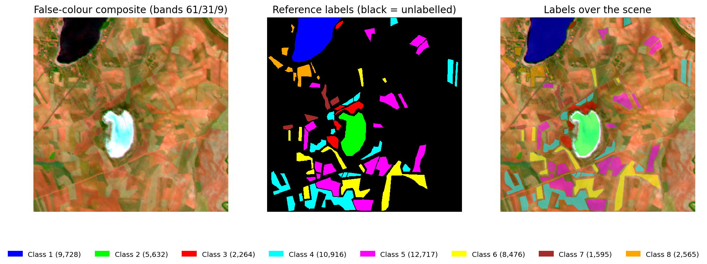

<div align="center">

# Uncertainty Quantification for DIAS 65-Band Hyperspectral Land-Cover Classification

### A Comparative Study of Conformal, Credal and Diffusion-Based Methods across 11 Deep Classifiers

[](LICENSE)




</div>

A land-cover map is only as useful as our ability to tell which parts of it to trust. This project asks
**how well modern uncertainty methods tell us which pixels of a land-cover map to trust**. We train 11
deep classifiers on a 65-band airborne hyperspectral scene, attach 11 uncertainty-quantification (UQ)
methods to them, and measure whether each method's promise holds.

> This page is the short version. The full write-up, with the data analysis, maths and every figure, is in
> **[`docs/`](docs/README.md)**, and each method folder has its own detailed README.

---

## What we did

| Step | What | Details |
|:-:|---|---|
| **1** | **Data.** A 512 × 512-pixel scene with 65 spectral bands and 8 land-cover classes (53,893 labelled pixels). Each pixel is classified from the 9 × 9 patch around it | [Data and set-up](docs/01_data_and_setup.md) |
| **2** | **Classifiers.** 11 backbones: a CNN (AlexNet-style), a Fourier network (GFNet), Transformers (ViT-UNet, Hiera), state-space models (MambaHSI S/B/L), a graph network (SpatialGCN) and foundation-style models (DOFA, GeoRSCLIP) | [Models and classification](docs/02_models_and_classification.md) |
| **3** | **Uncertainty.** 11 UQ methods on top: five conformal-prediction variants, spatial and multi-head conformal prediction, credal ensembles and their distilled student, and a diffusion model with a statistical test | [Methods in plain words](docs/03_uncertainty_methods.md) |
| **4** | **Evaluation.** Coverage of the 95% promise overall and per class, size and shape of the prediction sets, and how much of the map each method calls "uncertain" | [Uncertainty results](docs/04_uncertainty_results.md) |

---

## End result

### Classification

**Almost every model is near-perfect (99.9–100% test accuracy).** GFNet reaches 99.99%, and Hiera-ViT and
GeoRSCLIP score 100.00%. The exceptions are **DOFA-Spectral (83.9%)** and **SpatialGCN (97.1%)**. These
near-perfect scores are optimistic, because of how the pixels were split (finding F8).

### Uncertainty: eight findings

| # | Finding | Evidence |
|:-:|---|---|
| F1 | **The 95% guarantee holds.** Split, class-conditional, clustered and RC3P conformal prediction cover the true class 94.6–96.7% of the time on all 11 backbones | [§8.1](docs/04_uncertainty_results.md#81-rq1--does-the-95-guarantee-hold) |
| F2 | **Near-perfect models abstain instead of hedging.** About 95% of sets hold one class and ~5% are *empty*; almost none hold two classes | [§8.2](docs/04_uncertainty_results.md#82-rq2--what-do-the-prediction-sets-look-like) |
| F3 | **Sets become informative only when the model makes mistakes.** DOFA-Spectral lists 2+ classes for 38% of pixels and still covers 95% | [§8.2](docs/04_uncertainty_results.md#82-rq2--what-do-the-prediction-sets-look-like) |
| F4 | **"95% on average" can hide a failing class.** Split CP covers DOFA-Spectral's class 7 only 41.5% of the time. Class-conditional CP raises it to 93% | [§8.3](docs/04_uncertainty_results.md#83-rq3--is-coverage-fair-across-classes) |
| F5 | **The method's rule decides how much of the map is "uncertain"**: 0.05–0.17% (DAPM), 10–14% (CREDIT, MultiCP), 27–35% (SCMCP, 9 × 9 window) | [§8.5](docs/04_uncertainty_results.md#85-rq5--how-much-of-the-map-does-each-method-call-uncertain) |
| F6 | **Requiring 7 heads to agree multiplies the misses.** MultiCP's joint coverage is ≈ 70%, close to 0.95⁷ | [§8.6](docs/04_uncertainty_results.md#86-rq6--multi-head-and-spatial-variants) |
| F7 | **The ensembles disagree mostly off the labelled area.** 99.6–99.96% of the pixels CREDIT flags are unlabelled | [§8.7](docs/04_uncertainty_results.md#87-rq7--what-do-ensembles-say-about-the-two-kinds-of-uncertainty) |
| F8 | **Accuracy is inflated by the random split.** Every test patch contains training pixels (50.6 of 81 on average) | [§4.3](docs/01_data_and_setup.md#43-how-pixels-are-split-and-why-it-matters) |

<p align="center"></p>

*Coverage of the five baseline conformal methods on every backbone. Dots inside the shaded band are
statistically indistinguishable from the 95% target. RAPS sits at the model's accuracy because, as
implemented, it always returns only the top class.*

### Which method to use

| Method | Verdict |
|---|---|
| **Class-conditional CP** | ✅ **Recommended default.** Valid overall *and* for every class (≥ 0.92), at no extra cost at test time |
| **RC3P** | ✅ Valid and fair (≥ 0.92), with a small extra rank search |
| **Split CP** | ⚠️ Valid on average, but the worst class can drop to 0.41 |
| **Clustered CP** | ⚠️ Valid on average; only partly fixes the per-class gaps |
| **RAPS (as implemented)** | ❌ Coverage equals accuracy rather than 95% |
| **SACP** | ⚠️ Spatially coherent maps, but ≈ 100% coverage, so it says little |
| **MultiCP / SCMCP** | ❌ ≈ 70% joint coverage, below the 95% target |
| **CreDE / CREDIT** | ✅ Best at showing *where the model has never been trained* (no formal guarantee) |
| **DAPM** | ❌ Flags only ~0.1% of the scene, scattered at random |

---

## Read more

| | Where |
|---|---|
| 📖 **Full report** (data, set-up, models, methods, results, limitations) | [`docs/`](docs/README.md) |
| Five conformal methods on AlexNet / GFNet / ViT-UNet | [`baseline/`](baseline/README.md) |
| Spatially-aware conformal prediction (SACP) | [`sacp/`](sacp/README.md) |
| Multi-head conformal prediction (MultiCP) and its smoothed version (SCMCP) | [`multicp/`](multicp/README.md) · [`multicp_sacp/`](multicp_sacp/README.md) |
| Credal ensembles (CreDE) and the distilled student (CREDIT) | [`ensemble/`](ensemble/README.md) · [`credit/`](credit/README.md) |
| Diffusion-based uncertainty (DAPM) | [`dapm/`](dapm/README.md) |
| Extra backbones, each with the five conformal methods | [`dofa/`](dofa/README.md) · [`georsclip/`](georsclip/README.md) · [`mambahsi/`](mambahsi/README.md) · [`spatialgcn/`](spatialgcn/README.md) |
| Limitations, read before using the numbers | [Chapter 5](docs/05_limitations.md) |

**Data and weights.** 🤗 [Dataset](https://huggingface.co/datasets/DaneshSelwal/Classification-DIAS-65Bands-Data) ·
🤗 [Trained models](https://huggingface.co/DaneshSelwal/Classification-DIAS-65Bands) ·
[How to reproduce](docs/06_reproducibility_and_references.md#11-repository-map-and-reproducibility) ·
companion 6-band study: [6Band-Multispectral-UQ](https://github.com/DaneshSelwal/6Band-Multispectral-UQ)

---

## Licence and citation

Released under the [Apache License 2.0](LICENSE).

```bibtex
@misc{selwal2026dias_uq,
  author       = {Selwal, Danesh},
  title        = {Uncertainty Quantification for DIAS 65-Band Hyperspectral
                  Land-Cover Classification},
  year         = {2026},
  howpublished = {\url{https://github.com/DaneshSelwal/DIAS-65Band-Hyperspectral-UQ}}
}
```
