<div align="center">

# Knowing When the Map Is Wrong
### Uncertainty Quantification for 65-Band DIAS Hyperspectral Land-Cover Classification


</div>

> **Abstract.** A land-cover map is only useful if you know which parts of it to trust. We train 11 deep
> classifiers (CNN, Fourier, Transformer, State-Space, Graph and foundation-style models) on a 65-band
> airborne hyperspectral scene and attach **eleven uncertainty-quantification (UQ) methods** to them, from
> conformal prediction (which gives a mathematical *"the true class is in this set 95% of the time"*
> guarantee) to credal ensembles, diffusion sampling and spatially-aware conformal prediction. Every number
> in this document is read from the committed result files. We also report, plainly, what the experiments
> **cannot** tell you: the random pixel split lets almost every test pixel see its training neighbours, which
> pushes accuracy to ≈ 99.9% and makes most uncertainty methods look trivially perfect. The two imperfect
> models (DOFA-Spectral, 84%; SpatialGCN, 97%) show what the UQ methods do when the model makes real mistakes.

---

## Contents

1. [Results at a glance](#1-results-at-a-glance)
2. [The data](#2-the-data)
3. [From pixels to patches: the classification set-up](#3-from-pixels-to-patches-the-classification-set-up)
4. [Model architectures](#4-model-architectures)
5. [Classification results](#5-classification-results)
6. [Uncertainty quantification: the idea in plain words](#6-uncertainty-quantification-the-idea-in-plain-words)
7. [Uncertainty results across methods](#7-uncertainty-results-across-methods)
8. [Limitations: read this before citing a number](#8-limitations-read-this-before-citing-a-number)
9. [Repository map & reproducibility](#9-repository-map--reproducibility)
10. [References](#10-references)

---

## 1. Results at a glance

| Question | Short answer | Where |
|---|---|---|
| How accurate are the classifiers? | 9 of 11 models reach **≥ 99.9%** test accuracy; DOFA-Spectral 83.9%, SpatialGCN 97.0% | [§5](#5-classification-results) |
| Do the conformal methods keep their 95% promise? | **Yes.** Split, class-conditional, clustered and RC3P land within about ±0.6% of 95% on every backbone | [baseline/](baseline/README.md) |
| What do the 95% sets look like on near-perfect models? | ~95% single-class sets and **~5% empty sets** (the method "abstains"), almost never 2+ classes | [§7.1](#71-why-near-perfect-models-produce-empty-sets) |
| When are sets actually informative? | When the model errs: DOFA-Spectral's sets grow to **1.5–1.9 classes** and still cover 95% | [dofa/](dofa/README.md) |
| Does making small classes fair help? | Yes. Split CP lets class 7 fall to **77%** coverage; class-conditional CP and RC3P bring every class to ≈ 92–99% | [§7.2](#72-fairness-across-classes) |
| Does intersecting 7 heads (MultiCP) help? | Not as implemented: coverage falls to **≈ 70% = 0.95⁷** | [multicp/](multicp/README.md) |
| Does spatial smoothing (SACP) help? | Coverage is ≈ 100% at every window size; the threshold relaxes as the window grows | [sacp/](sacp/README.md) |
| How much of the scene is "uncertain"? | DAPM: **0.05–0.17%**; MultiCP / SCMCP: 11–35% (a fixed top-fraction rule) | [dapm/](dapm/README.md) |

<p align="center">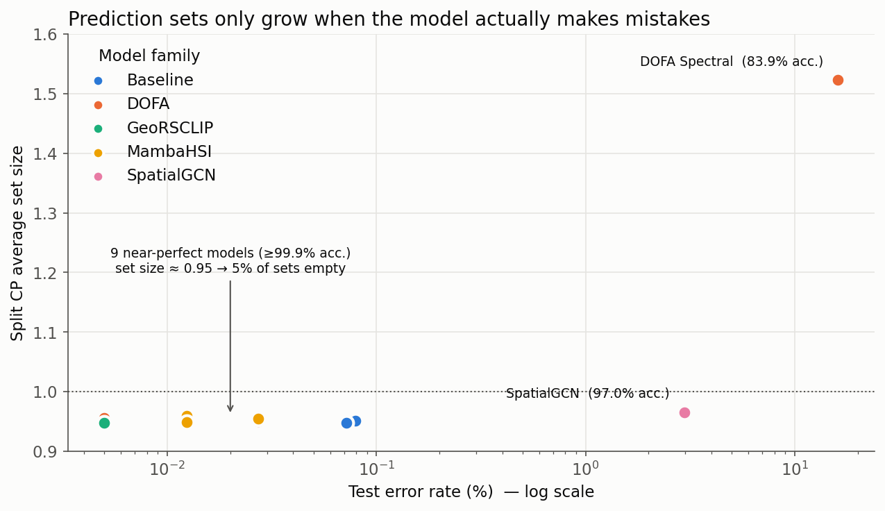</p>

---

## 2. The data

### 2.1 What the scene is

| Property | Value | Status |
|---|---|---|
| Files | `DIAS.mat` (cube), `DIAS_ref.mat` (labels), MATLAB v5, created 9 March 2017 | confirmed (file headers) |
| Size | **512 × 512 pixels × 65 spectral bands** | confirmed |
| Labelled pixels | **53,893** (20.6% of the scene); 208,251 unlabelled (label 0) | confirmed |
| Classes | **8** (labels 1–8) | confirmed |
| Stored values | integers −128 … 127 (signed 8-bit) | confirmed |
| True radiometric range | **0 … 241** (unsigned 8-bit, see §2.3) | confirmed by analysis |
| Sensor | Consistent with the **DAIS 7915** *Digital Airborne Imaging Spectrometer* | **inferred** |
| Location, date, class names | Not recorded in the files or in any public source we could find | **unknown** |

**Why "DAIS"?** The name *DIAS* most likely refers to the DLR **DAIS 7915** airborne imaging spectrometer (the
dataset card on Hugging Face also expands it as *Digital Airborne Imaging Spectrometer*). The spectra support
this: the signatures below have sharp steps at **bands 32/33, ~39 and ~47**, the places where an
instrument hands over from one detector module to the next. DAIS 7915's first module has exactly **32
visible/near-infrared bands**. Treat this as a strong hint, not a citation.

### 2.2 What is in the picture

<p align="center">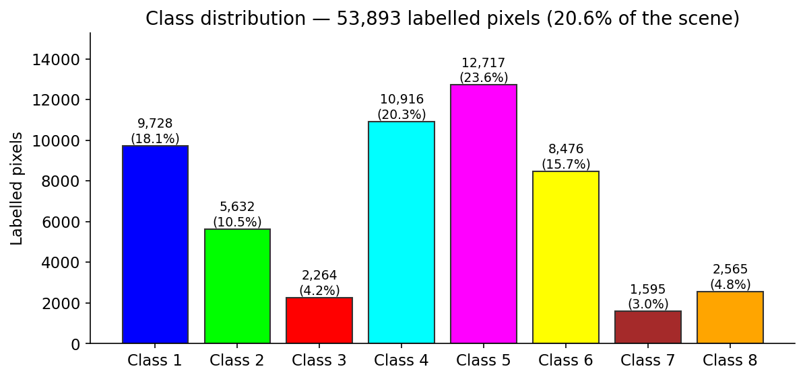</p>

The scene shows a large dark water body (top), a very bright white pan in the centre, and a patchwork of
agricultural parcels. The class meanings below are **our interpretation of the spectra and the image; they
are not labels shipped with the data.**

| Label | Pixels | Share | What the spectrum and map suggest *(inferred)* |
|:-:|--:|--:|---|
| 1 | 9,728 | 18.1% | Uniformly dark in every band, forms the large lake: **open water** |
| 2 | 5,632 | 10.5% | Brightest surface by far, the central white pan: **salt crust / bright dry lake bed** |
| 3 | 2,264 | 4.2% | Ring around the pan, bright early bands, dark later ones: **moist margin / wet soil** |
| 4 | 10,916 | 20.3% | Agricultural parcels, rising spectrum with a plateau |
| 5 | 12,717 | 23.6% | Agricultural parcels, similar to class 4 with a different shape after band 40 |
| 6 | 8,476 | 15.7% | Agricultural parcels, brightest of the crop-like classes |
| 7 | 1,595 | 3.0% | Small parcels, close to classes 5/6 spectrally: **the hardest class** |
| 8 | 2,565 | 4.8% | Near the settlement in the north-west: possibly built-up / mixed land |

> ⚠️ **Note on class numbering in figures.** The reference file uses labels **1–8**. The notebooks subtract 1,
> so the maps and tables they produced say **"Class 0 … Class 7"**. *Class k* in a notebook figure =
> *label k + 1* here. The figures made for this README use 1–8.

### 2.3 Spectral signatures

<p align="center">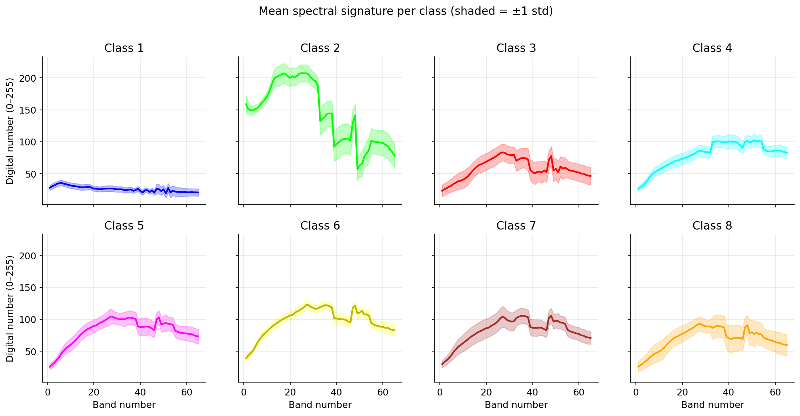</p>
<p align="center"></p>

Water (1) and the bright pan (2) are unmistakable. Classes 4–8 are all variations on the same "vegetated or
bare field" shape, which is where a classifier, and its uncertainty, has to work hardest.

**A data-quality finding: the stored values wrap round.** The sensor recorded unsigned 8-bit values (0–255),
but `DIAS.mat` stores them as *signed* 8-bit numbers. Anything brighter than 127 wraps round to a negative
number: a reflectance of 169 is stored as −87. This affects **3.5% of all values** and **60% of class-2
values**. Adding 256 to the negatives restores smooth spectra: band-to-band jumps larger than 150 fall from
1.07% to 0%.

<p align="center">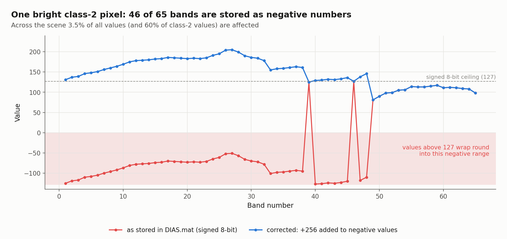</p>

The figures in this section use the corrected values. **The models were trained on the stored, wrapped
values.** They still separate the classes (wrapping is a consistent, learnable distortion), but the physical
meaning of the input is scrambled for bright pixels. See [§8](#8-limitations-read-this-before-citing-a-number).

### 2.4 How much independent information is in 65 bands?

| | |
|:-:|:-:|
|  | 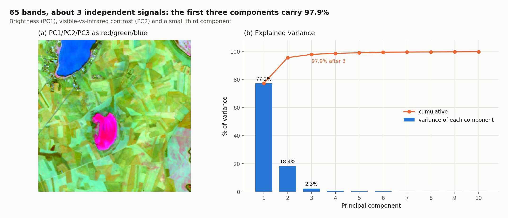 |

Neighbouring bands are highly correlated. The first three principal components explain **77.2%, 18.4%
and 2.3%** of the variance (97.9% together), which is why even simple models do well here.

<p align="center">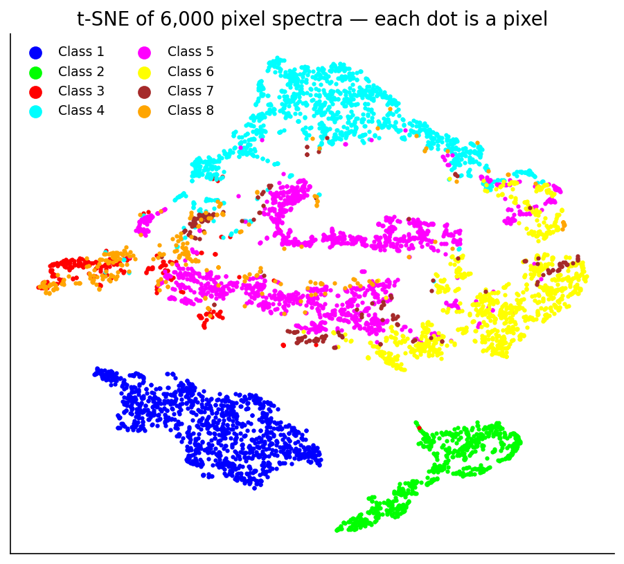</p>

A 2-D t-SNE map of 6,000 pixel spectra (spectrum only, no spatial context) shows the same story. Water
(blue) and the pan (green) are isolated islands. Classes 4–8 overlap, and spatial context (the 9×9 patch)
is what pulls them apart.

---

## 3. From pixels to patches: the classification set-up

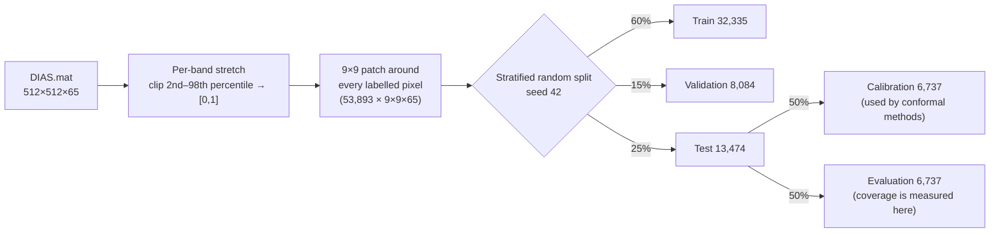

1. **Normalise.** Each band is clipped to its 2nd–98th percentile and scaled to [0, 1].
2. **Patch.** The image is edge-padded by 4 pixels, and a 9 × 9 × 65 cube is cut around every labelled
   pixel. The label of the centre pixel is the target.
3. **Split.** A stratified random 75/25 train/test split (seed 42), with 20% of train held out for
   validation. For uncertainty methods, the test pool is split again, 50/50, into a *calibration* half and an
   *evaluation* half.
4. **Full-scene maps.** For maps, every one of the 262,144 pixels (labelled or not) gets a patch and a
   prediction.

AlexNet is the exception: it was trained on its original "legacy" split (seed 10, 40,419 train / 13,474
test, no validation set). See [§8](#8-limitations-read-this-before-citing-a-number) for why that matters.

**Common training recipe** (`baseline/Model_training.ipynb`): AdamW-style optimiser, learning rate 3 × 10⁻⁴
with cosine decay, label smoothing 0.05, weight decay 10⁻⁴, gradient clip 1.0, dropout 0.25, batch 128,
**100 epochs**.

---

## 4. Model architectures

Model architecture is not the focus of this project, but every uncertainty method sits on top of one. Three
**baseline backbones** are used by every UQ method; eight **extended backbones** test whether the
conclusions survive a change of architecture.

### 4.1 Baseline backbones


| Model | Idea in one line | Key configuration |
|---|---|---|
| **AlexNet-CNN** | Stacked small convolutions learn local spatial-spectral texture | conv filters 96/256/384/384/256; dense 4096/1024/256/32 |
| **GFNet** | Replaces attention with a learnable filter in the Fourier domain, mixing all tokens cheaply | hidden 512, 5 blocks, MLP ratio 4, 3×3 inner patch |
| **ViT-UNet** | Vision Transformer whose layers are linked like a U-Net (layer *i* ↔ layer *L−i*) | dim 256, 12 layers, 4 heads, MLP ×2 |

### 4.2 Extended backbones (each evaluated with the same five conformal methods)

| Folder | Models | Idea in one line |
|---|---|---|
| [`dofa/`](dofa/README.md) | DOFA-Spectral, Hiera-ViT, DOFA+Hiera Fusion | A hypernetwork turns each band's wavelength into its own filter weights (DOFA); a hierarchical ViT (Hiera) adds multi-scale space |
| [`georsclip/`](georsclip/README.md) | GeoRSCLIP-TextHead | CLIP-style: an image tower is matched by cosine similarity to a text tower that encodes a prompt per class |
| [`mambahsi/`](mambahsi/README.md) | MambaHSI Small / Base / Large | A selective state-space model scans the spectral-spatial token sequence (a Mamba-style recurrence) |
| [`spatialgcn/`](spatialgcn/README.md) | SpatialGCN | Each 9×9 patch is a graph of 81 pixel-nodes with 4-neighbour edges; graph convolutions pass messages |

The ensemble, multi-head and DAPM methods add their own structure on top of the baselines; it is described
in their folders.

---

## 5. Classification results

| Model | Test accuracy | Cohen's κ | Macro-F1 | NLL | Brier | ECE (15 bins) |
|---|--:|--:|--:|--:|--:|--:|
| AlexNet-CNN | 99.93% | 0.9991 | 0.9983 | 0.0026 | 0.0013 | 0.0005 |
| GFNet | **99.99%** | 0.9999 | 0.9998 | 0.0081 | 0.0002 | 0.0080 |
| ViT-UNet | 99.93% | 0.9992 | 0.9990 | 0.0417 | 0.0027 | 0.0389 |
| Hiera-ViT | 100.00% | 1.0000 | 1.0000 | 0.0398 | — | 0.0390 |
| DOFA+Hiera Fusion | 99.98% | 0.9997 | 0.9996 | 0.0305 | — | 0.0294 |
| **DOFA-Spectral** | **83.91%** | 0.8038 | 0.6780 | 0.4657 | — | 0.0475 |
| GeoRSCLIP-TextHead | 100.00% | 1.0000 | 1.0000 | 0.0396 | — | 0.0388 |
| MambaHSI-Small | 99.98% | 0.9997 | 0.9998 | 0.0106 | — | 0.0102 |
| MambaHSI-Base | 99.99% | 0.9999 | 0.9999 | 0.0194 | — | 0.0192 |
| MambaHSI-Large | 99.99% | 0.9999 | 1.0000 | 0.0209 | — | 0.0206 |
| **SpatialGCN** | **97.05%** | 0.9644 | 0.9442 | 0.1132 | — | 0.0422 |

*Sources: `*/results/classification_summary.csv`. NLL = negative log-likelihood; ECE = expected calibration
error (lower is better for both).*

| Ground truth | AlexNet-CNN | GFNet | ViT-UNet |
|:-:|:-:|:-:|:-:|
|  |  | 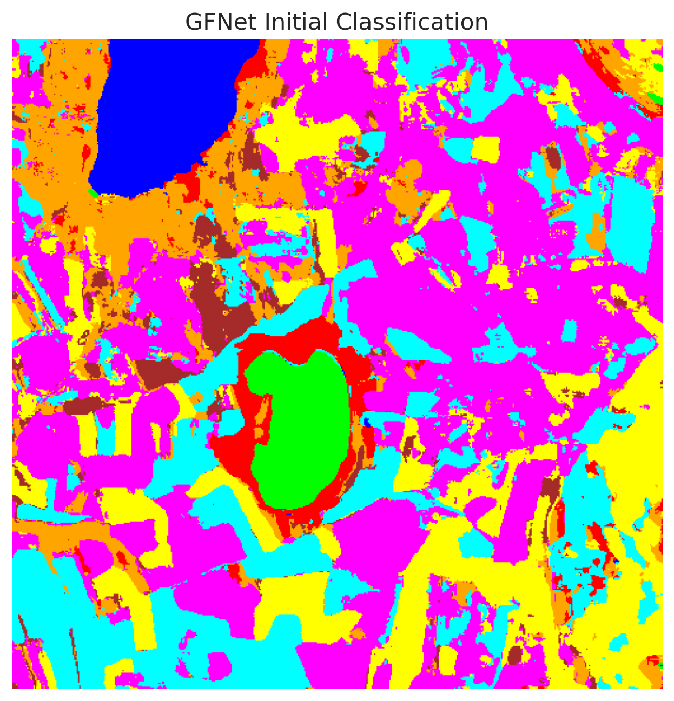 |  |

<p align="center">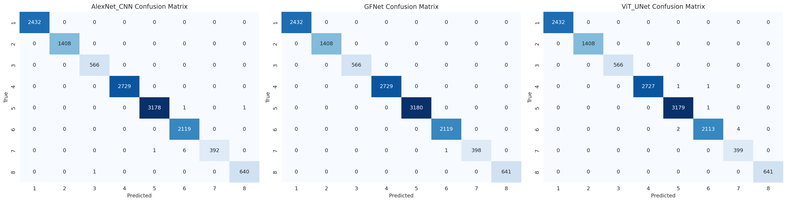</p>

**Why is accuracy so high? Partly because the test is easy, not only because the models are good.** See
[§8.1](#81-the-random-pixel-split-leaks-information).

---

## 6. Uncertainty quantification: the idea in plain words

A classifier always answers, even when it is guessing. Uncertainty quantification adds a second output:
**how much should you trust this answer?** This project uses three families of method.

| Family | Analogy | Output per pixel | Guarantee? |
|---|---|---|---|
| **Conformal prediction** (Split, Class-conditional, Clustered, RC3P, RAPS, SACP, MultiCP, SCMCP) | A weather forecaster who has kept score: *"on days I said this, I was right 95% of the time"* | A **set** of classes, e.g. {crop A} or {crop A, crop B} | **Yes**: the true class is in the set ≥ 95% of the time, if calibration and test pixels are exchangeable |
| **Credal / ensemble** (CREDIT, CreDE) | Ask five experts; report the range of their opinions | Lower/upper probability per class → aleatoric and epistemic uncertainty | No formal guarantee |
| **Generative / statistical test** (DAPM) | Re-draw the answer 30 times from a diffusion model; test if the top two classes are really different | p-value → certain / uncertain | No formal guarantee |

> **Two kinds of uncertainty.** *Aleatoric* uncertainty is noise in the world: a mixed pixel really is half
> crop, half soil. *Epistemic* uncertainty is a gap in the model's knowledge, and more data would reduce it.
> CREDIT and CreDE try to separate the two; conformal methods report the total.

### 6.1 The one formula behind conformal prediction

1. Score how "strange" the true answer looks for each calibration pixel: $s_i = 1 - \hat p_{y_i}(x_i)$.
   If the model gave the true class 0.98, the score is 0.02 (not strange).
2. Find the cut-off that 95% of calibration scores stay under (with a small finite-sample correction):

$$\hat q = \text{Quantile}\left(s_1,\dots,s_n;\ \frac{\lceil (n+1)(1-\alpha)\rceil}{n}\right),\qquad \alpha = 0.05$$

3. For a new pixel, keep every class whose score is under the cut-off:
   $C(x) = \{\,k : 1 - \hat p_k(x) \le \hat q\,\}$.

Because new pixels are scored exactly like calibration pixels, the true class lands under the cut-off
**95% of the time on average**. Every conformal folder in this repo changes one of these three steps: the score,
the grouping used to compute $\hat q$, or the neighbourhood the score is computed over.

### 6.2 Method map

| Folder | Method | What it changes | Read |
|---|---|---|---|
| [`baseline/`](baseline/README.md) | Split CP, Class-conditional CP, Clustered CP, RC3P, RAPS | The score and the grouping | ⭐ start here |
| [`sacp/`](sacp/README.md) | Spatially-Aggregated CP | Averages each pixel's score with its neighbours' | |
| [`multicp/`](multicp/README.md) | Multi-head CP | 7 output heads; a class must pass all 7 | |
| [`multicp_sacp/`](multicp_sacp/README.md) | Spatial MultiCP (SCMCP) | Smooths probabilities in space, then MultiCP | |
| [`credit/`](credit/README.md) | CREDIT | One "student" network learns an ensemble's probability intervals | |
| [`ensemble/`](ensemble/README.md) | Deep ensembles + CreDE | 5 independently trained models → credal intervals | |
| [`dapm/`](dapm/README.md) | DAPM | VAE + domain adaptation + diffusion sampling + Welch t-test | |
| [`dofa/`](dofa/README.md), [`georsclip/`](georsclip/README.md), [`mambahsi/`](mambahsi/README.md), [`spatialgcn/`](spatialgcn/README.md) | Same five CP methods | New backbones | |

---

## 7. Uncertainty results across methods

<p align="center">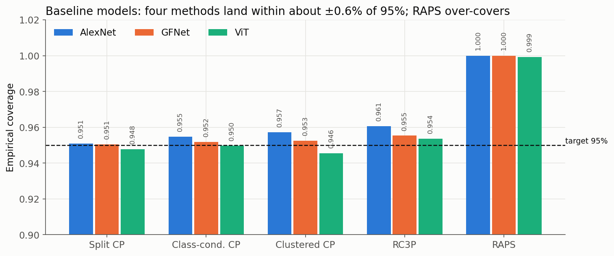</p>

### 7.1 Why near-perfect models produce empty sets

<p align="center">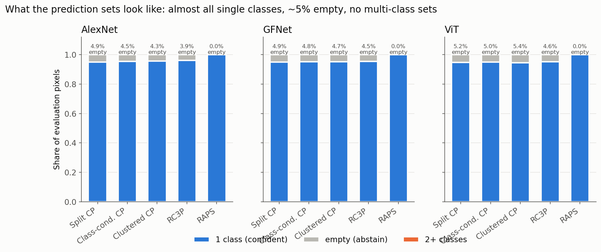</p>

At α = 0.05, conformal prediction promises *at least 95%* coverage and uses up the remaining 5% to make
sets as small as possible. A 99.9%-accurate model is wrong on only ~0.1% of pixels, so the cut-off
$\hat q$ has to fall **among correct predictions**. The 5% of pixels with the least confident correct
prediction get an **empty set**: the method says "I won't commit". That is why, for every near-perfect
backbone:

$$\text{coverage} \approx \text{singleton rate} \approx 0.95, \qquad \text{empty-set rate} \approx 0.05, \qquad \text{average set size} \approx 0.95 < 1.$$

<p align="center"></p>

*Illustrative simulation (not repository data) of a calibration-score distribution for a 99.9%-accurate
model.*

**Practical reading:** on these models an empty set means *"one of the 5% least-confident pixels"*, not
*"likely wrong"*. To make the sets flag real errors, choose α below the model's error rate (e.g. α = 0.001),
or evaluate on a harder spatial split ([§8](#8-limitations-read-this-before-citing-a-number)).

### 7.2 Fairness across classes

<p align="center">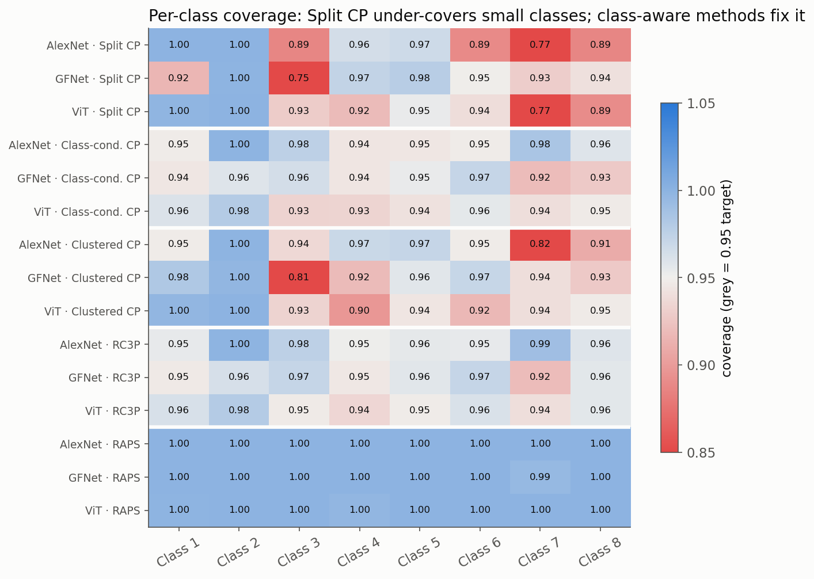</p>

Split CP promises 95% **on average over all pixels**, so a small class can be short-changed. AlexNet's
class 7 (the rarest, 1,595 pixels) gets only **77%** coverage. Class-conditional CP and RC3P compute a
cut-off per class and bring every class close to 95%. Clustered CP sits in between.

### 7.3 Where the uncertainty is on the map

| Baseline GFNet, Split CP (99.99% acc.) | DOFA-Spectral, Split CP (83.9% acc.) |
|:-:|:-:|
| 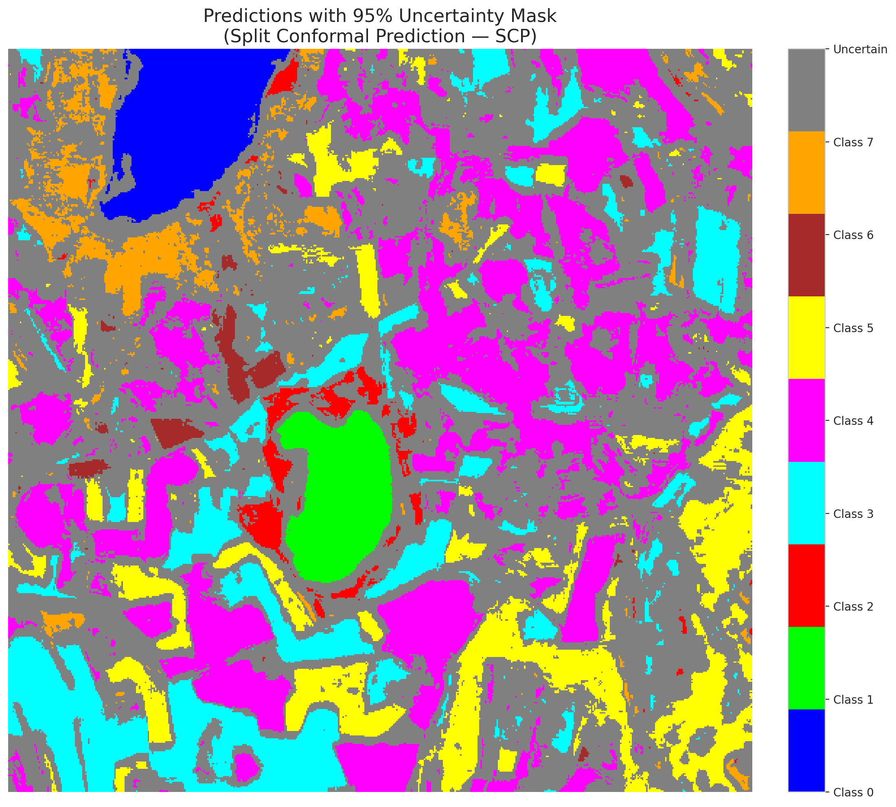 | 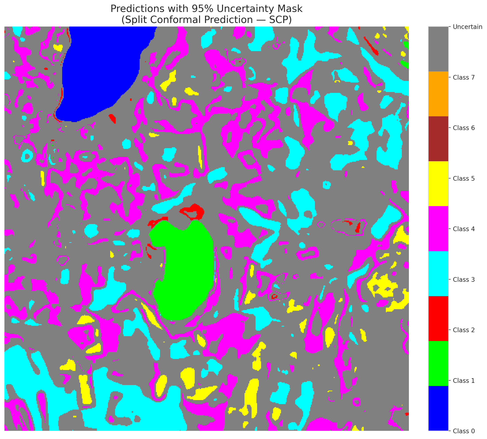 |
| Grey (uncertain) concentrates on **parcel boundaries and unlabelled land** that the model never trained on | Grey covers **most of the farmland**: the classes the model confuses. Lake and pan stay confident |

*Grey = the set is not a single class (empty or 2+ classes). Notebook class numbering (0–7).*

### 7.4 Other method families

| | |
|:-:|:-:|
| 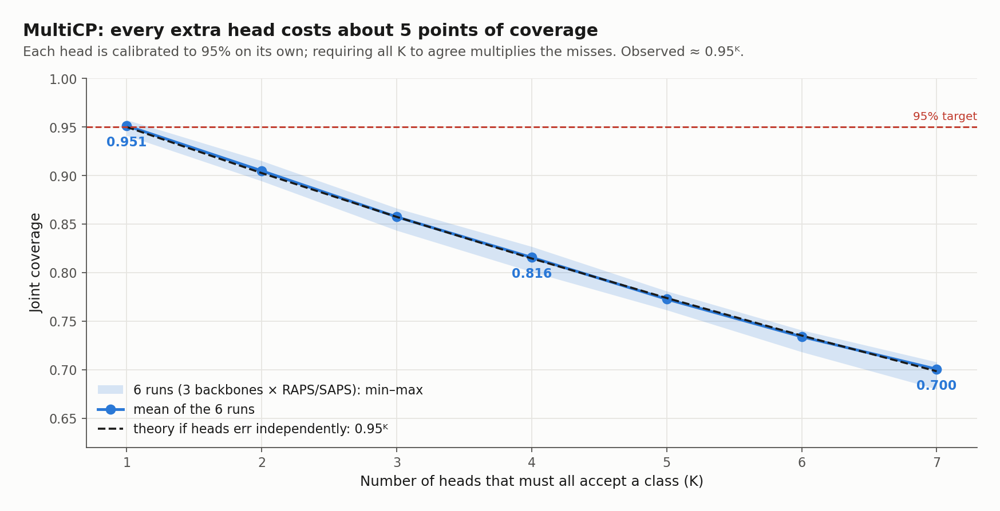 | 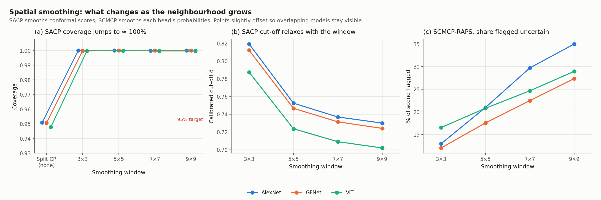 |
| **MultiCP:** coverage drops by ~5% per head, tracking 0.95ᴷ → [multicp/](multicp/README.md) | **SACP / SCMCP:** effect of the smoothing window → [sacp/](sacp/README.md), [multicp_sacp/](multicp_sacp/README.md) |
|  | 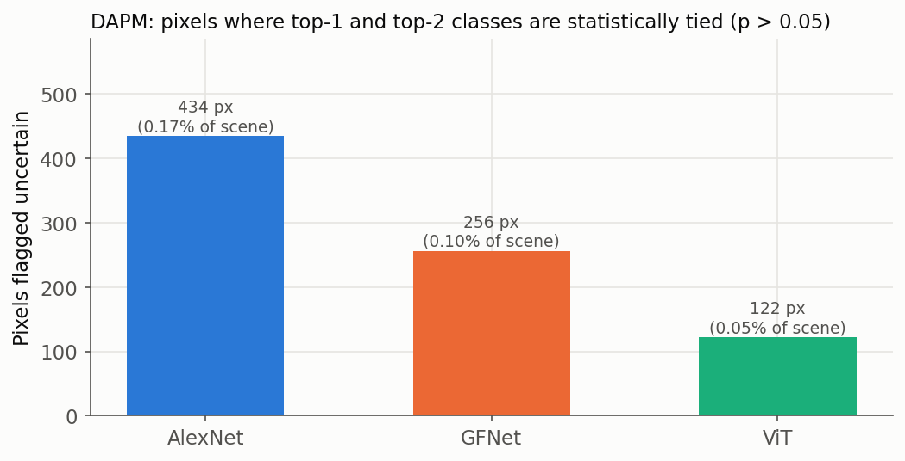 |
| **CREDIT vs CreDE:** aleatoric and epistemic uncertainty → [credit/](credit/README.md), [ensemble/](ensemble/README.md) | **DAPM:** only 122–434 pixels flagged, scattered at random rather than on field edges → [dapm/](dapm/README.md) |

---

## 8. Limitations: read this before citing a number

### 8.1 The random pixel split leaks information

<p align="center">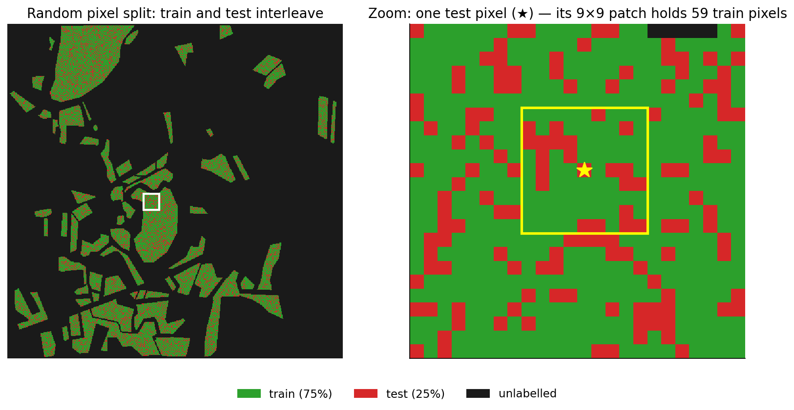</p>

Train and test pixels are drawn at random from the **same fields**. A test pixel's 9 × 9 input patch
overlaps the patches of its training neighbours: **100% of test patches contain training pixels (50.6 of 81
on average)**. The model is largely being asked about pixels it has nearly seen, so accuracy is optimistic,
and conformal sets inherit the optimism. A **spatially-blocked split** (whole parcels or image tiles held out)
would give a realistic estimate; we expect it to lower accuracy and make the UQ methods far more informative.

### 8.2 Other caveats found while documenting

| # | Issue | Effect | Where |
|:-:|---|---|---|
| 1 | Stored values wrap round (signed vs unsigned 8-bit) | Bright pixels (mostly class 2) are fed to the models as dark ones | [§2.3](#23-spectral-signatures) |
| 2 | AlexNet was trained on split seed 10, but conformal calibration uses seed 42 | **75.2%** of AlexNet's calibration/evaluation pixels were in its training set, so its conformal numbers are not valid hold-out estimates | all CP folders |
| 3 | Near-perfect models + α = 0.05 | Sets are singletons or empty; they do not single out errors | [§7.1](#71-why-near-perfect-models-produce-empty-sets) |
| 4 | RAPS here is the non-randomised variant and leaves the true class's own probability out of the score | The threshold collapses to 0 → always top-1 → coverage = accuracy (~100%), not 95% | [baseline/](baseline/README.md#raps) |
| 5 | MultiCP intersects 7 independently calibrated heads | Joint coverage ≈ 0.95⁷ ≈ 70% | [multicp/](multicp/README.md) |
| 6 | MultiCP / SCMCP uncertainty maps treat label 7 as "unlabelled" (left over from the 6-band dataset) | Real class-7 pixels are greyed out in those maps | [multicp/](multicp/README.md) |
| 7 | CREDIT selects its best checkpoint on the test set | Small optimistic bias in CREDIT's test metrics | [credit/](credit/README.md) |
| 8 | DOFA assumes 65 evenly spaced wavelengths, 0.40–2.50 µm | The true band centres are unknown, so DOFA's wavelength conditioning is approximate | [dofa/](dofa/README.md) |
| 9 | Credal coverage (CREDIT/CreDE) is *measured*, not *calibrated* to a target | No 95% guarantee for those sets | [credit/](credit/README.md) |

---

## 9. Repository map & reproducibility

```
classification_dias/
├── README.md                 ← you are here
├── docs/figures/             ← figures made for the documentation (data, uncertainty, maps)
├── baseline/   credit/   ensemble/   dapm/
├── multicp/    sacp/     multicp_sacp/
├── dofa/       georsclip/  mambahsi/  spatialgcn/
│   ├── README.md             ← method write-up (maths in plain words + results)
│   ├── *.ipynb               ← executed notebooks (Kaggle GPU)
│   └── results/              ← CSV / JSON / PNG / XLSX outputs
└── scripts/                  ← verification helpers
```

| Resource | Link |
|---|---|
| Data (`DIAS.mat`, `DIAS_ref.mat`) | 🤗 [datasets/DaneshSelwal/Classification-DIAS-65Bands-Data](https://huggingface.co/datasets/DaneshSelwal/Classification-DIAS-65Bands-Data) |
| Trained weights | 🤗 [DaneshSelwal/Classification-DIAS-65Bands](https://huggingface.co/DaneshSelwal/Classification-DIAS-65Bands) |
| Browsable workspace | 🤗 [spaces/DaneshSelwal/Classification-DIAS-65Bands-Workspace](https://huggingface.co/spaces/DaneshSelwal/Classification-DIAS-65Bands-Workspace) |
| Kaggle data | [kaggle.com/datasets/daneshselwal/dias-dataset-k01](https://www.kaggle.com/datasets/daneshselwal/dias-dataset-k01) |
| Umbrella project (11 datasets) | [Classification_Uncertainty_Quantification_Analysis](https://github.com/DaneshSelwal/Classification_Uncertainty_Quantification_Analysis) |

**To reproduce:** run each folder's training notebook, then its uncertainty notebook, on a GPU (Kaggle T4/P100
was used). Seeds are fixed (42; AlexNet legacy 10). Paths assume Kaggle input datasets, so edit the
configuration cell (Section 2) for a local run.

---

## 10. References

1. Angelopoulos, A. N., & Bates, S. (2023). *Conformal Prediction: A Gentle Introduction.* Foundations and Trends in ML.
2. Vovk, V., Gammerman, A., & Shafer, G. (2005). *Algorithmic Learning in a Random World.* Springer.
3. Angelopoulos, A. N., Bates, S., Malik, J., & Jordan, M. I. (2021). *Uncertainty Sets for Image Classifiers using Conformal Prediction* (RAPS). ICLR.
4. Romano, Y., Sesia, M., & Candès, E. (2020). *Classification with Valid and Adaptive Coverage* (APS). NeurIPS.
5. Ding, T., et al. (2023). *Class-Conditional Conformal Prediction with Many Classes* (Clustered CP). NeurIPS.
6. Shi, Y., et al. (2024). *Conformal Prediction for Class-wise Coverage via Augmented Label Rank Calibration* (RC3P). NeurIPS.
7. Huang, J., et al. (2024). *Conformal Prediction for Deep Classifier via Label Ranking* (SAPS). ICML.
8. Lakshminarayanan, B., Pritzel, A., & Blundell, C. (2017). *Simple and Scalable Predictive Uncertainty Estimation using Deep Ensembles.* NeurIPS.
9. Ganin, Y., et al. (2016). *Domain-Adversarial Training of Neural Networks.* JMLR.
10. Ho, J., Jain, A., & Abbeel, P. (2020). *Denoising Diffusion Probabilistic Models.* NeurIPS.
11. Rao, Y., et al. (2021). *Global Filter Networks for Image Classification* (GFNet). NeurIPS.
12. Dosovitskiy, A., et al. (2021). *An Image is Worth 16×16 Words* (ViT). ICLR.
13. Xiong, Z., et al. (2024). *Neural Plasticity-Inspired Foundation Model for Observing the Earth Crossing Modalities* (DOFA).
14. Gu, A., & Dao, T. (2023). *Mamba: Linear-Time Sequence Modeling with Selective State Spaces.*
15. Kipf, T. N., & Welling, M. (2017). *Semi-Supervised Classification with Graph Convolutional Networks.* ICLR.
16. Multi-CP reference implementation: [github.com/yamtawa/Multi-CP](https://github.com/yamtawa/Multi-CP).
