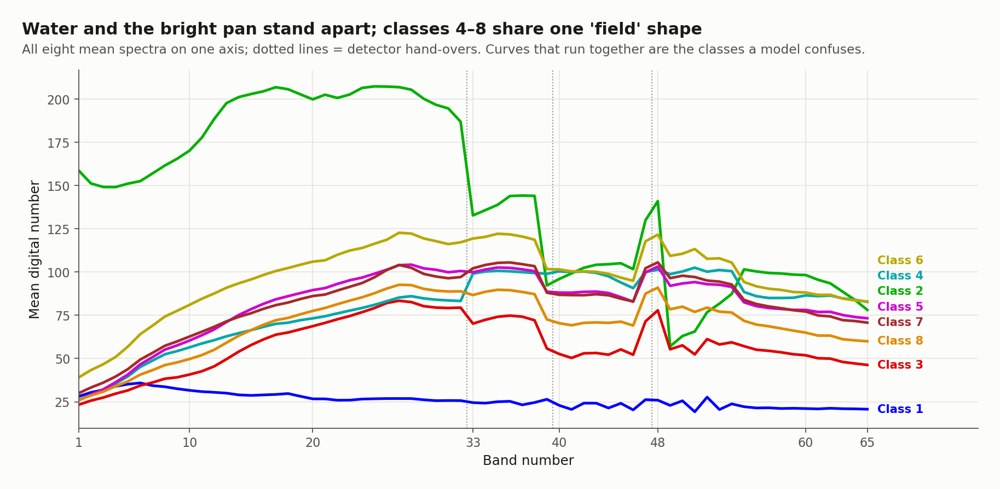
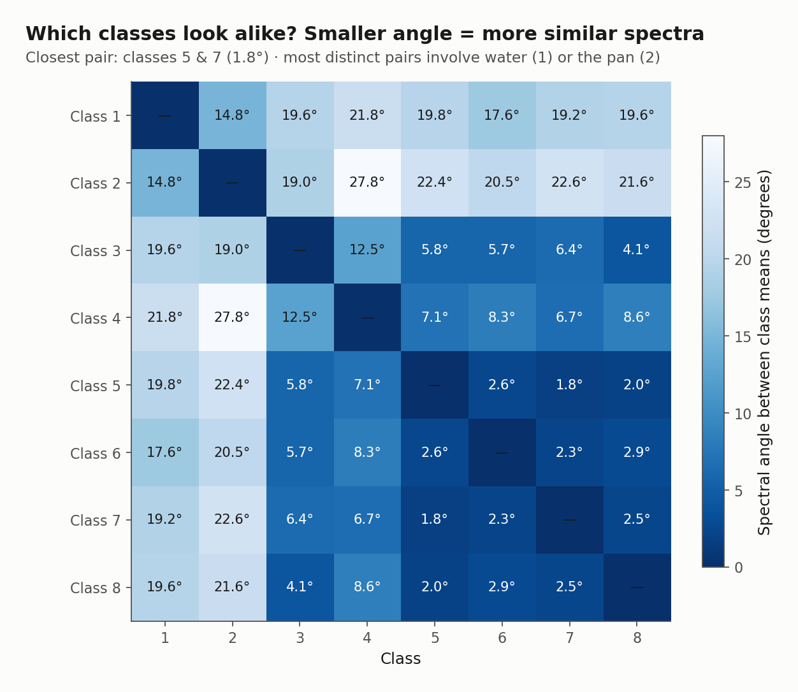
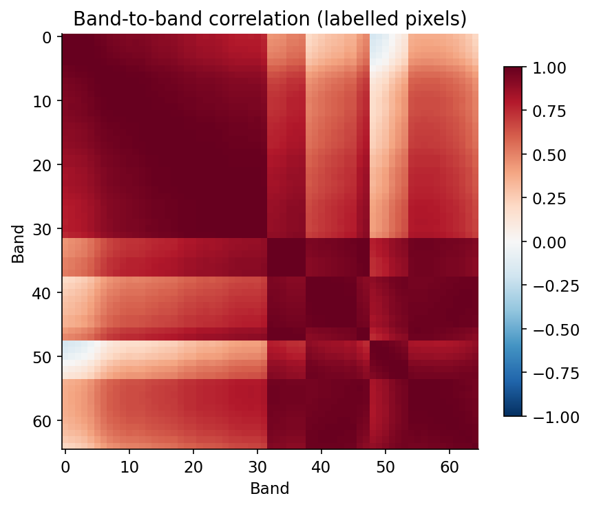
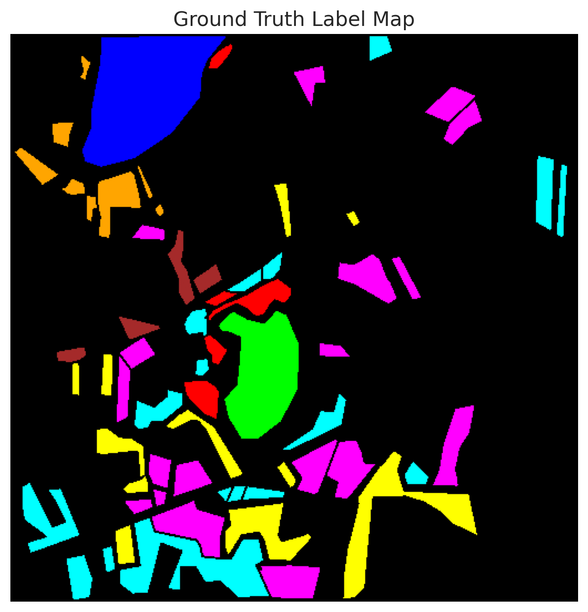
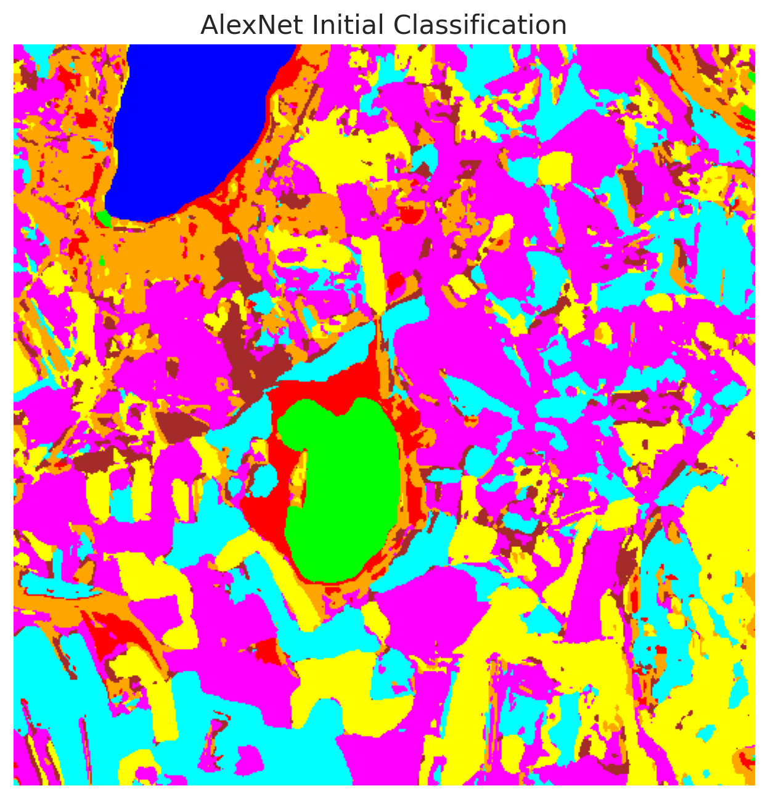
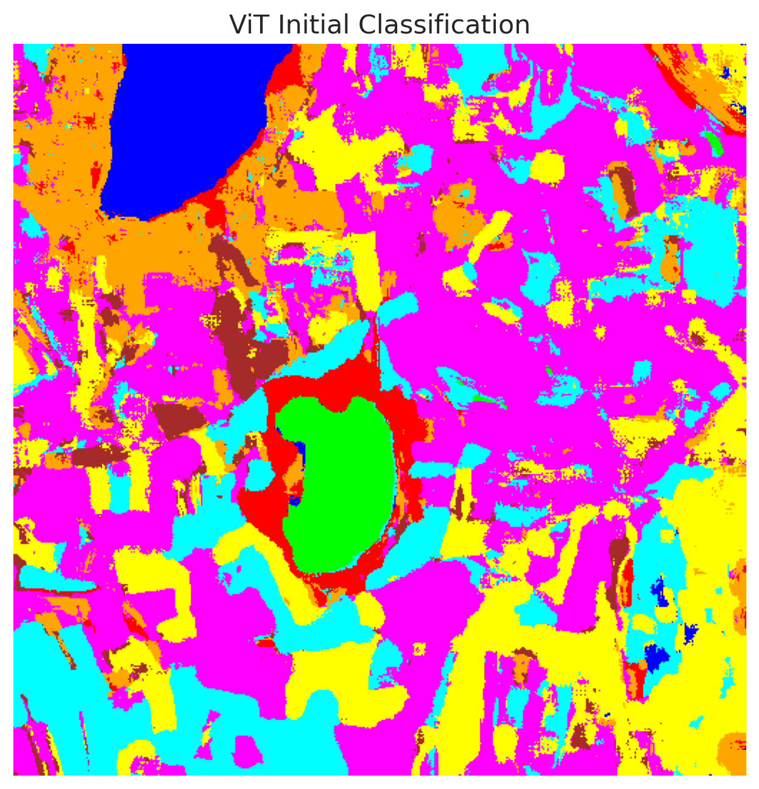
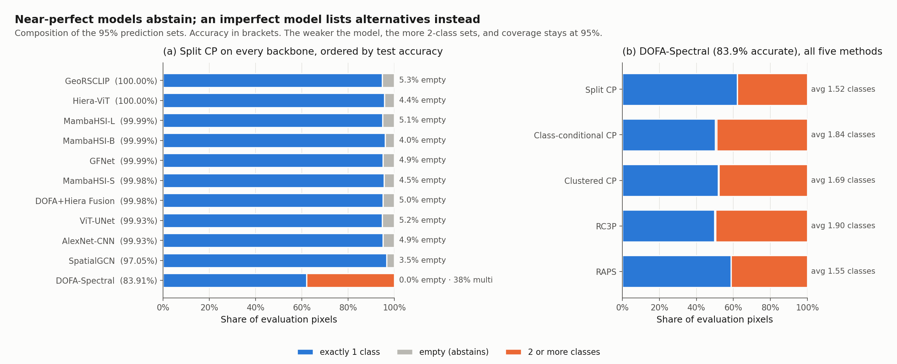
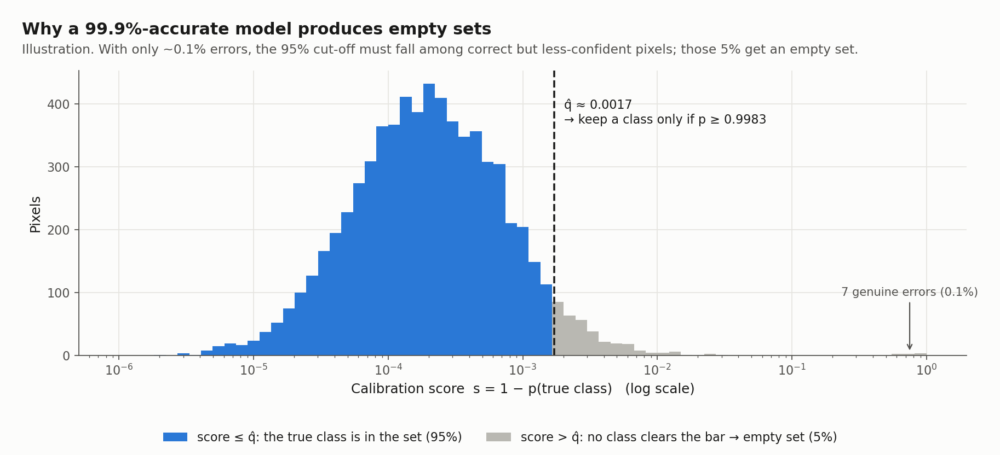
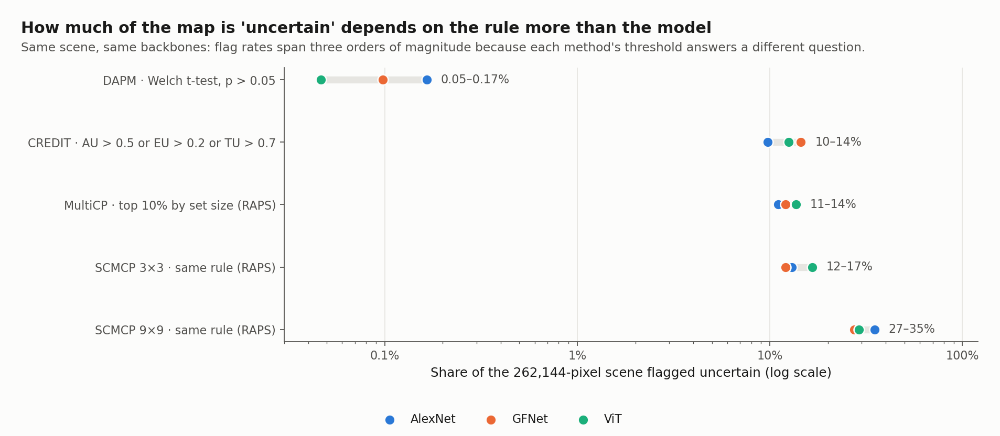
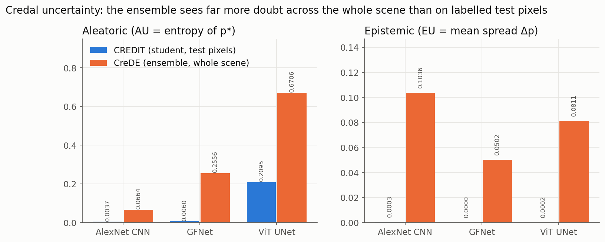

<div align="center">

# Knowing When the Map Is Wrong

### Uncertainty Quantification for 65-Band DIAS Hyperspectral Land-Cover Classification

[](LICENSE)


</div>

> **Abstract.** A land-cover map is only as useful as our ability to tell which parts of it to trust.
> We train **11 deep classifiers** on a 512 × 512-pixel, 65-band airborne hyperspectral scene: CNN,
> Fourier, Transformer, state-space, graph and foundation-style models. We then attach **11
> uncertainty-quantification (UQ) methods** to them. They range from conformal prediction, which gives
> a distribution-free guarantee of the form *"the true class is in this set 95% of the time"*, to credal
> ensembles, distillation, diffusion sampling and spatially-aware conformal prediction.
>
> Five findings stand out:
> 1. The four calibrated conformal methods keep their 95% promise on every backbone (0.946–0.967).
> 2. On near-perfect models, conformal sets do not flag errors. They *abstain* on the ~5% least-confident
>    pixels instead.
> 3. A guarantee that holds **on average** can hide a class covered only **41.5%** of the time.
>    Class-conditional calibration fixes this.
> 4. How much of the map is called "uncertain" depends far more on the method's rule (0.05% to 35% of the
>    scene) than on the model.
> 5. The experiments have a structural weakness, measured here: the random pixel split places training
>    pixels inside **every** test pixel's input patch.
>
> Every number in this document is read from the result files committed in this repository.

---

## Contents

1. [Key findings](#1-key-findings)
2. [Why uncertainty matters for land-cover maps](#2-why-uncertainty-matters-for-land-cover-maps)
3. [The data](#3-the-data)
4. [Experimental set-up](#4-experimental-set-up)
5. [Model architectures](#5-model-architectures)
6. [Classification results](#6-classification-results)
7. [Uncertainty quantification: methods in plain words](#7-uncertainty-quantification-methods-in-plain-words)
8. [Uncertainty results](#8-uncertainty-results)
9. [Discussion and recommendations](#9-discussion-and-recommendations)
10. [Limitations and threats to validity](#10-limitations-and-threats-to-validity)
11. [Repository map and reproducibility](#11-repository-map-and-reproducibility)
12. [Citation, licence and references](#12-citation-licence-and-references)

---

## 1. Key findings

| # | Finding | Evidence | Details |
|:-:|---|---|---|
| F1 | **The 95% guarantee holds.** Split, class-conditional, clustered and RC3P conformal prediction reach 0.946–0.967 coverage on all 11 backbones | [Fig. 11](#81-rq1--does-the-95-guarantee-hold) | [baseline/](baseline/README.md) |
| F2 | **Near-perfect models abstain instead of hedging.** At ≥ 99.9% accuracy, 95% of sets hold one class and ~5% are *empty*; almost none hold two classes | [Fig. 12](#82-rq2--what-do-the-prediction-sets-look-like) | [§8.2](#82-rq2--what-do-the-prediction-sets-look-like) |
| F3 | **Sets become informative only when the model errs.** DOFA-Spectral (83.9% accurate) produces 2+-class sets for 38% of pixels and still covers 95% | [Fig. 12b](#82-rq2--what-do-the-prediction-sets-look-like) | [dofa/](dofa/README.md) |
| F4 | **"95% on average" can hide a failing class.** Split CP covers DOFA-Spectral's class 7 only 41.5% of the time; class-conditional CP raises it to 93% | [Fig. 14–15](#83-rq3--is-coverage-fair-across-classes) | [dofa/](dofa/README.md) |
| F5 | **The rule decides how much of the map is "uncertain".** 0.05–0.17% (DAPM) vs 10–14% (CREDIT, MultiCP) vs 27–35% (SCMCP 9×9), all on the same backbones | [Fig. 18](#85-rq5--how-much-of-the-map-does-each-method-call-uncertain) | [§8.5](#85-rq5--how-much-of-the-map-does-each-method-call-uncertain) |
| F6 | **Intersecting heads multiplies the misses.** MultiCP's 7 independently calibrated heads give ≈ 0.95⁷ = 70% joint coverage | [Fig. 19](#86-rq6--multi-head-and-spatial-variants) | [multicp/](multicp/README.md) |
| F7 | **Disagreement lives off the labels.** 99.6–99.96% of the pixels CREDIT flags are unlabelled; ensemble epistemic uncertainty is 300–25,000× higher across the scene than on test pixels | [Fig. 21](#87-rq7--what-do-ensembles-say-about-the-two-kinds-of-uncertainty) | [ensemble/](ensemble/README.md) |
| F8 | **Accuracy is inflated by the split.** 100% of test patches contain training pixels (50.6 of 81 on average) | [Fig. 9](#43-how-pixels-are-split-and-why-it-matters) | [§10](#10-limitations-and-threats-to-validity) |

---

## 2. Why uncertainty matters for land-cover maps

Land-cover maps feed crop-area statistics, water-resource planning and environmental monitoring. A
classifier always produces an answer for every pixel, including pixels it has never seen anything like,
pixels that straddle two fields, and surfaces that were never labelled. A map without uncertainty
treats all of these the same as a pixel in the middle of a well-known field.

Uncertainty quantification adds a second layer to the map: **"how much should I trust this pixel?"**
A useful answer must be:

| Property | Meaning | Who provides it here |
|---|---|---|
| **Valid** | When the method says "95%", it is right 95% of the time | Conformal prediction (§7.1) |
| **Fair** | The promise holds for every class, not only on average | Class-conditional CP, RC3P |
| **Informative** | It singles out the pixels that are actually wrong or ambiguous | Depends on model accuracy (§8.2) |
| **Interpretable** | It separates "the pixel is ambiguous" from "the model hasn't learned this" | Credal ensembles, CREDIT (§8.7) |
| **Spatially coherent** | Uncertainty forms regions (field edges) rather than random speckle | SACP / SCMCP (§8.6) |

This repository tests which methods deliver which properties on one hyperspectral scene.

---

## 3. The data

### 3.1 What the files contain

| Property | Value | Status |
|---|---|---|
| Files | `DIAS.mat` (image cube), `DIAS_ref.mat` (reference labels), MATLAB v5, created 9 March 2017 | confirmed (file headers) |
| Size | **512 × 512 pixels × 65 spectral bands** | confirmed |
| Labelled pixels | **53,893** (20.6% of the scene); 208,251 unlabelled (label 0) | confirmed |
| Classes | **8** (labels 1–8) | confirmed |
| Stored values | integers −128 … 127 (signed 8-bit) | confirmed |
| True radiometric range | **0 … 241** (unsigned 8-bit, see §3.5) | confirmed by analysis |
| Sensor | Consistent with the DLR **DAIS 7915** *Digital Airborne Imaging Spectrometer* | **inferred** |
| Location, date, class names | Not recorded in the files or in any public source we found | **unknown** |

**Provenance.** "DIAS" most likely refers to the **DAIS 7915** airborne imaging spectrometer; the
Hugging Face dataset card also expands the name as *Digital Airborne Imaging Spectrometer*. The spectra
support this. Every class shows a sharp step at the same band positions (32|33, 39|40 and 47|48), which
is the signature of an instrument handing over from one detector module to the next. DAIS 7915's
first module has exactly 32 visible/near-infrared bands. Treat this as strong circumstantial evidence,
not a citation.

### 3.2 The scene and its classes

The scene (**Figure 1**, top of page) contains a large dark lake in the north, a very bright white pan
in the centre and a patchwork of agricultural parcels. The reference labels cover parcels scattered
across the scene; everything else (black in Figure 1b) has no label.

| Label | Pixels | Share | What the spectrum and map suggest *(our interpretation, not shipped with the data)* |
|:-:|--:|--:|---|
| 1 | 9,728 | 18.1% | Uniformly dark in every band, forms the large lake: **open water** |
| 2 | 5,632 | 10.5% | By far the brightest surface, the central white pan: **salt crust / dry lake bed** |
| 3 | 2,264 | 4.2% | Ring around the pan; bright early bands, darker later ones: **moist margin / wet soil** |
| 4 | 10,916 | 20.3% | Agricultural parcels, rising spectrum with a plateau after band 33 |
| 5 | 12,717 | 23.6% | Agricultural parcels, similar to class 4, different shape after band 40 |
| 6 | 8,476 | 15.7% | Agricultural parcels, brightest of the crop-like classes |
| 7 | 1,595 | 3.0% | Small parcels, spectrally almost identical to class 5: **the hardest class** |
| 8 | 2,565 | 4.8% | Near the settlement in the north-west: possibly built-up / mixed land |

<p align="center"></p>

*__Figure 2.__ Labelled pixels per class.*

**Reading Figure 2.** The classes are imbalanced: class 5 has eight times as many pixels as class 7.
This matters for uncertainty. Any method that promises 95% coverage *on average over pixels* can meet
that promise while serving the two rare classes (3 and 7) badly. We return to this in §8.3.

> ⚠️ **Class numbering in notebook figures.** The reference file uses labels **1–8**. The notebooks
> subtract 1, so the maps and tables they produced say **"Class 0 … Class 7"**. *Class k* in a notebook
> figure = *label k + 1* here. All figures made for this documentation use 1–8.

### 3.3 Spectral behaviour: which classes look alike?

<p align="center"></p>

*__Figure 3.__ Mean spectrum per class (line) with ±1 standard deviation (band), corrected values.*

<p align="center"></p>

*__Figure 4.__ All eight mean spectra on one axis.*

**Reading Figures 3–4.** Water (1) is dark and flat; the pan (2) is bright everywhere. Both are
unmistakable. Classes 3–8 all share one "vegetated or bare field" shape: a rise through the first 27
bands, a plateau, and the same steps at the detector hand-overs. They differ mainly in overall brightness
and in small details after band 40.

<p align="center"></p>

*__Figure 5.__ Spectral angle between class-mean spectra. 0° means identical shape.*

**Reading Figure 5.** The spectral angle compares the *shape* of two spectra and ignores brightness.
The dark block in the lower right shows that classes 5, 6, 7 and 8 are within **1.8–2.9°** of each
other. Class 7 is closest to class 5 (1.8°), which is why it is the class most often mishandled by the
uncertainty methods (§8.3). Water and the pan are 15–28° from everything else.

### 3.4 How much independent information do 65 bands carry?

| | |
|:-:|:-:|
|  |  |
| *__Figure 6a.__ Band-to-band correlation* | *__Figure 6b.__ t-SNE of 6,000 pixel spectra* |

<p align="center"></p>

*__Figure 7.__ Principal-component analysis of all 262,144 pixels.*

**Reading Figures 6–7.** Neighbouring bands are almost perfectly correlated within each detector block
(Figure 6a). The first three principal components carry **77.2%, 18.4% and 2.3%** of the variance,
97.9% together (Figure 7). In the t-SNE map (Figure 6b), each dot is one pixel placed according to its
spectrum alone. Water and the pan form isolated islands; classes 3–8 form one tangled cloud.

**Why it matters.** A model that looks only at a pixel's spectrum will confuse classes 3–8. The
**9 × 9 spatial patch** used by every model is what separates them, and that is the reason the
train/test split (§4.3) matters so much.

### 3.5 A data-quality finding: stored values wrap round

<p align="center"></p>

*__Figure 8.__ One bright class-2 pixel as stored (red) and corrected (blue).*

The sensor recorded unsigned 8-bit values (0–255), but `DIAS.mat` stores them as *signed* 8-bit
integers. Any value above 127 wraps round to a negative number; for example, a reflectance of 169 is
stored as −87. This affects **3.5% of all values** and **60% of class-2 values**. Adding 256 to the
negatives restores smooth spectra: band-to-band jumps larger than 150 fall from 1.07% to 0%. Figures 3–7
use the corrected values.

**The models were trained on the stored, wrapped values.** They still separate the classes, because
wrapping is a consistent and therefore learnable distortion. But for bright pixels the physical meaning
of the input is scrambled, which matters for any model that assumes smooth spectra (e.g. DOFA's
wavelength conditioning, [dofa/](dofa/README.md)).

---

## 4. Experimental set-up

### 4.1 Pipeline


1. **Normalise.** Each band is clipped to its 2nd–98th percentile and scaled to [0, 1].
2. **Patch.** The image is edge-padded by 4 pixels, and a 9 × 9 × 65 cube is cut around every labelled
   pixel. The label of the centre pixel is the target.
3. **Split.** Stratified random 75/25 train/test (seed 42), with 20% of train held out for validation.
   For uncertainty methods, the test pool is split 50/50 again into a **calibration** half (where the
   method learns its thresholds) and an **evaluation** half (where we check whether its promises hold).
4. **Full-scene maps.** For maps, every one of the 262,144 pixels gets a patch and a prediction,
   labelled or not.

AlexNet is the exception: it was trained on its original "legacy" split (seed 10, 40,419 train /
13,474 test, no validation set). §10 explains why that matters.

### 4.2 Training recipe

| Setting | Value |
|---|---|
| Optimiser | AdamW-style, learning rate 3 × 10⁻⁴, cosine decay (α = 0.05) |
| Regularisation | label smoothing 0.05, weight decay 10⁻⁴, dropout 0.25, gradient clip 1.0 |
| Batch / epochs | 128 / **100** |
| Hardware | Kaggle GPU (T4 / P100) |
| Seeds | 42 (data split and training); AlexNet legacy split 10; ensemble members 43–47 |

### 4.3 How pixels are split, and why it matters

<p align="center"></p>

*__Figure 9.__ The notebooks' random pixel split, reproduced exactly.*

**Reading Figure 9.** Train (green) and test (red) pixels are drawn at random from the **same parcels**
(9a). Zooming in (9b) shows that a test pixel's 9 × 9 input patch is mostly made of training pixels.
Panel 9c counts this for every test pixel: **all 13,474 test patches contain training pixels, 50.6 of 81
on average** (median 54).

**Why it matters.** The model is largely being asked about locations whose surroundings it was trained
on. Accuracy is therefore optimistic, and the uncertainty methods are evaluated on an easy problem. This
is the most important caveat in this study (§10).

### 4.4 Evaluation metrics (a glossary)

| Metric | Plain meaning | Good value |
|---|---|---|
| **Accuracy** | Share of test pixels classified correctly | high |
| **Cohen's κ** | Accuracy corrected for agreement expected by chance | high (max 1) |
| **Macro-F1** | Average of per-class F1 scores, so small classes count equally | high |
| **NLL** (negative log-likelihood) | Penalises confident wrong answers heavily | low |
| **Brier score** | Mean squared error of the predicted probabilities | low |
| **ECE** (expected calibration error) | Gap between stated confidence and actual accuracy, over 15 confidence bins | low |
| **Coverage** | Share of evaluation pixels whose prediction set contains the true class | ≈ target (95%) |
| **Average set size** | Mean number of classes per set | small, given coverage |
| **Singleton / empty rate** | Share of sets with exactly one / zero classes | — (see §8.2) |
| **Per-class coverage** | Coverage measured inside each class separately | ≈ 95% for *every* class |
| **AU / EU / TU** | Aleatoric / epistemic / total uncertainty (credal methods) | — (relative) |

---

## 5. Model architectures

Architecture is not the focus of this project, but every uncertainty method sits on top of one. Three
**baseline backbones** are used by every UQ method; eight **extended backbones** test whether the
conclusions survive a change of architecture.

### 5.1 Baseline backbones


| Model | Idea in one line | Key configuration |
|---|---|---|
| **AlexNet-CNN** | Stacked small convolutions learn local spatial-spectral texture | conv filters 96/256/384/384/256; dense 4096/1024/256/32 |
| **GFNet** | Replaces attention with a learnable filter in the Fourier domain, mixing all tokens cheaply | hidden 512, 5 blocks, MLP ratio 4, 3×3 inner patch |
| **ViT-UNet** | Vision Transformer whose layers are linked like a U-Net (layer *i* ↔ layer *L−i*) | dim 256, 12 layers, 4 heads |

### 5.2 Extended backbones (same five conformal methods)

| Folder | Models | Idea in one line |
|---|---|---|
| [`dofa/`](dofa/README.md) | DOFA-Spectral, Hiera-ViT, DOFA+Hiera Fusion | A hypernetwork turns each band's wavelength into filter weights (DOFA); a hierarchical ViT (Hiera) adds multi-scale spatial context |
| [`georsclip/`](georsclip/README.md) | GeoRSCLIP-TextHead | CLIP-style: image features are matched by cosine similarity to text embeddings of one prompt per class |
| [`mambahsi/`](mambahsi/README.md) | MambaHSI Small / Base / Large | A selective state-space model scans the patch as a token sequence |
| [`spatialgcn/`](spatialgcn/README.md) | SpatialGCN | Each patch is a graph of 81 pixel-nodes with 4-neighbour edges; graph convolutions pass messages |

The ensemble, multi-head and DAPM methods add their own structure on top of the baselines; their folders
describe it.

---

## 6. Classification results

| Model | Test accuracy | Cohen's κ | Macro-F1 | NLL | Brier | ECE (15 bins) |
|---|--:|--:|--:|--:|--:|--:|
| AlexNet-CNN | 99.93% | 0.9991 | 0.9983 | 0.0026 | 0.0013 | 0.0005 |
| GFNet | **99.99%** | 0.9999 | 0.9998 | 0.0081 | 0.0002 | 0.0080 |
| ViT-UNet | 99.93% | 0.9992 | 0.9990 | 0.0417 | 0.0027 | 0.0389 |
| Hiera-ViT | 100.00% | 1.0000 | 1.0000 | 0.0398 | — | 0.0390 |
| DOFA+Hiera Fusion | 99.98% | 0.9997 | 0.9996 | 0.0305 | — | 0.0294 |
| **DOFA-Spectral** | **83.91%** | 0.8038 | 0.6780 | 0.4657 | — | 0.0475 |
| GeoRSCLIP-TextHead | 100.00% | 1.0000 | 1.0000 | 0.0396 | — | 0.0388 |
| MambaHSI-Small | 99.98% | 0.9997 | 0.9998 | 0.0106 | — | 0.0102 |
| MambaHSI-Base | 99.99% | 0.9999 | 0.9999 | 0.0194 | — | 0.0192 |
| MambaHSI-Large | 99.99% | 0.9999 | 1.0000 | 0.0209 | — | 0.0206 |
| **SpatialGCN** | **97.05%** | 0.9644 | 0.9442 | 0.1132 | — | 0.0422 |

*__Table 1.__ Test-set classification metrics. Sources: `*/results/classification_summary.csv`. "—" =
not reported by that notebook.*

**What Table 1 shows.**
- **Nine of eleven models are effectively perfect** (≥ 99.93%). This level of accuracy is partly the
  random split (§4.3), not only model quality.
- **Two models make real mistakes**, and they are the most instructive for uncertainty. DOFA-Spectral
  (83.9%) throws away the spatial layout of the patch (§3.4), and SpatialGCN reaches 97.1%.
- **Calibration differs even among near-perfect models.** AlexNet's ECE (0.0005) is 80× lower than
  ViT-UNet's (0.0389). ViT-UNet's probabilities are less peaked than its accuracy justifies; label
  smoothing caps how confident it can be. This shows up again in the credal results (§8.7).

| Ground truth | AlexNet-CNN | GFNet | ViT-UNet |
|:-:|:-:|:-:|:-:|
|  |  |  |  |

*__Figure 10.__ Full-scene classification maps of the three baselines (notebook class numbering 0–7).*

**Reading Figure 10.** Inside labelled parcels the three maps agree with the reference almost perfectly.
They differ on **unlabelled land**, which is most of the scene. There each model extrapolates differently,
and no accuracy number can tell us which one is right. This is exactly where uncertainty maps add
information.

---

## 7. Uncertainty quantification: methods in plain words

### 7.1 Three families

| Family | Everyday analogy | Output per pixel | Guarantee? |
|---|---|---|---|
| **Conformal prediction**: Split, Class-conditional, Clustered, RC3P, RAPS, SACP, MultiCP, SCMCP | A forecaster who keeps score: *"on days I said this, I was right 95% of the time"* | A **set** of classes, e.g. {crop A} or {crop A, crop B} | **Yes**: the true class is in the set ≥ 95% of the time, provided calibration and test pixels are exchangeable |
| **Credal / ensemble**: CREDIT, CreDE | Ask five experts and report the range of their opinions | Lower/upper probability per class → aleatoric and epistemic uncertainty | No |
| **Generative + statistical test**: DAPM | Redraw the answer 30 times and test whether the top two classes are really different | p-value → certain / uncertain | No |

> **Two kinds of uncertainty.** *Aleatoric* uncertainty is ambiguity in the world: a mixed pixel really
> is half crop, half soil, and more data would not help. *Epistemic* uncertainty is a gap in the model's
> knowledge, and more or better data would reduce it. Credal methods try to separate the two; conformal
> methods report their combined effect as the size of a set.

### 7.2 Conformal prediction in three steps

<p align="center"></p>

*__Box 1.__ How conformal prediction works, with illustrative (made-up) numbers.*

1. **Score.** For each calibration pixel, measure how "surprised" the model was by the true answer:
   $`s_i = 1 - \hat p_{y_i}(x_i)`$. A model that gave the true class 0.98 scores 0.02.
2. **Cut-off.** Find the value that 95% of calibration scores stay under, with a small finite-sample
   correction:

```math
\hat q = \text{Quantile}\left(s_1,\dots,s_n;\ \frac{\lceil (n+1)(1-\alpha)\rceil}{n}\right),\qquad \alpha = 0.05
```

3. **Set.** For a new pixel, keep every class the model would be no more surprised by:
   $`C(x) = \{\,k : \hat p_k(x) \ge 1 - \hat q\,\}`$.

New pixels are scored exactly like calibration pixels, so the true class falls under the cut-off
**95% of the time on average**. This holds whatever the model is. Every conformal folder in this
repository changes one ingredient: the **score** (RAPS, SAPS), the **grouping** used to compute the
cut-off (class-conditional, clustered, RC3P), the **neighbourhood** the score is computed over (SACP,
SCMCP), or the **number of heads** that must agree (MultiCP).

### 7.3 Method map

| Folder | Method | What it changes | Output | Read |
|---|---|---|---|---|
| [`baseline/`](baseline/README.md) | Split CP, Class-conditional CP, Clustered CP, RC3P, RAPS | The score and the grouping | Prediction sets | ⭐ start here |
| [`sacp/`](sacp/README.md) | Spatially-Aggregated CP | Averages each pixel's score with its neighbours' | Prediction sets | |
| [`multicp/`](multicp/README.md) | Multi-head CP | 7 output heads; a class must pass all 7 | Prediction sets | |
| [`multicp_sacp/`](multicp_sacp/README.md) | Spatial MultiCP (SCMCP) | Smooths probabilities in space, then MultiCP | Prediction sets | |
| [`ensemble/`](ensemble/README.md) | Deep ensembles + CreDE | 5 independently trained models → credal intervals | AU / EU / TU, credal sets | |
| [`credit/`](credit/README.md) | CREDIT | One student network learns the ensemble's intervals | AU / EU / TU, credal sets | |
| [`dapm/`](dapm/README.md) | DAPM | VAE + domain alignment + diffusion sampling + Welch t-test | p-value per pixel | |
| [`dofa/`](dofa/README.md), [`georsclip/`](georsclip/README.md), [`mambahsi/`](mambahsi/README.md), [`spatialgcn/`](spatialgcn/README.md) | The five baseline CP methods | New backbones | Prediction sets | |

---

## 8. Uncertainty results

The results are organised as seven research questions (RQ1–RQ7). Each subsection states the question,
shows the evidence, explains how to read it, and ends with the takeaway.

### 8.1 RQ1 · Does the 95% guarantee hold?

<p align="center"></p>

*__Figure 11.__ Empirical coverage of the five baseline conformal methods on all 11 backbones.*

**How to read it.** Each dot is one backbone. The dashed line is the 95% target and the shaded band is
95% ± 1 point. A valid method should put its dots in or near the band. A little above the band is
acceptable (the guarantee is "at least 95%"), but far above means the sets are larger than necessary.

**What it shows.**
- **Split, class-conditional, clustered and RC3P** stay between **0.946 and 0.967** on every backbone,
  including DOFA-Spectral at 84% accuracy. The guarantee does what it says, independently of architecture.
- Small deviations below 0.95 (minimum 0.946) are expected sampling noise. With 6,737 evaluation pixels
  the standard error of a coverage estimate is about 0.27 points.
- **RAPS sits at ≈ 100%** for every near-perfect model and at 97.3% for SpatialGCN, i.e. at the model's
  accuracy. The implementation used here leaves out RAPS's randomisation, so its threshold collapses to
  zero and the set is always the top-1 class ([baseline/ §3.5](baseline/README.md#raps)). Only for
  DOFA-Spectral, where the true class is often not ranked first, does RAPS reach its target (0.951).

> **Takeaway RQ1.** The four calibrated conformal methods are valid on this data. RAPS as implemented is
> not calibrated to 95%; it reproduces accuracy.

### 8.2 RQ2 · What do the prediction sets look like?

<p align="center"></p>

*__Figure 12.__ Composition of the 95% prediction sets: (a) Split CP on every backbone, ordered by
accuracy; (b) all five methods on DOFA-Spectral.*

**How to read it.** Each bar is 100% of the evaluation pixels, divided into pixels whose set holds exactly
one class (blue), no class (grey) and two or more classes (orange).

**What it shows.**
- **Near-perfect models (≥ 99.9%) produce sets of exactly one class, or none.** About 95% are singletons
  and 4–5% are empty; there are virtually no 2-class sets.
- **SpatialGCN (97%)** has fewer empty sets (3.5%). Its class-aware variants begin to list two classes
  (up to 3.5% under RC3P; [spatialgcn/](spatialgcn/README.md)).
- **DOFA-Spectral (84%)** has **no empty sets** and lists two or more classes for **38%** of pixels
  under Split CP, rising to about 50% under class-conditional CP and RC3P (average 1.84–1.90 classes).

**Why near-perfect models give empty sets.**

<p align="center"></p>

*__Figure 13.__ Illustration with a simulated score distribution (not repository data).*

Conformal prediction promises *at least* 95% coverage and spends the remaining 5% to keep sets small.
A 99.9%-accurate model is wrong on only ~0.1% of pixels, so to "use up" its 5% budget the cut-off must
fall among **correct** predictions. The 5% of pixels with the least-confident correct prediction then
fail the bar for every class and receive an **empty set**: the method declines to commit. Hence, for
every near-perfect backbone:

```math
\text{coverage} \approx \text{singleton rate} \approx 0.95, \qquad \text{empty-set rate} \approx 0.05, \qquad \text{average set size} \approx 0.95 < 1
```

> **Takeaway RQ2.** On these models an empty set means *"one of the 5% least-confident pixels"*, not
> *"probably wrong"*. Sets become informative (they list real alternatives) only when the model makes real
> errors, as for DOFA-Spectral. To make sets flag errors on a near-perfect model, choose α below its error
> rate (e.g. α = 0.001), or evaluate on a harder, spatially blocked split.

### 8.3 RQ3 · Is coverage fair across classes?

<p align="center"></p>

*__Figure 14.__ For every backbone, the coverage of its least-covered class, per method.*

**How to read it.** Overall coverage can be 95% while one class is badly served. This figure keeps only
the **worst class** of each backbone, so a dot far below the dashed line means some class is
under-protected.

**What it shows.**
- Under **Split CP** the median worst class sits at **0.77**, and DOFA-Spectral's worst class is at
  **0.415**.
- **Clustered CP** (one cut-off per group of similar classes) helps most backbones but still lets
  DOFA-Spectral fall to 0.465. Its cluster mixes the hard class with easy ones.
- **Class-conditional CP and RC3P** compute one cut-off per class and keep the worst class of **every
  backbone at ≥ 0.92**.

<p align="center"></p>

*__Figure 15.__ DOFA-Spectral per-class coverage under Split CP (orange) and class-conditional CP (blue).*

**Reading Figure 15.** Split CP reaches its 95% average by **over-covering** the easy, large classes
(water and the pan at 99.5–100%) and **under-covering** the rare field classes: class 7 at 41.5% and
class 8 at 66.9%. Class-conditional CP pulls every class into 93–98%. It does not improve the model; it
redistributes the error budget fairly and pays with larger sets (Figure 12b).

<p align="center"></p>

*__Figure 16.__ Every class × method × baseline model. White ≈ 95%; red = under-covered.*

**Reading Figure 16.** The red cells under Split CP are the rare classes: label 7 for AlexNet and ViT
(0.77), label 3 for GFNet (0.75). The class-conditional and RC3P rows are uniformly close to white.

> **Takeaway RQ3.** For land-cover mapping, where small classes are often the point of the map, use a
> **class-aware** conformal method (class-conditional CP or RC3P). Split CP's guarantee is real but holds
> only on average.

### 8.4 RQ4 · Where on the map is the uncertainty?

| Baseline GFNet, Split CP (99.99% acc.) | DOFA-Spectral, Split CP (83.9% acc.) |
|:-:|:-:|
|  |  |

*__Figure 17.__ Full-scene class maps with "uncertain" pixels (set not a single class) shown in grey.
Notebook class numbering 0–7.*

**Reading Figure 17.**
- **GFNet (left):** grey concentrates on **parcel boundaries and unlabelled land**. These are places
  where the 9 × 9 patch mixes two surfaces, or where the surface was never labelled. Inside labelled
  parcels the model is confident.
- **DOFA-Spectral (right):** grey covers most of the **farmland**, the classes it confuses (Figure 5).
  The lake and the pan stay confident because their spectra are unique.

> **Takeaway RQ4.** Uncertainty concentrates in physically sensible places: mixed pixels at field edges,
> unlabelled surfaces, and spectrally similar crops. The map, not only the summary number, is the useful
> product.

### 8.5 RQ5 · How much of the map does each method call uncertain?

<p align="center"></p>

*__Figure 18.__ Share of the full 262,144-pixel scene flagged uncertain, per method (log scale). Each dot
is one baseline backbone.*

**What it shows.** On the same scene and the same backbones, the flagged share ranges from **0.05%**
(DAPM) to **35%** (SCMCP with a 9 × 9 window), a factor of about 700. The models barely matter; the
rules do:

| Method | Its rule for "uncertain" | What the rule really asks |
|---|---|---|
| DAPM | Welch t-test p > 0.05 between top-2 classes over 30 samples | "Are the top two classes statistically tied?" Almost never, with 30 samples |
| CREDIT | AU > 0.5 or EU > 0.2 or TU > 0.7 (fixed thresholds) | "Is the cautious distribution spread out?" True mostly off the labels |
| MultiCP / SCMCP | the **top 10%** of pixels by set size | A quota rather than a test: about 10% (plus ties) is flagged by construction |

> **Takeaway RQ5.** "Percentage of the map that is uncertain" is not comparable across methods unless the
> threshold is calibrated to the same meaning. Only the conformal sets carry a calibrated meaning (a 95%
> coverage guarantee).

### 8.6 RQ6 · Multi-head and spatial variants

<p align="center"></p>

*__Figure 19.__ MultiCP joint coverage as more heads must agree (6 runs, band = min–max).*

**Reading Figure 19.** Each head is calibrated to 95% on its own, and a class must pass **all K
heads**. Every additional head costs about 5 points of coverage, matching the independence prediction
0.95ᴷ almost exactly: **0.951 → 0.816 → 0.700** at K = 1, 4, 7. A Bonferroni budget of α/K per head, or
the joint calibration of the reference Multi-CP algorithm, would restore 95% ([multicp/](multicp/README.md)).

<p align="center"></p>

*__Figure 20.__ Spatial methods as the smoothing window grows.*

**Reading Figure 20.**
- **(a)** SACP coverage jumps from Split CP's 95% to **≈ 100%** at every window. SACP forces empty sets to
  hold the best class, so the ~5% abstentions become (correct) singletons.
- **(b)** The calibrated cut-off falls as the window grows (0.82 → 0.73 for AlexNet). Averaging more
  neighbours' scores pulls them towards their mean.
- **(c)** In SCMCP, larger windows blur parcel edges into their neighbours, and the flagged share grows
  from 12–17% to 27–35%.

| Split CP (no smoothing) | SACP 3×3 |
|:-:|:-:|
|  |  |

*__Figure 20b.__ GFNet: Split CP greys out whole unlabelled areas; SACP gives them coherent classes and
confines uncertainty to thin outlines along parcel boundaries.*

> **Takeaway RQ6.** Intersecting independently calibrated heads breaks the guarantee in a predictable way
> (0.95ᴷ). Spatial smoothing produces more coherent maps, at the cost of bending the exchangeability
> assumption behind the guarantee ([sacp/](sacp/README.md#4-caveats)).

### 8.7 RQ7 · What do ensembles say about the two kinds of uncertainty?

<p align="center"></p>

*__Figure 21.__ Mean aleatoric (AU) and epistemic (EU) uncertainty: CREDIT student on labelled test
pixels vs CreDE ensemble over the whole scene (log scale).*

**Reading Figure 21.**
- On **labelled test pixels**, the five ensemble members agree almost perfectly. The CREDIT student
  learns a disagreement of **≈ 10⁻⁴** (2 × 10⁻⁶ for GFNet).
- Over the **whole scene**, 79% of it unlabelled, the same ensembles disagree **300–25,000× more** (EU
  0.05–0.10).
- Consistently, **99.6–99.96%** of the 25,499–38,001 pixels CREDIT flags are unlabelled.
- ViT-UNet has the highest aleatoric uncertainty on both pixel sets. This mirrors its high ECE in Table 1:
  its probabilities are flatter than its accuracy warrants.

> **Takeaway RQ7.** On this data the epistemic signal is a detector of **"surfaces the model was never
> taught"**, the most valuable thing a land-cover uncertainty map can show. Test-set metrics cannot
> reveal it, because the test set contains only labelled surfaces.

### 8.8 Method scorecard

| Method | Valid 95%? | Fair per class? | Informative on near-perfect models? | Spatially coherent? | Extra cost |
|---|:-:|:-:|:-:|:-:|---|
| Split CP | ✅ | ❌ (worst class 0.41–0.92) | ❌ abstains | ❌ | none |
| Class-conditional CP | ✅ | ✅ (≥ 0.92) | ❌ abstains | ❌ | none |
| Clustered CP | ✅ | ⚠️ partly | ❌ abstains | ❌ | k-means on embeddings |
| RC3P | ✅ | ✅ (≥ 0.92) | ❌ abstains | ❌ | rank search |
| RAPS (as implemented) | ❌ = accuracy | — | ❌ always top-1 | ❌ | none |
| SACP | ⚠️ ≈ 100%, assumption bent | ✅ | ❌ | ✅ | neighbourhood smoothing |
| MultiCP / SCMCP | ❌ ≈ 70% | ❌ (0.64–0.77) | ⚠️ quota-based | ⚠️ SCMCP | 7-head model |
| CreDE / CREDIT | no guarantee | ✅ measured ≥ 98% | ✅ flags unlabelled land | ✅ | 5 models (CREDIT: 1 at test time) |
| DAPM | no guarantee | — | ❌ flags ~0.1%, scattered at random | ❌ | VAE + diffusion, 30 samples/pixel |

---

## 9. Discussion and recommendations

**1. Validity is easy; usefulness is not.** Every standard conformal method kept its promise (RQ1). On
near-perfect models, however, a valid 95% set carries almost no information: it is the top class, or
nothing. The informative regime starts once the error rate approaches α. That happened only for
DOFA-Spectral and, partly, SpatialGCN.

**2. Report per-class coverage, always.** The most consequential failure in this study (41.5% coverage
on a rare class) is invisible in the headline coverage number (RQ3). Class-conditional CP and RC3P cost
nothing extra at test time and should be the default for land-cover maps.

**3. Do not compare "% uncertain" across methods.** The share of a map flagged uncertain reflects each
method's thresholding rule, not a shared quantity (RQ5). If an uncertainty map is to drive decisions,
its threshold must be calibrated to a stated meaning.

**4. The interesting uncertainty is off the labels.** Credal ensembles reveal that the models disagree
mainly on unlabelled surfaces (RQ7). No metric computed on the test set can see this. A practical
workflow is to label next whichever surfaces the epistemic map highlights (active learning).

**5. Spatial structure is the next frontier.** Both the leakage (F8) and SACP's coherent maps point the
same way. Pixels are not independent, and evaluation should respect that, with spatially blocked
splits and spatially aware calibration.

---

## 10. Limitations and threats to validity

| # | Issue | Effect on results | Where |
|:-:|---|---|---|
| 1 | **Random pixel split**: every test patch contains training pixels (50.6 of 81 on average) | Accuracy, and every uncertainty metric computed on it, is optimistic. A spatially blocked split (whole parcels or tiles held out) is needed for a realistic estimate | [§4.3](#43-how-pixels-are-split-and-why-it-matters) |
| 2 | Stored values wrap round (signed vs unsigned 8-bit) | Bright pixels (mostly class 2) are fed to the models as dark ones | [§3.5](#35-a-data-quality-finding-stored-values-wrap-round) |
| 3 | AlexNet trained on split seed 10, while conformal calibration uses seed 42 | **75.2%** of AlexNet's calibration/evaluation pixels were in its training set, so its conformal numbers are not hold-out estimates | all CP folders |
| 4 | Near-perfect models + α = 0.05 | Sets are singletons or empty and do not single out errors | [§8.2](#82-rq2--what-do-the-prediction-sets-look-like) |
| 5 | RAPS implemented without randomisation, and without the true class's own probability | Threshold collapses to 0 → always top-1 → coverage = accuracy | [baseline/](baseline/README.md#raps) |
| 6 | MultiCP intersects independently calibrated heads | Joint coverage ≈ 0.95⁷ ≈ 70% | [multicp/](multicp/README.md) |
| 7 | MultiCP / SCMCP maps treat label 7 as "unlabelled" (left over from the 6-band dataset) | Real class-7 parcels are greyed out in those maps | [multicp/](multicp/README.md#33-maps) |
| 8 | CREDIT selects its best checkpoint on the test set | Small optimistic bias in CREDIT's test metrics | [credit/](credit/README.md) |
| 9 | DOFA assumes 65 evenly spaced wavelengths, 0.40–2.50 µm | DOFA's wavelength conditioning is approximate | [dofa/](dofa/README.md) |
| 10 | SACP / SCMCP smooth across calibration and test pixels | Exchangeability is bent, so the formal guarantee does not strictly apply | [sacp/](sacp/README.md#4-caveats) |
| 11 | One scene, one sensor, one random split, no repeated seeds | No confidence intervals across runs; results may not transfer to other scenes | — |
| 12 | Class names and acquisition details unknown | Class interpretations in §3.2 are inferred | [§3.1](#31-what-the-files-contain) |

---

## 11. Repository map and reproducibility

```
classification_dias/
├── README.md                 ← you are here (the paper)
├── LICENSE                   ← Apache 2.0
├── docs/figures/             ← figures made for this documentation
│   ├── dataset/              ←   data analysis (Figures 1–9)
│   ├── uncertainty/          ←   cross-method results (Figures 11–21)
│   └── maps/                 ←   uncertainty maps extracted from the result workbooks
├── baseline/   credit/   ensemble/   dapm/
├── multicp/    sacp/     multicp_sacp/
├── dofa/       georsclip/  mambahsi/  spatialgcn/
│   ├── README.md             ← method write-up: intuition, maths, results, caveats
│   ├── *.ipynb               ← executed notebooks (Kaggle GPU)
│   └── results/              ← CSV / JSON / PNG / XLSX outputs (the source of every number)
└── scripts/                  ← verification helpers
```

| Resource | Link |
|---|---|
| Data (`DIAS.mat`, `DIAS_ref.mat`) | 🤗 [datasets/DaneshSelwal/Classification-DIAS-65Bands-Data](https://huggingface.co/datasets/DaneshSelwal/Classification-DIAS-65Bands-Data) |
| Trained weights | 🤗 [DaneshSelwal/Classification-DIAS-65Bands](https://huggingface.co/DaneshSelwal/Classification-DIAS-65Bands) |
| Browsable workspace | 🤗 [spaces/DaneshSelwal/Classification-DIAS-65Bands-Workspace](https://huggingface.co/spaces/DaneshSelwal/Classification-DIAS-65Bands-Workspace) |
| Kaggle data | [kaggle.com/datasets/daneshselwal/dias-dataset-k01](https://www.kaggle.com/datasets/daneshselwal/dias-dataset-k01) |
| Umbrella project (11 datasets) | [Classification_Uncertainty_Quantification_Analysis](https://github.com/DaneshSelwal/Classification_Uncertainty_Quantification_Analysis) |

**To reproduce:** run each folder's training notebook, then its uncertainty notebook, on a GPU (Kaggle
T4/P100 was used). Seeds are fixed (§4.2). Paths assume Kaggle input datasets; for a local run, edit the
configuration cell (Section 2 of each notebook). The documentation figures were generated from the
committed `results/` files and the Hugging Face data.

---

## 12. Citation, licence and references

**Licence.** Released under the [Apache License 2.0](LICENSE).

**Citation.** If you use this work, please cite:

```bibtex
@misc{selwal2026dias_uq,
  author       = {Selwal, Danesh},
  title        = {Knowing When the Map Is Wrong: Uncertainty Quantification for
                  65-Band DIAS Hyperspectral Land-Cover Classification},
  year         = {2026},
  howpublished = {\url{https://github.com/DaneshSelwal/classification_dias}}
}
```

**References.**

1. Angelopoulos, A. N., & Bates, S. (2023). *Conformal Prediction: A Gentle Introduction.* Foundations and Trends in ML.
2. Vovk, V., Gammerman, A., & Shafer, G. (2005). *Algorithmic Learning in a Random World.* Springer.
3. Angelopoulos, A. N., Bates, S., Malik, J., & Jordan, M. I. (2021). *Uncertainty Sets for Image Classifiers using Conformal Prediction* (RAPS). ICLR.
4. Romano, Y., Sesia, M., & Candès, E. (2020). *Classification with Valid and Adaptive Coverage* (APS). NeurIPS.
5. Ding, T., et al. (2023). *Class-Conditional Conformal Prediction with Many Classes* (Clustered CP). NeurIPS.
6. Shi, Y., et al. (2024). *Conformal Prediction for Class-wise Coverage via Augmented Label Rank Calibration* (RC3P). NeurIPS.
7. Huang, J., et al. (2024). *Conformal Prediction for Deep Classifier via Label Ranking* (SAPS). ICML.
8. Lakshminarayanan, B., Pritzel, A., & Blundell, C. (2017). *Simple and Scalable Predictive Uncertainty Estimation using Deep Ensembles.* NeurIPS.
9. Hüllermeier, E., & Waegeman, W. (2021). *Aleatoric and Epistemic Uncertainty in Machine Learning.* Machine Learning 110.
10. Ganin, Y., et al. (2016). *Domain-Adversarial Training of Neural Networks.* JMLR.
11. Ho, J., Jain, A., & Abbeel, P. (2020). *Denoising Diffusion Probabilistic Models.* NeurIPS.
12. Rao, Y., et al. (2021). *Global Filter Networks for Image Classification* (GFNet). NeurIPS.
13. Dosovitskiy, A., et al. (2021). *An Image is Worth 16×16 Words* (ViT). ICLR.
14. Xiong, Z., et al. (2024). *Neural Plasticity-Inspired Foundation Model for Observing the Earth Crossing Modalities* (DOFA).
15. Gu, A., & Dao, T. (2023). *Mamba: Linear-Time Sequence Modeling with Selective State Spaces.*
16. Kipf, T. N., & Welling, M. (2017). *Semi-Supervised Classification with Graph Convolutional Networks.* ICLR.
17. Roberts, D. R., et al. (2017). *Cross-validation strategies for data with temporal, spatial, hierarchical, or phylogenetic structure.* Ecography 40.
18. Multi-CP reference implementation: [github.com/yamtawa/Multi-CP](https://github.com/yamtawa/Multi-CP).
