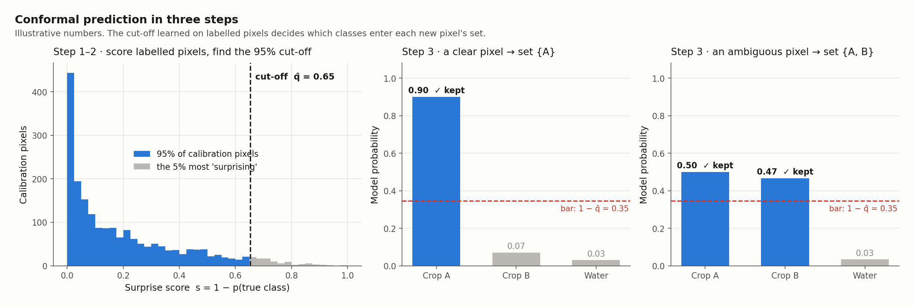
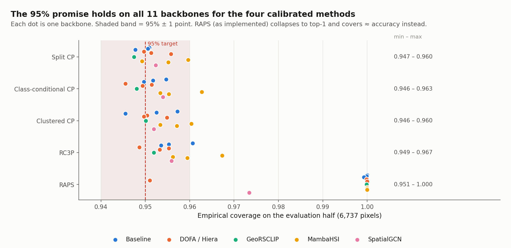
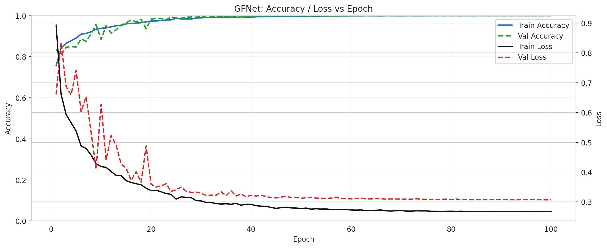
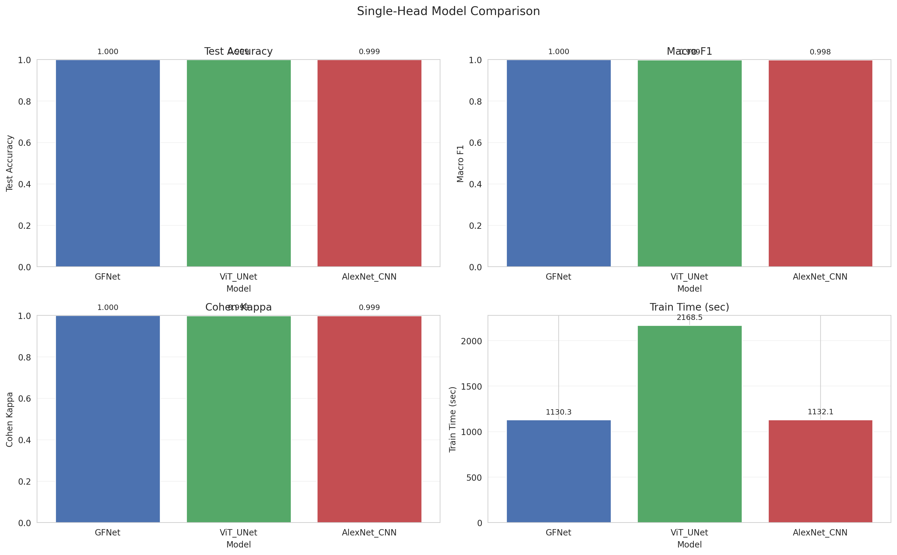
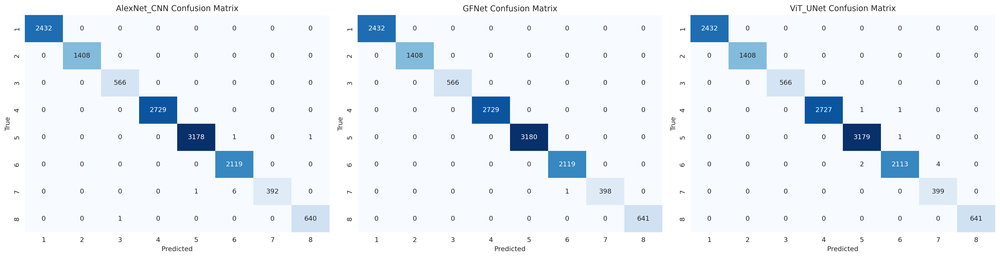

# Baseline: three backbones × five conformal methods

[← back to main README](../README.md) · next: [SACP (spatial)](../sacp/README.md) · [MultiCP (multi-head)](../multicp/README.md)

| | |
|---|---|
| **What** | Train AlexNet-CNN, GFNet and ViT-UNet once, then wrap each in five *conformal prediction* recipes that turn probabilities into a **set of classes** with a 95% guarantee |
| **Key result** | Split, class-conditional, clustered and RC3P all reach **0.946–0.961** coverage. Split CP lets rare classes fall to **0.75–0.77**; class-conditional CP and RC3P keep every class at ≥ 0.92 |
| **Surprise** | On these near-perfect models every set is a single class or **empty** (~5%); 2-class sets never occur |
| **Use it when** | You need a calibrated, model-agnostic statement of confidence with zero extra training |
| **Notebooks** | [`Model_training.ipynb`](Model_training.ipynb) (training, maps) · [`Model_uncertainty_comparison.ipynb`](Model_uncertainty_comparison.ipynb) (Section 8: the five methods) |

---

## 1. Motivation: why a *set* instead of one answer?

Picture a doctor reading an X-ray. A careful doctor doesn't say *"it's definitely A"*; they say *"it's A
or B, let's rule out B"*. That short list is useful **only if the doctor is right about how often the list
contains the truth**. Conformal prediction makes that "how often" exact.

We choose an error budget **α = 0.05**, and the method promises:

```math
\Pr\big(\,\text{true class} \in C(x)\,\big) \;\ge\; 1 - \alpha = 95\%
```

*In words: across many pixels, at least 95 out of 100 prediction sets contain the true class.*

The promise rests on a single assumption: calibration and test pixels are *exchangeable* (drawn the same
way). Nothing is assumed about the model. A bad model still gets a valid guarantee; it simply needs
bigger sets to keep it.

<p align="center"></p>

*__Box 1.__ The three steps, with illustrative numbers. Left: the cut-off is the 95th percentile of
calibration scores. Middle/right: a new pixel keeps every class whose probability clears the bar
1 − q̂.*

---

## 2. Data seen by the methods

The 13,474 test pixels from the training split are cut in half (stratified, seed 42):

| Split | Pixels | Role |
|---|--:|---|
| Calibration | 6,737 | The method *learns* its cut-off(s) $`\hat q`$ here |
| Evaluation | 6,737 | Coverage and set size are *measured* here, on pixels the cut-off never saw |

With 6,737 evaluation pixels, a coverage estimate has a standard error of about **±0.27 points**. Values
between roughly 0.945 and 0.955 are therefore statistically consistent with exactly 95%.

---

## 3. The five methods, step by step

Every method below uses the same **running example**, a pixel with three possible classes:

| | Crop A | Crop B | Water |
|---|--:|--:|--:|
| Model probability $`\hat p_k(x)`$ | 0.70 | 0.25 | 0.05 |

### 3.1 Split Conformal Prediction (Split CP): the foundation

**Step 1. Score each calibration pixel.** How surprised was the model by the true answer?

```math
s_i = 1 - \hat p_{y_i}(x_i)
```

*If the model gave the true class 0.98, the score is 0.02 (not surprised). If it gave 0.10, the score is
0.90 (very surprised).*

**Step 2. Find the 95% cut-off.** Sort the $`n`$ scores and take the one at position
$`\lceil (n+1)(1-\alpha) \rceil`$:

```math
\hat q = \text{Quantile}\!\left(s_1,\dots,s_n;\ \tfrac{\lceil (n+1)(0.95)\rceil}{n}\right)
```

*The "+1" is a small safety margin that makes the guarantee exact for a finite calibration set. With
n = 6,737 we take the 6,402nd smallest score.*

**Step 3. Build the set.** Keep every class the model would be no more surprised by than the cut-off:

```math
C(x) = \{\,k : 1 - \hat p_k(x) \le \hat q\,\} = \{\,k : \hat p_k(x) \ge 1 - \hat q\,\}
```

> **Worked example.** Suppose calibration gave $`\hat q = 0.80`$, so a class is kept if
> $`\hat p_k \ge 0.20`$. Our pixel keeps **{Crop A, Crop B}**, a set of two: the model can't decide
> between the crops. With a sharper model, say $`\hat q = 0.10`$, the bar becomes $`\hat p_k \ge 0.90`$.
> No class qualifies, and the set is **empty**.

*Code:* `build_split_outputs_for_model` (score `1 - prob_cal[range, y_cal]`, set `prob_eval >= 1 - q_hat`);
`conformal_qhat` applies the $`\lceil(n+1)(1-\alpha)\rceil/n`$ level with `method='higher'`.

### 3.2 Class-conditional CP: a fair cut-off for every class

Split CP's promise is an **average over all pixels**. A large, easy class (water) can over-cover while a
small, hard class (label 7) under-covers, and the average still looks fine. Class-conditional CP repeats
Step 2 **separately for each class** $`c`$, using only the calibration pixels of that class:

```math
\hat q_c = \text{Quantile}\!\left(\{\,s_i : y_i = c\,\};\ \tfrac{\lceil (n_c+1)(0.95)\rceil}{n_c}\right), \qquad C(x) = \{\,k : \hat p_k(x) \ge 1 - \hat q_k\,\}
```

*In words: each class gets its own bar, set so that 95% of **that class's** pixels clear it.*

> **Worked example.** Water is easy ($`\hat q_{\text{water}} = 0.05`$, bar 0.95). Crop B is hard
> ($`\hat q_B = 0.80`$, bar 0.20). Crop B is kept because 0.25 ≥ 0.20 ✔; water would need ≥ 0.95 ✘. The
> pixel gets {Crop A, Crop B} if Crop A also clears its own bar.

*Code:* `build_classconditional_outputs_for_model`.

### 3.3 Clustered CP: share cut-offs between similar classes

Per-class cut-offs need enough calibration pixels per class; with few pixels they are noisy. Clustered CP
groups classes that **the network represents similarly** and computes one cut-off per group:

1. Take the network's penultimate-layer features for the calibration pixels.
2. Average them per class → one "fingerprint" vector per class.
3. Cluster the 8 fingerprints with k-means (**k = 4**).
4. Compute $`\hat q_g`$ from all calibration pixels whose class is in cluster $`g`$, and give every class in
   that cluster the same cut-off.

*In words: a compromise between one cut-off for everyone (Split) and one per class (class-conditional).*

*Code:* `build_clustered_outputs_for_model` (`KMeans(n_clusters=4, random_state=42)` on class-mean embeddings).

### 3.4 RC3P: rank-calibrated class-conditional CP

RC3P adds a second rule to class-conditional CP: a class may enter the set only if it is **among the
model's top-$`k_c`$ guesses**, where $`k_c`$ is learned per class.

1. On calibration data, compute each class's *top-k error*: how often the true class is **not** among
   the model's top k.
2. For each class, pick the smallest $`k_c`$ whose top-k error is below an adjusted budget
   $`\alpha - g/\sqrt{n/C}`$, with $`g = 0.1`$.
3. Recalibrate the class cut-offs using only pixels whose true class ranked within $`k_c`$. Then search
   for the mix of $`k_c`$ and $`C`$ that gives the smallest average set.
4. Final set: $`C(x) = \{\,k : \hat p_k(x) \ge 1-\hat q_k \ \text{and} \ \text{rank}_k(x) \le k_c\,\}`$.

*In words: "keep class k only if it clears its probability bar **and** is ranked high enough". The second
condition trims implausible classes and keeps sets small.*

*Code:* `compute_rc3p_qhats_and_sets`, `build_rc3p_outputs_for_model`.

<a id="raps"></a>
### 3.5 RAPS: regularised adaptive prediction sets

RAPS walks down the classes from most to least likely, adding up probability until it has "enough", with
a penalty for long lists:

```math
s(x, y) = \sum_{j \,:\, \text{rank}_j < \text{rank}_y} \hat p_j(x) \;+\; \lambda \cdot \max(\text{rank}_y - k_{\text{reg}},\, 0), \qquad \lambda = 0.01,\ k_{\text{reg}} = 1
```

*In words: "how much probability sits **above** the true class, plus a small fine for each place it is
below the top".* The set adds classes in rank order while the running total plus penalty stays at or below
$`\hat q`$, and always contains at least the top class.

> **What happens on these models.** At ≈ 99.9% accuracy the true class is almost always ranked first, so
> its score is exactly **0** and $`\hat q = 0`$. The set then holds only the top class, and **coverage ≈
> accuracy ≈ 100%**, not 95%. This implementation is the non-randomised variant and also omits the true
> class's own probability. The original RAPS (Angelopoulos et al., 2021) adds a random fraction
> $`u \cdot \hat p_y`$ of it, which would let the threshold land at exactly 95%.

*Code:* `raps_score_single`, `raps_set_single`, `build_raps_outputs_for_model`. RAPS produces no full-scene map.

---

## 4. Implementation details

| Setting | Value |
|---|---|
| Backbones | AlexNet-CNN, GFNet, ViT-UNet (architectures in [main README §5](../docs/02_models_and_classification.md#5-model-architectures)) |
| Training | 100 epochs, batch 128, lr 3 × 10⁻⁴ cosine, label smoothing 0.05, dropout 0.25 |
| α | 0.05 (95% target) |
| Quantile rule | $`\lceil (n+1)(1-\alpha)\rceil / n`$, `method="higher"` |
| Clustered CP | k-means, k = 4, on class-mean penultimate embeddings |
| RC3P | g = 0.1, mix-parameter search for the smallest average set |
| RAPS | λ = 0.01, k_reg = 1, non-randomised |
| Outputs | `results/uncertainty_results/summary_metrics.csv`, `per_class_coverage.csv`, `conformal_reports_all_models.xlsx` (maps) |

---

## 5. Results

### 5.1 Does each method keep its 95% promise?

| Model | Method | Coverage | Avg. set size | Singletons | Empty sets | Mean per-class coverage |
|---|---|--:|--:|--:|--:|--:|
| AlexNet | Split CP | 0.9509 | 0.951 | 95.1% | 4.9% | 0.921 |
| AlexNet | Class-cond. CP | 0.9547 | 0.955 | 95.5% | 4.5% | 0.963 |
| AlexNet | Clustered CP | 0.9573 | 0.957 | 95.7% | 4.3% | 0.938 |
| AlexNet | RC3P | 0.9607 | 0.961 | 96.1% | 3.9% | 0.967 |
| AlexNet | RAPS | 1.0000 | 1.000 | 100% | 0.0% | 1.000 |
| GFNet | Split CP | 0.9506 | 0.951 | 95.1% | 4.9% | 0.930 |
| GFNet | Class-cond. CP | 0.9518 | 0.952 | 95.2% | 4.8% | 0.948 |
| GFNet | Clustered CP | 0.9525 | 0.953 | 95.3% | 4.7% | 0.939 |
| GFNet | RC3P | 0.9553 | 0.955 | 95.5% | 4.5% | 0.954 |
| GFNet | RAPS | 0.9999 | 1.000 | 100% | 0.0% | 0.999 |
| ViT | Split CP | 0.9478 | 0.948 | 94.8% | 5.2% | 0.925 |
| ViT | Class-cond. CP | 0.9497 | 0.950 | 95.0% | 5.0% | 0.949 |
| ViT | Clustered CP | 0.9455 | 0.946 | 94.6% | 5.5% | 0.947 |
| ViT | RC3P | 0.9535 | 0.954 | 95.4% | 4.6% | 0.954 |
| ViT | RAPS | 0.9993 | 1.000 | 100% | 0.0% | 1.000 |

*__Table 1.__ Source: [`results/uncertainty_results/summary_metrics.csv`](results/uncertainty_results/summary_metrics.csv).*

**Reading Table 1.**
- **Coverage.** Every non-RAPS row is within 0.946–0.961, i.e. within sampling noise of 95% or slightly
  above. RC3P is the most conservative (0.954–0.961): its extra rank rule makes it err on the side of
  covering.
- **Set size = coverage = singleton rate in every row.** That is only possible if every set holds either
  exactly the right class or nothing. There are **no** 2-class sets. The ~5% empty sets are the method
  abstaining on its least-confident pixels; the [main README §8.2](../docs/04_uncertainty_results.md#82-rq2--what-do-the-prediction-sets-look-like)
  explains why.
- **Mean per-class coverage** is the column that separates the methods. Split CP averages 0.921–0.930;
  class-conditional and RC3P average 0.948–0.967.

<p align="center"></p>

*__Figure 1.__ The same picture on all 11 backbones: the four calibrated methods hold; RAPS tracks accuracy.*

### 5.2 Is coverage fair across classes?

<p align="center"></p>

*__Figure 2.__ Per-class coverage for every method × model (white ≈ 95%, red = under-covered).
Source: [`results/uncertainty_results/per_class_coverage.csv`](results/uncertainty_results/per_class_coverage.csv).*

| Model · method | Worst class coverage | Which class |
|---|--:|---|
| AlexNet · Split CP | **0.77** | label 7 (1,595 px, 3.0% of labels) |
| GFNet · Split CP | **0.75** | label 3 (2,264 px, 4.2%) |
| ViT · Split CP | **0.77** | label 7 |
| AlexNet · Clustered CP | 0.82 | label 7 |
| GFNet · Class-cond. CP | 0.92 | label 7 |
| AlexNet · RC3P | 0.95 | — |

**Reading Figure 2.** The under-covered cells are exactly the two rare classes from the class
distribution ([main README, Figure 2](../docs/01_data_and_setup.md#32-the-scene-and-its-classes)). Split CP uses one
cut-off for everyone. That cut-off is dominated by the abundant, easy classes, and rare classes, whose
pixels tend to receive lower probabilities, fail it more often. The class-conditional and RC3P rows are
close to white throughout.

> **Takeaway.** If small classes matter, and in land-cover mapping they usually do, use
> **class-conditional CP** or **RC3P**. They cost nothing extra at test time.

### 5.3 Where on the map is the uncertainty?

| Split CP: certain vs uncertain (GFNet) | Split CP: class map with uncertain mask (GFNet) |
|:-:|:-:|
|  |  |

*__Figure 3.__ Full-scene Split CP map for GFNet; "uncertain" = the set is not exactly one class.
Extracted from [`results/uncertainty_results/conformal_reports_all_models.xlsx`](results/uncertainty_results/conformal_reports_all_models.xlsx),
which holds the maps for every method × model. Notebook class numbering 0–7 = label 1–8.*

**Reading Figure 3.** Uncertain pixels fall on **parcel boundaries**, where the 9 × 9 patch mixes two
surfaces, and on large areas of **unlabelled land**, where the model never received a label. Inside
labelled parcels the model is confident, consistent with its 99.99% accuracy.

### 5.4 Classification quality of the backbones

| Model | Accuracy | κ | Macro-F1 | NLL | Brier | ECE | Train time |
|---|--:|--:|--:|--:|--:|--:|--:|
| GFNet | 99.99% | 0.9999 | 0.9998 | 0.0081 | 0.0002 | 0.0080 | 18.8 min |
| ViT-UNet | 99.93% | 0.9992 | 0.9990 | 0.0417 | 0.0027 | 0.0389 | 36.1 min |
| AlexNet-CNN | 99.93% | 0.9991 | 0.9983 | 0.0026 | 0.0013 | 0.0005 | 18.9 min |

*__Table 2.__ Source: [`results/classification_summary.csv`](results/classification_summary.csv).*

| Training curves (GFNet) | Model comparison |
|:-:|:-:|
|  |  |

*__Figure 4.__ GFNet training and validation curves, and a metric comparison of the three backbones.*

<p align="center"></p>

*__Figure 5.__ Test confusion matrices. The few errors fall among the spectrally similar field classes.*

---

## 6. Discussion

| Method | Strength | Weakness | Verdict here |
|---|---|---|---|
| Split CP | Simplest; exact average guarantee | Rare classes can be badly under-covered | Fine for a headline number, not for class-level use |
| Class-conditional CP | Per-class guarantee | Needs enough calibration pixels per class; slightly larger sets | **Recommended** default |
| Clustered CP | Stabilises cut-offs for tiny classes | Only as good as the clustering; can group a hard class with easy ones | Middle ground |
| RC3P | Per-class guarantee plus rank filter; smallest sets among class-aware methods in theory | More moving parts | **Recommended**, conservative |
| RAPS (this implementation) | Adaptive to probability shape | Non-randomised version collapses to top-1 on confident models | Not calibrated here; fix before use |

**Why no 2-class sets?** A 2-class set appears only when a pixel's second-best class clears the bar
$`1 - \hat q`$. With near-perfect models, $`\hat q`$ is tiny (the bar is close to 1), so second-best
classes never clear it. The [DOFA backbone](../dofa/README.md) shows the opposite regime.

---

## 7. Caveats

- **AlexNet's conformal numbers are not hold-out estimates.** AlexNet was trained on the seed-10 split,
  but the conformal notebook draws calibration/evaluation pixels from the seed-42 split. **75.2%** of
  those pixels were in AlexNet's training set.
- **RAPS cannot reach its 95% target here** (§3.5). Its 100% coverage reflects accuracy, not calibration.
- All results inherit the optimistic random pixel split ([main README §10](../docs/05_limitations.md#10-limitations-and-threats-to-validity)).

## References

Angelopoulos & Bates (2023), *A Gentle Introduction to Conformal Prediction*; Vovk et al. (2005);
Ding et al. (2023), *Class-Conditional Conformal Prediction with Many Classes*; Shi et al. (2024),
*RC3P*; Angelopoulos et al. (2021), *RAPS*.
