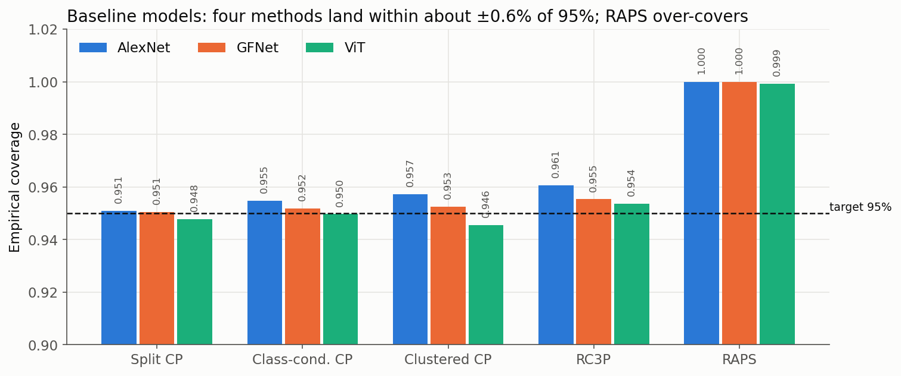
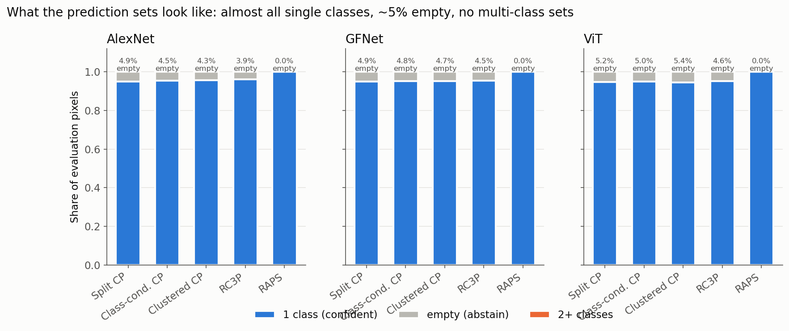
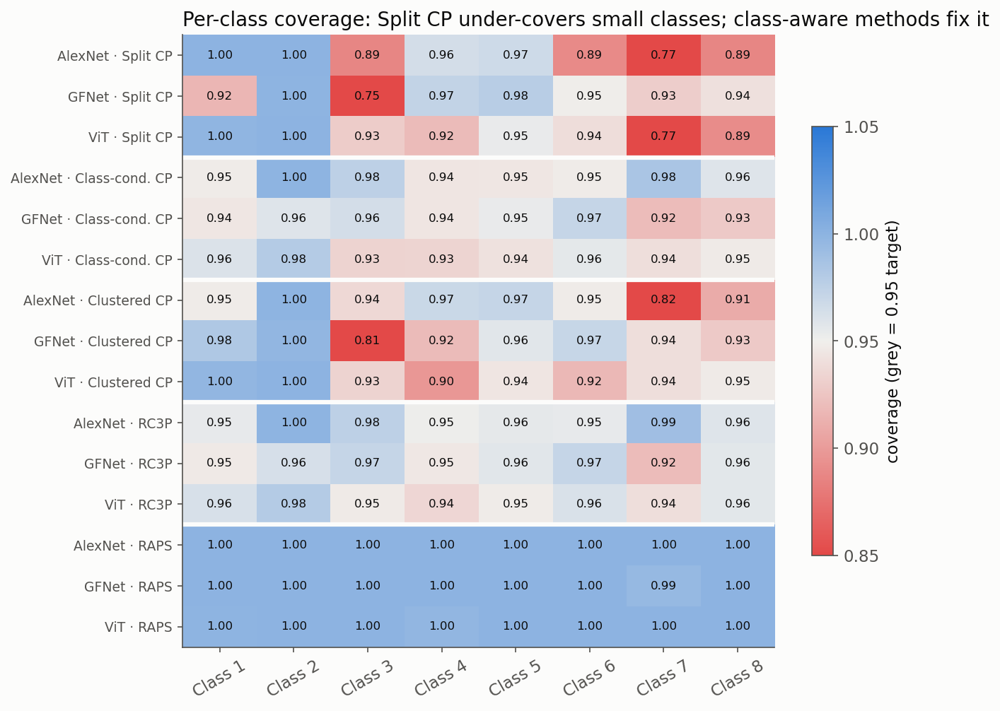
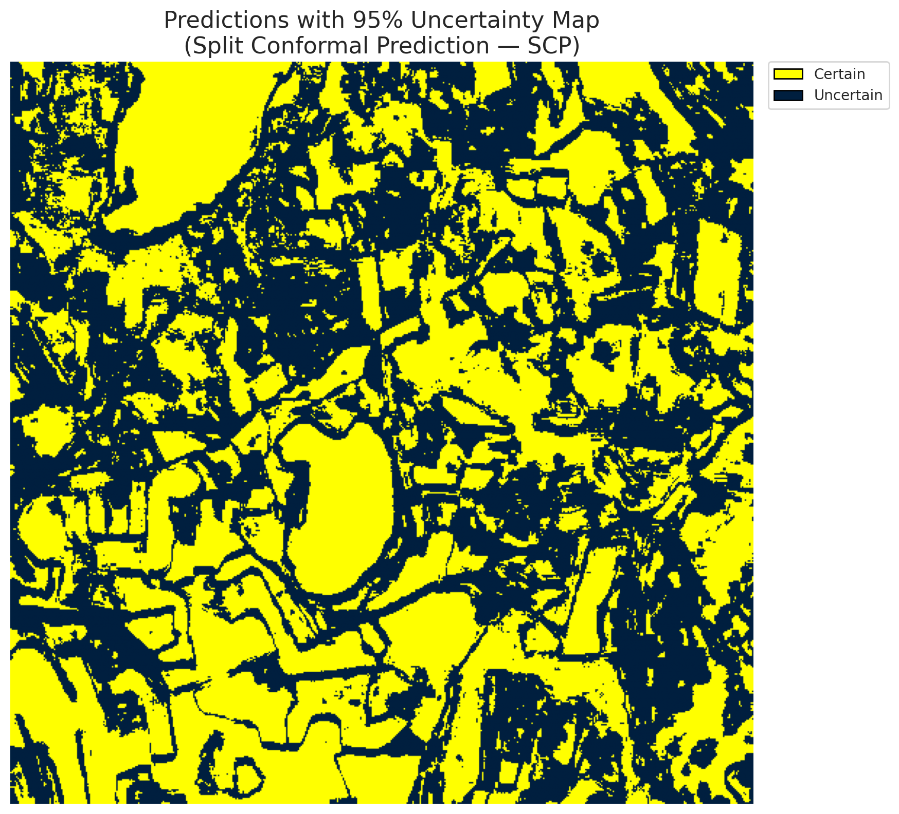
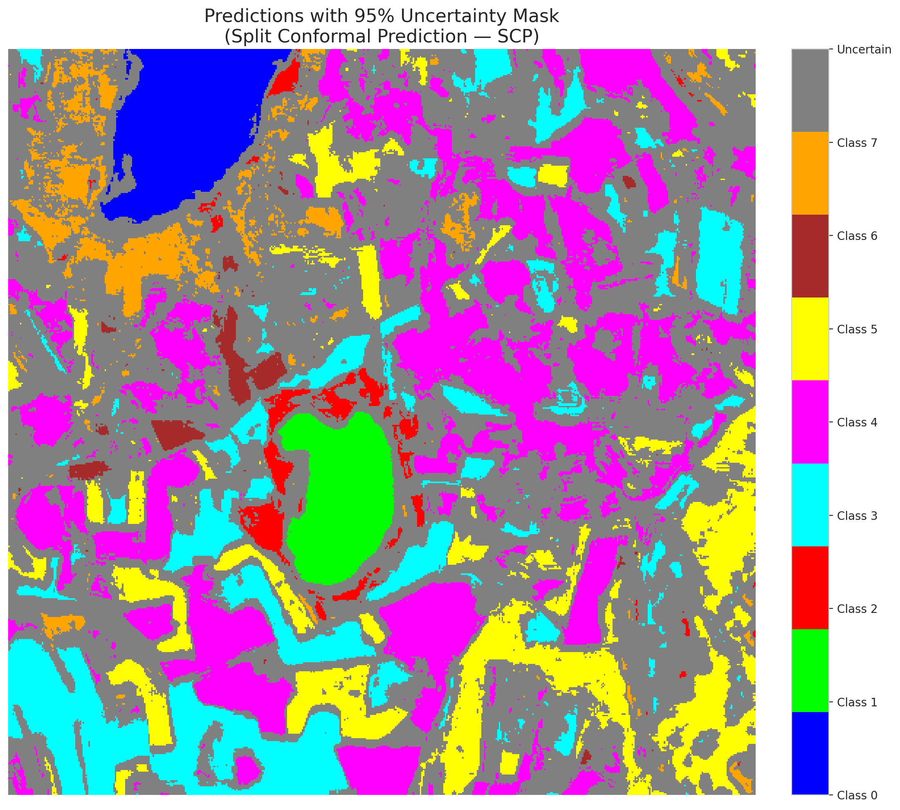

# Baseline: three backbones × five conformal methods

[← back to main README](../README.md)

> **In one sentence:** we train AlexNet-CNN, GFNet and ViT-UNet once, then wrap each in five different
> *conformal prediction* recipes that turn the model's probabilities into a **set of classes** with a
> 95% guarantee of containing the right answer.

| Notebook | What it does |
|---|---|
| [`Model_training.ipynb`](Model_training.ipynb) | Loads DIAS, cuts 9×9 patches, trains the three backbones for 100 epochs, writes classification maps |
| [`Model_uncertainty_comparison.ipynb`](Model_uncertainty_comparison.ipynb) | Loads the trained models and runs Split CP, Class-conditional CP, RC3P, Clustered CP and RAPS (Section 8) |

---

## 1. Why a "set" instead of one answer?

Picture a doctor looking at an X-ray. A cautious doctor doesn't say *"it's definitely A"*. They say
*"it's A or B; let's rule out B"*. That short list is useful **only if the doctor is right about how often
the list contains the truth**. Conformal prediction is a way to make that "how often" exact.

We choose an error budget **α = 0.05**. The method then promises:

$$\Pr\big(\,\text{true class} \in C(x)\,\big) \;\ge\; 1 - \alpha = 95\%$$

*In words: across many pixels, at least 95 out of 100 prediction sets contain the true class.* The only
assumption is that calibration pixels and test pixels are drawn the same way (*exchangeable*). Nothing is
assumed about the model.

## 2. The data the methods see

The 13,474 test pixels from the training split are cut in half (stratified, seed 42):

| Split | Pixels | Role |
|---|--:|---|
| Calibration | 6,737 | Learn the cut-off $\hat q$ |
| Evaluation | 6,737 | Measure coverage and set size |

---

## 3. The five methods, step by step

A **running example** follows each method: a pixel whose model output over 3 classes is

| | Crop A | Crop B | Water |
|---|--:|--:|--:|
| $\hat p_k(x)$ | 0.70 | 0.25 | 0.05 |

### 3.1 Split Conformal Prediction (Split CP): the foundation

**Step 1. Score each calibration pixel.** How surprised was the model by the true answer?

$$s_i = 1 - \hat p_{y_i}(x_i)$$

*If the model gave the true class 0.98, the score is 0.02: not surprised. If it gave 0.10, the score is
0.90: very surprised.*

**Step 2. Find the 95% cut-off.** Sort the $n$ scores and take the one at position
$\lceil (n+1)(1-\alpha) \rceil$:

$$\hat q = \text{Quantile}\!\left(s_1,\dots,s_n;\ \tfrac{\lceil (n+1)(0.95)\rceil}{n}\right)$$

*The "+1" is a small safety margin that makes the guarantee hold exactly for a finite calibration set.
With $n$ = 6,737 we take the 6,402nd smallest score.*

**Step 3. Build the set.** Keep every class the model would be "no more surprised by" than the cut-off:

$$C(x) = \{\,k : 1 - \hat p_k(x) \le \hat q\,\} = \{\,k : \hat p_k(x) \ge 1 - \hat q\,\}$$

> **Worked example.** Suppose calibration gave $\hat q = 0.80$, so a class is kept if $\hat p_k \ge 0.20$.
> Our pixel keeps **{Crop A, Crop B}**, a set of 2: the model is not sure between the two crops. With
> $\hat q = 0.10$ (a sharper model) the rule becomes $\hat p_k \ge 0.90$, and *no* class qualifies, so the
> set is **empty**.

*Code:* `build_split_outputs_for_model` (score `1 - prob_cal[range, y_cal]`, set
`prob_eval >= 1 - q_hat`); `conformal_qhat` applies the $\lceil(n+1)(1-\alpha)\rceil/n$ level with
`method='higher'`.

### 3.2 Class-Conditional CP: a fair cut-off for every class

Split CP's promise is an **average over all pixels**. A big, easy class (water) can over-cover while a
small, hard class (class 7) under-covers, and the average still looks fine. Class-conditional CP repeats
Step 2 **separately for each class** $c$, using only calibration pixels of that class:

$$\hat q_c = \text{Quantile}\!\left(\{\,s_i : y_i = c\,\};\ \tfrac{\lceil (n_c+1)(0.95)\rceil}{n_c}\right), \qquad C(x) = \{\,k : \hat p_k(x) \ge 1 - \hat q_k\,\}$$

*In words: each class gets its own bar to clear, set so that 95% of **that class's** pixels clear it.*

> **Worked example.** Water is easy ($\hat q_{\text{water}} = 0.05$); Crop B is hard ($\hat q_B = 0.80$).
> Crop B is kept if $\hat p_B \ge 0.20$ ✔ (0.25). Water would need $\hat p \ge 0.95$ ✘. The pixel gets
> {Crop A, Crop B} if Crop A also clears its bar.

*Code:* `build_classconditional_outputs_for_model`.

### 3.3 Clustered CP: share cut-offs between similar classes

Per-class cut-offs need enough pixels per class; with few pixels they are noisy. Clustered CP groups
classes that **the model represents similarly** and computes one cut-off per group.

1. Take the network's penultimate-layer features for the calibration pixels.
2. Average them per class → one "fingerprint" vector per class.
3. Cluster the 8 fingerprints with k-means (**k = 4**).
4. Compute $\hat q_g$ from all calibration pixels whose class is in cluster $g$, and give every class in the
   cluster that cut-off.

*In words: a compromise between one cut-off for everyone (Split) and one per class (Class-conditional).*

*Code:* `build_clustered_outputs_for_model` (`KMeans(n_clusters=4, random_state=42)` on class-mean embeddings).

### 3.4 RC3P: rank-calibrated class-conditional CP

RC3P adds a second rule to class-conditional CP: a class can only enter the set if it is **among the
model's top-$k_c$ guesses**, where $k_c$ is learned per class.

1. On calibration data, compute each class's top-$k$ error: how often the true class is *not* in the
   model's top $k$.
2. For each class, pick the smallest $k_c$ whose top-$k$ error is below an adjusted budget
   $\alpha - g/\sqrt{n/C}$ (with $g$ = 0.1).
3. Recalibrate the class cut-offs using only pixels where the true class ranked within $k_c$, and search
   over a mix between $k_c$ and $C$ for the setting with the smallest average set.
4. Final set: $C(x) = \{\,k : \hat p_k(x) \ge 1-\hat q_k \ \text{ and } \ \text{rank}_k(x) \le k_c\,\}$.

*In words: "keep class k only if it clears its probability bar **and** is ranked high enough". The second
condition trims implausible classes and keeps sets small.*

*Code:* `compute_rc3p_qhats_and_sets`, `build_rc3p_outputs_for_model`.

### 3.5 RAPS: regularised adaptive prediction sets

RAPS walks down the classes from most to least likely, adding up probability until it has "enough", with
a penalty for long lists:

$$s(x, y) = \sum_{j \,:\, \text{rank}_j < \text{rank}_y} \hat p_j(x) \;+\; \lambda \cdot \max(\text{rank}_y - k_{\text{reg}},\, 0), \qquad \lambda = 0.01,\ k_{\text{reg}} = 1$$

*In words: "how much probability mass sits **above** the true class, plus a small fine for every place it
is below rank 1".* The set adds classes in rank order while the running total plus penalty stays at or
below $\hat q$, and always contains at least the top class.

> **What happens on these models.** With ≈ 99.9% accuracy the true class is almost always rank 0, so its
> score is exactly **0**, and $\hat q$ = 0. The set then holds only the top class, so **coverage ≈
> accuracy ≈ 100%**, not 95%. This implementation is the *non-randomised* variant and leaves the true class's
> own probability out of the score. The original RAPS (Angelopoulos et al., 2021) adds a random fraction of
> the true class's probability, which would let the threshold land at 95%.

*Code:* `raps_score_single`, `raps_set_single`, `build_raps_outputs_for_model`. RAPS produces no full-scene map.

---

## 4. Results

### 4.1 Coverage and set size

| Model | Method | Coverage | Avg. set size | Singletons | Empty sets | Mean per-class coverage |
|---|---|--:|--:|--:|--:|--:|
| AlexNet | Split CP | 0.9509 | 0.951 | 95.1% | 4.9% | 0.921 |
| AlexNet | Class-cond. CP | 0.9547 | 0.955 | 95.5% | 4.5% | 0.963 |
| AlexNet | Clustered CP | 0.9573 | 0.957 | 95.7% | 4.3% | 0.938 |
| AlexNet | RC3P | 0.9607 | 0.961 | 96.1% | 3.9% | 0.967 |
| AlexNet | RAPS | 1.0000 | 1.000 | 100% | 0.0% | 1.000 |
| GFNet | Split CP | 0.9506 | 0.951 | 95.1% | 4.9% | 0.930 |
| GFNet | Class-cond. CP | 0.9518 | 0.952 | 95.2% | 4.8% | 0.948 |
| GFNet | Clustered CP | 0.9525 | 0.953 | 95.3% | 4.7% | 0.939 |
| GFNet | RC3P | 0.9553 | 0.955 | 95.5% | 4.5% | 0.954 |
| GFNet | RAPS | 0.9999 | 1.000 | 100% | 0.0% | 0.999 |
| ViT | Split CP | 0.9478 | 0.948 | 94.8% | 5.2% | 0.925 |
| ViT | Class-cond. CP | 0.9497 | 0.950 | 95.0% | 5.0% | 0.949 |
| ViT | Clustered CP | 0.9455 | 0.946 | 94.6% | 5.5% | 0.947 |
| ViT | RC3P | 0.9535 | 0.954 | 95.4% | 4.6% | 0.954 |
| ViT | RAPS | 0.9993 | 1.000 | 100% | 0.0% | 1.000 |

*Source: [`results/uncertainty_results/summary_metrics.csv`](results/uncertainty_results/summary_metrics.csv).*

**Reading the table.** Coverage ≈ singleton rate and set size ≈ 0.95 in every row. With a near-perfect
model there are no "2-class" sets: each pixel either gets the one correct class, or (for the ~5% least
confident) an **empty set**. See the [main README, §7.1](../README.md#71-why-near-perfect-models-produce-empty-sets)
for why this is the expected behaviour and what to change to make sets more informative.

### 4.2 Per-class fairness

| Model / method | Worst class coverage |
|---|---|
| AlexNet · Split CP | **0.77** (label 7) |
| GFNet · Split CP | **0.75** (label 3) |
| ViT · Split CP | **0.77** (label 7) |
| AlexNet · RC3P | 0.95 |
| GFNet · Class-cond. CP | 0.92 |

Split CP keeps its 95% promise **on average** while letting small classes (labels 3 and 7, each under 5%
of the pixels) drop to ~75%. Class-conditional CP and RC3P restore 92–99% on every class, which is the
practical reason to prefer them for land-cover maps where small classes matter. *Source:
[`results/uncertainty_results/per_class_coverage.csv`](results/uncertainty_results/per_class_coverage.csv).*

### 4.3 Maps

| Split CP: certain vs uncertain (GFNet) | Split CP: class map with uncertain mask (GFNet) |
|:-:|:-:|
|  |  |

Uncertain (grey) pixels sit on **field boundaries and unlabelled land**, where the 9×9 patch mixes
several surfaces and the model never received a label. Inside labelled parcels the model is confident.
*Maps extracted from
[`results/uncertainty_results/conformal_reports_all_models.xlsx`](results/uncertainty_results/conformal_reports_all_models.xlsx),
which holds every method × model map. Notebook class numbering 0–7 = label 1–8.*

### 4.4 Classification

| Model | Accuracy | κ | Macro-F1 | NLL | Brier | ECE | Train time |
|---|--:|--:|--:|--:|--:|--:|--:|
| GFNet | 99.99% | 0.9999 | 0.9998 | 0.0081 | 0.0002 | 0.0080 | 18.8 min |
| ViT-UNet | 99.93% | 0.9992 | 0.9990 | 0.0417 | 0.0027 | 0.0389 | 36.1 min |
| AlexNet-CNN | 99.93% | 0.9991 | 0.9983 | 0.0026 | 0.0013 | 0.0005 | 18.9 min |

| Training curves (GFNet) | Model comparison |
|:-:|:-:|
|  |  |

---

## 5. Caveats specific to this folder

- **AlexNet's conformal numbers are not hold-out estimates.** AlexNet was trained on the seed-10 split,
  but the conformal notebook draws calibration/evaluation pixels from the seed-42 split; **75.2%** of those
  pixels were in AlexNet's training set.
- **RAPS cannot reach its 95% target here** (see §3.5); its 100% coverage reflects accuracy, not calibration.
- Results inherit the optimistic random pixel split ([main README §8](../README.md#8-limitations-read-this-before-citing-a-number)).

## References

Angelopoulos & Bates (2023), *A Gentle Introduction to Conformal Prediction*; Ding et al. (2023),
*Class-Conditional Conformal Prediction with Many Classes*; Shi et al. (2024), *RC3P*;
Angelopoulos et al. (2021), *RAPS*.
