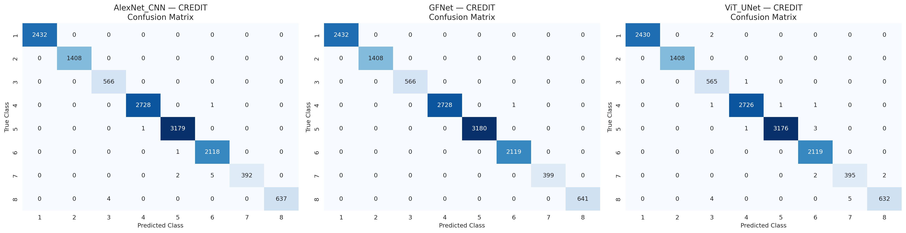

# CREDIT: one network that learns what five networks disagree about

[← back to main README](../README.md) · teacher ensemble: [ensemble/](../ensemble/README.md)

> **In one sentence:** running a 5-model ensemble on every pixel is 5× the cost, so CREDIT trains **one
> "student" network with two heads** to imitate the ensemble's credal intervals: one head for the cautious
> probabilities $`p^*`$, one for the disagreement $`\Delta p`$.

| Notebook | What it does |
|---|---|
| [`Model_training_credit.ipynb`](Model_training_credit.ipynb) | Builds the targets from the 5 ensemble teachers, trains a dual-head student per backbone (100 epochs), evaluates it, and draws AU/EU/TU maps |

---

## 1. The idea

A student watches five teachers answer the same question. For each question the student writes down two
things: *"the most cautious answer they would all accept"* and *"how much they argued"*. Later the student
answers new questions alone, in one pass, and still reports how much the teachers *would have* argued.
That is **knowledge distillation of uncertainty**.

## 2. The maths, step by step

**Step 1. Targets from the teachers** (same formulas as [CreDE](../ensemble/README.md#2-the-maths-step-by-step)),
computed on every training pixel:

```math
p^{*}_k = \frac{\min_m p^{(m)}_k}{\sum_j \min_m p^{(m)}_j}, \qquad \Delta p_k = \max_m p^{(m)}_k - \min_m p^{(m)}_k
```

**Step 2. Student with two heads.** The backbone's penultimate features feed:
- a **softmax** head → $`\hat p^{*}(x)`$ (sums to 1), and
- a **sigmoid** head → $`\widehat{\Delta p}(x)`$ (each value in 0–1).

**Step 3. Loss.**

```math
\mathcal{L} = \underbrace{\mathrm{KL}\big(p^{*} \,\|\, \hat p^{*}\big)}_{\text{match the cautious distribution}} \;+\; \lambda\,\underbrace{\frac{1}{C}\sum_k \big(\Delta p_k - \widehat{\Delta p}_k\big)^2}_{\text{match the disagreement}}, \qquad \lambda = 0.5
```

*In words: copy the shape of the teachers' cautious answer (KL divergence), and copy how wide their
disagreement was (squared error).*

**Step 4. Uncertainty and sets at test time.**

```math
\text{AU} = -\sum_k \hat p^{*}_k \ln \hat p^{*}_k, \qquad \text{EU} = \frac{1}{C}\sum_k \widehat{\Delta p}_k, \qquad \text{TU} = \text{AU} + \text{EU}
```

Bounds: lower $`= \hat p^{*}`$, upper $`= \min(1, \hat p^{*} + \widehat{\Delta p})`$. A class enters the set
if its upper bound reaches the best lower bound (*interval dominance*, as in CreDE).

> **Worked example.** The student outputs $`\hat p^{*}`$ = (0.85, 0.12, 0.03) and $`\widehat{\Delta p}`$ =
> (0.05, 0.10, 0.01). Upper bounds = (0.90, 0.22, 0.04). Best lower bound = 0.85. Only Crop A reaches it →
> set {Crop A}. AU = −(0.85 ln 0.85 + 0.12 ln 0.12 + 0.03 ln 0.03) ≈ 0.50; EU ≈ 0.053; TU ≈ 0.55.

*Code:* `generate_credit_targets` (6.1), `build_credit_student` (6.2), training loop (6.5),
`credal_set_metrics` (5.5), `generate_spatial_credit_maps` (8.2). Optimiser: Adagrad (AlexNet) / Adam
3 × 10⁻⁴ (GFNet, ViT).

---

## 3. Results

| Student | Accuracy | Macro-F1 | NLL | ECE | Mean AU | Mean EU | Credal coverage | Avg. set size |
|---|--:|--:|--:|--:|--:|--:|--:|--:|
| AlexNet-CNN | 99.90% | 0.9977 | 0.0033 | 0.0005 | 0.0037 | 0.00030 | 0.9990 | 1.0000 |
| GFNet | **99.99%** | 0.9999 | 0.0009 | 0.0008 | 0.0060 | 0.000002 | 0.9999 | 1.0000 |
| ViT-UNet | 99.83% | 0.9962 | 0.0387 | 0.0323 | 0.2095 | 0.00021 | 0.9983 | 1.0001 |

*Sources: [`results/credit_evaluation_summary.csv`](results/credit_evaluation_summary.csv),
[`results/credit_credal_coverage_overall.csv`](results/credit_credal_coverage_overall.csv). Metrics on 13,474
labelled test pixels.*

**Per-class credal coverage** ([`results/credit_credal_coverage_classwise.csv`](results/credit_credal_coverage_classwise.csv)):
every class is ≥ 98.2% for AlexNet (lowest: label 7), ≥ 99.96% for GFNet, and ≥ 98.6% for ViT (lowest: label 8).

**Reading it.**
- The student keeps the ensemble's accuracy in **one forward pass**.
- On labelled test pixels the learned disagreement is tiny (EU ≈ 10⁻⁴). The teachers agreed on those pixels,
  so there was little disagreement to learn. Compare CreDE's scene-wide EU of 0.05–0.10 in the
  [figure](../docs/figures/uncertainty/credal_au_eu.png): most disagreement lives on unlabelled land.
- Credal sets are effectively single classes (size 1.0000–1.0001), so coverage equals accuracy.

### Maps

| AlexNet-CNN | GFNet | ViT-UNet |
|:-:|:-:|:-:|
|  |  |  |

The `*_uncertain_pixels.csv` files list every pixel flagged under AU > 0.5, EU > 0.2 or TU > 0.7 with its
row, column, predicted and reference class.

<p align="center"></p>

---

## 4. Caveats

- **Checkpoint chosen on the test set.** `ModelCheckpoint` monitors `val_loss` on `test_ds`, so the
  reported test metrics are slightly optimistic.
- **Coverage is measured, not calibrated.** No conformal step guarantees a target level.
- The student can only learn disagreement that the teachers showed on *training* pixels. Off-distribution
  disagreement (unlabelled land) is extrapolated.
- AlexNet uses the seed-10 legacy split, consistent with its teachers.

## References

Hinton et al. (2015), *Distilling the Knowledge in a Neural Network*; Lakshminarayanan et al. (2017),
*Deep Ensembles*; Hüllermeier & Waegeman (2021), *Aleatoric and Epistemic Uncertainty in ML*.
