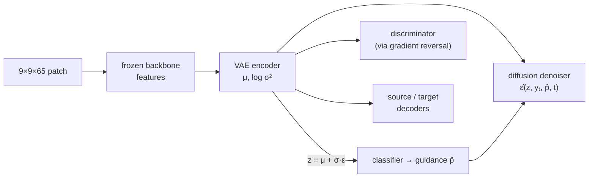
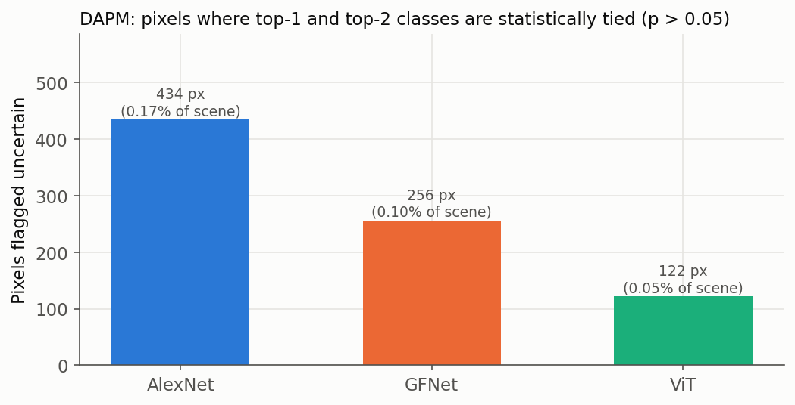
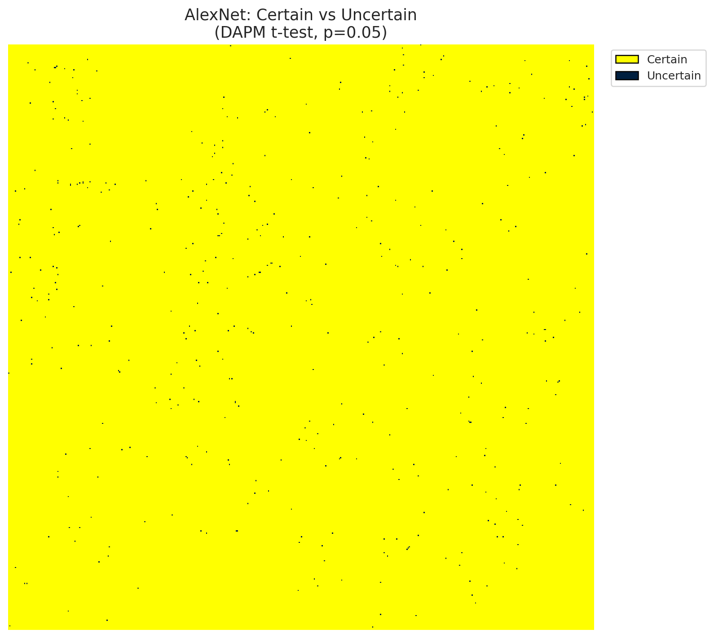
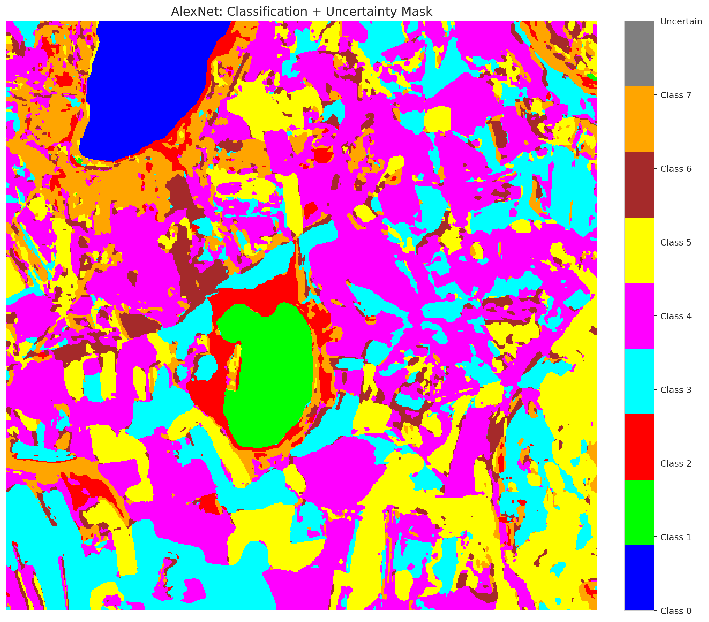
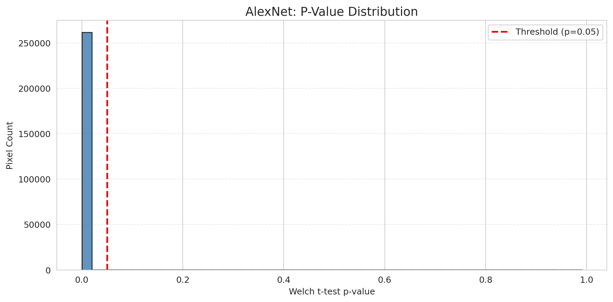

# DAPM: Diffusion-Augmented Probabilistic Model

[← back to main README](../README.md)

> **In one sentence:** DAPM learns a compact latent description of each pixel that looks the same for
> labelled and unlabelled land, then lets a **diffusion model re-imagine the class label 30 times**. If the
> top two classes are statistically tied across those 30 draws, the pixel is flagged uncertain.

| Notebook | What it does |
|---|---|
| [`Model_training_dapm_full.ipynb`](Model_training_dapm_full.ipynb) | Stage 1: VAE + classifier + domain-adversarial alignment. Stage 2: conditional diffusion over labels. One bundle per backbone |
| [`Model_uncertainty_dapm_full.ipynb`](Model_uncertainty_dapm_full.ipynb) | 30 diffusion samples per pixel over the **whole scene** → Welch t-test → certain/uncertain maps |
| [`Model_uncertainty_dapm_cp.ipynb`](Model_uncertainty_dapm_cp.ipynb) | The same five conformal methods as [baseline/](../baseline/README.md), run on DAPM's latent classifier |

---

## 1. The idea

Labelled pixels cover only 20.6% of the scene, and a model trained on them may behave strangely on the
rest. DAPM treats **labelled pixels as the "source" domain** and **unlabelled pixels as the "target"
domain** (up to 20,000 sampled) and does three things:

1. **Compress** each pixel's backbone features into a 64-number latent code with a *variational
   autoencoder* (VAE). The code is fuzzy: a mean plus a spread.
2. **Align** the two domains. A small *discriminator* tries to tell source codes from target codes, and
   the encoder is trained to fool it (through a *gradient-reversal layer*). The codes end up describing
   land cover, not "was this pixel labelled?".
3. **Re-imagine the label.** A *diffusion model* learns to turn random noise into a class-probability
   vector, guided by the latent code. Running it many times gives a *distribution* of answers per pixel,
   and its spread is the uncertainty.

## 2. The maths, step by step



**Stage 1: VAE + domain alignment** (20 epochs, lr 10⁻³, backbone frozen):

```math
\mathcal{L}_1 = \underbrace{\lambda_{rec}\,(\mathcal{L}^{src}_{rec} + \mathcal{L}^{tgt}_{rec})}_{\text{rebuild the features}} + \underbrace{\lambda_{KL}\,\mathrm{KL}\big(q(z|x)\,\|\,\mathcal{N}(0,I)\big)}_{\text{keep codes tidy}} + \underbrace{\lambda_{CE}\,\mathrm{CE}(y, \hat p(z))}_{\text{classify source}} + \underbrace{\lambda_{dom}\,\mathcal{L}_{domain}}_{\text{fool the discriminator}}
```

with $`\lambda_{rec}=1,\ \lambda_{KL}=0.01,\ \lambda_{CE}=1,\ \lambda_{dom}=0.2`$.

*The gradient-reversal layer flips the sign of the discriminator's gradient on its way into the encoder,
so one optimiser step makes the discriminator better and the encoder harder to discriminate.*

**Stage 2: label diffusion** (20 epochs, T = 100 steps, linear $`\beta_t`$ from 10⁻⁴ to 0.02).
Take the one-hot label $`y_0`$ and add noise, $`y_t = \sqrt{\bar\alpha_t}\,y_0 + \sqrt{1-\bar\alpha_t}\,\varepsilon`$.
The denoiser learns to recover the noise:

```math
\mathcal{L}_2 = \big\|\varepsilon - \hat\varepsilon(z, y_t, \hat p, t)\big\|^2_{\text{source}} \;+\; 0.5\,\big\|\varepsilon - \hat\varepsilon\big\|^2_{\text{target, pseudo-label } y_0=\hat p}
```

*In words: "given this pixel's code and the classifier's hint, and a noisy label, guess the noise". On
target pixels the classifier's own soft prediction stands in for the missing label.*

**Inference: 30 samples, one test.** For each pixel:
1. Draw 30 codes $`z^{(s)} = \mu + \sigma\,\varepsilon^{(s)}`$.
2. Start each from pure noise $`y_T`$ and run the reverse diffusion for 100 steps → softmax →
   $`p^{(s)}`$, $`s = 1..30`$.
3. Let $`c_1, c_2`$ be the two classes with the highest *mean* probability. Run **Welch's t-test** on the 30
   values of $`p^{(s)}_{c_1}`$ against the 30 values of $`p^{(s)}_{c_2}`$.
4. **Uncertain** if $`p\text{-value} > 0.05`$, i.e. we cannot be 95% sure the top class really beats the
   runner-up.

> **Worked example.** Over 30 draws, crop A averages 0.48 (sd 0.15) and crop B 0.42 (sd 0.15). Welch's
> t ≈ 1.55, p ≈ 0.13 > 0.05 → **uncertain**. If crop A averaged 0.70 (sd 0.05) vs 0.20 (sd 0.05):
> t ≈ 38.7, p ≈ 10⁻⁴⁰ → certain.

*Code:* `GradientReversal`, `build_dapm_*` (training, 5.1–5.2); `reverse_diffusion`, `sample_dapm_chunk`,
`compute_dapm_ttest_uncertainty_chunk` (uncertainty, 7.1). Full-scene inference runs in 1,000-pixel chunks
cached as `results/dapm_full/chunk_outputs/*.npz`.

---

## 3. Results

### 3.1 Welch t-test uncertainty (whole scene, 262,144 pixels)

| Backbone | Accuracy (labelled pixels) | Uncertain pixels | % of scene | Mean top-1 − top-2 gap | Runtime |
|---|--:|--:|--:|--:|--:|
| AlexNet-CNN | 99.97% | **434** | 0.17% | 0.161 | 8.1 min |
| GFNet | 99.998% | **256** | 0.10% | 0.165 | 8.6 min |
| ViT-UNet | 99.96% | **122** | 0.05% | 0.171 | 9.0 min |

*Source: [`results/dapm_full_summary_metrics.csv`](results/dapm_full_summary_metrics.csv). Accuracy here is
over **all** labelled pixels, including those used in training.*

<p align="center"></p>

| Certain vs uncertain (AlexNet) | Class map + uncertain mask (AlexNet) | p-value distribution |
|:-:|:-:|:-:|
|  |  |  |

**Reading it.** DAPM is the most *decisive* method in the project: fewer than 1 pixel in 500 is flagged, and
the median p-value is 0. The mean probability gap between the top two classes is only ~0.16 because
diffusion samples are soft. But with 30 samples even a small, consistent gap is statistically clear.

**Where the flagged pixels are matters more than how many there are.** In the map below they are
*scattered single pixels spread evenly across the scene*. They don't follow parcel boundaries, the
unlabelled land or any one class. That pattern is what random sampling noise looks like, not real
ambiguity. So on this data DAPM's t-test mostly reports **"certain everywhere"**, and the handful of
flags should not be read as meaningful doubt. Compare the conformal maps in
[baseline/](../baseline/README.md#43-maps), where uncertainty clearly follows field edges.

### 3.2 Conformal prediction on DAPM probabilities

| Backbone | Split CP | Class-cond. CP | Clustered CP | RC3P | RAPS |
|---|--:|--:|--:|--:|--:|
| AlexNet | 0.9509 | 0.9506 | 0.9507 | 0.9540 | 0.9993 |
| GFNet | 0.9473 | 0.9519 | 0.9482 | 0.9567 | 1.0000 |
| ViT | 0.9516 | 0.9595 | 0.9558 | 0.9619 | 0.9996 |

*Empirical coverage at a 95% target. Source:
[`results/conformal_uncertainty_results/dapm_conformal_summary_metrics.csv`](results/conformal_uncertainty_results/dapm_conformal_summary_metrics.csv).
Clustered CP uses DAPM's latent mean $`\mu`$ as the embedding.*

The pattern matches the [baseline](../baseline/README.md#41-coverage-and-set-size): all methods except RAPS
sit near 95%, with ~4–5% empty sets and no multi-class sets. Split CP's mean per-class coverage drops to
0.86–0.91, so class-aware methods matter again.

---

## 4. Caveats

- The t-test assumes the 30 samples are independent draws. They share the pixel's latent mean, so the
  p-values are best read as a *ranking* of doubt, not exact probabilities.
- The 0.05 threshold is not calibrated; unlike conformal prediction, there is no coverage guarantee.
- "Target domain" = unlabelled pixels of the **same scene**, not a different sensor or date, so this is
  domain alignment in a mild sense.
- Inherits the random-split optimism and, for AlexNet's CP results, the seed-10/seed-42 overlap
  ([main README §8](../README.md#8-limitations-read-this-before-citing-a-number)).

## References

Kingma & Welling (2014), *Auto-Encoding Variational Bayes*; Ganin et al. (2016), *Domain-Adversarial
Training of Neural Networks*; Ho et al. (2020), *DDPM*; Han et al. (2022), *CARD: Classification and
Regression Diffusion Models*; Welch (1947).
