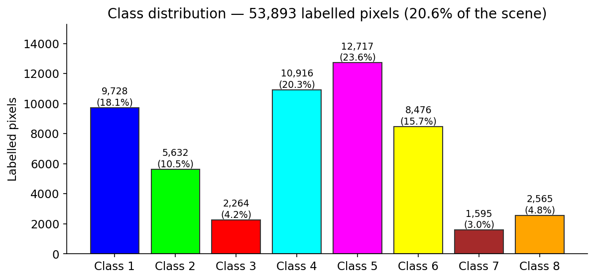
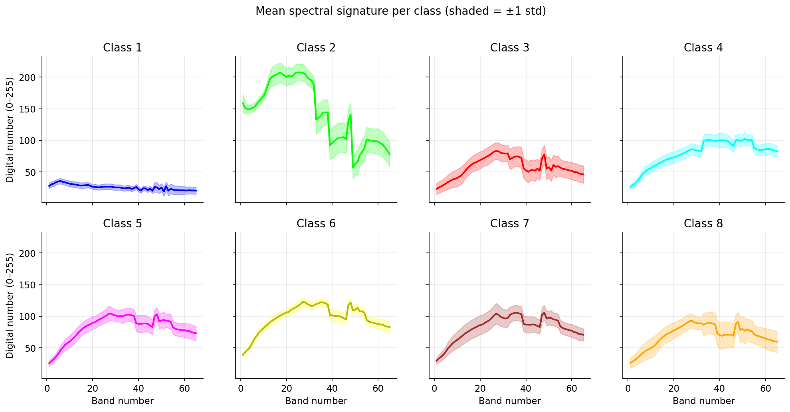
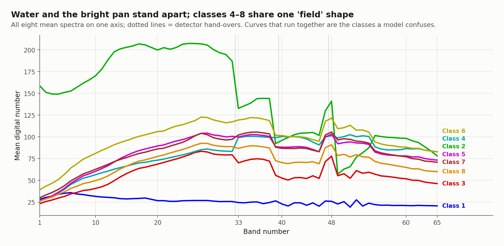
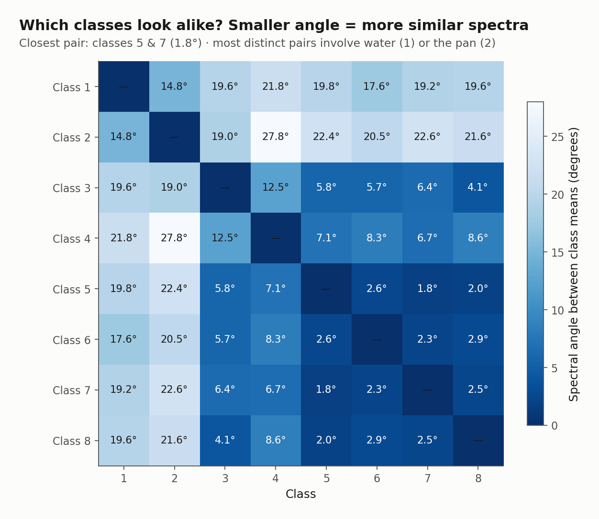
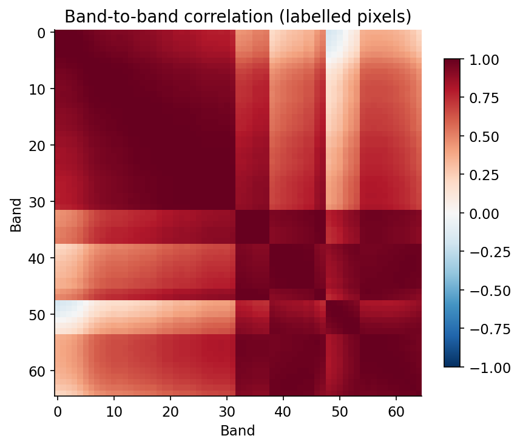
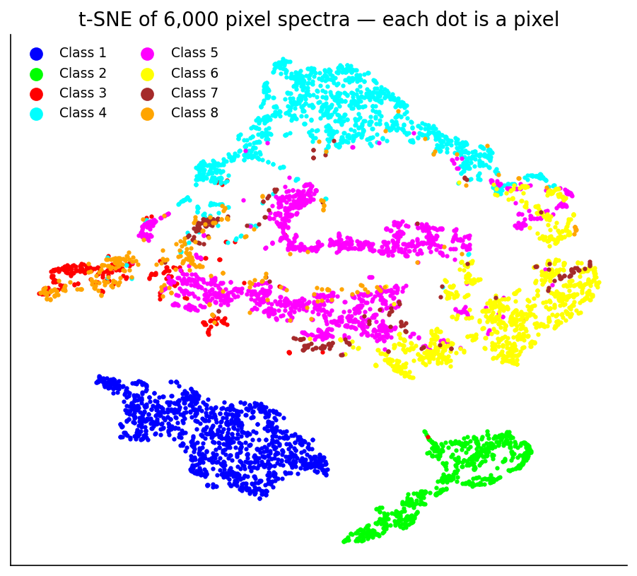
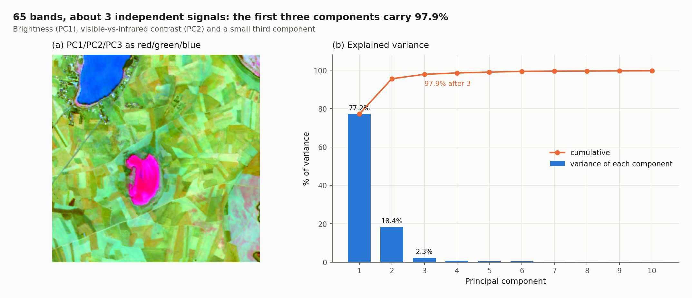
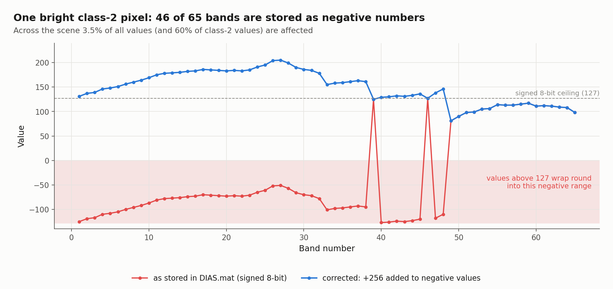
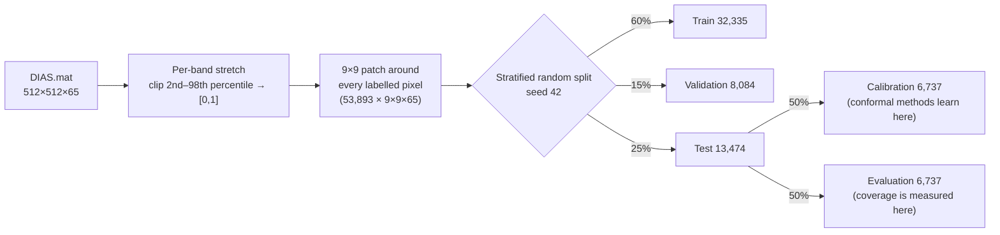
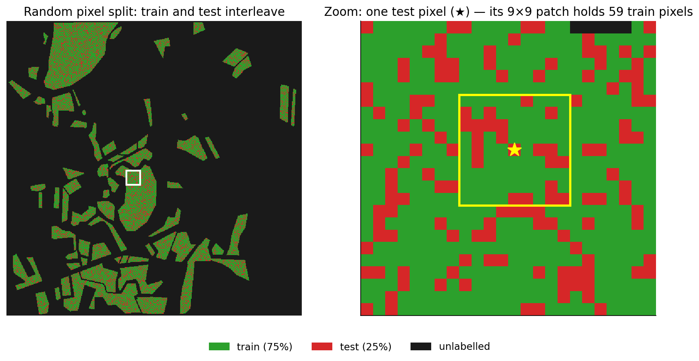

# Data and experimental set-up

*Full report, chapter 1 of 6 (§2–§4).* [Overview](../README.md) · [Report contents](README.md)

---

## 2. Why uncertainty matters for land-cover maps

Land-cover maps feed crop-area statistics, water-resource planning and environmental monitoring. A
classifier always produces an answer for every pixel, including pixels it has never seen anything like,
pixels that straddle two fields, and surfaces that were never labelled. A map without uncertainty
treats all of these the same as a pixel in the middle of a well-known field.

Uncertainty quantification adds a second layer to the map: **"how much should I trust this pixel?"**
A useful answer must be:

| Property | Meaning | Who provides it here |
|---|---|---|
| **Valid** | When the method says "95%", it is right 95% of the time | Conformal prediction (§7.1) |
| **Fair** | The promise holds for every class, not only on average | Class-conditional CP, RC3P |
| **Informative** | It singles out the pixels that are actually wrong or ambiguous | Depends on model accuracy (§8.2) |
| **Interpretable** | It separates "the pixel is ambiguous" from "the model hasn't learned this" | Credal ensembles, CREDIT (§8.7) |
| **Spatially coherent** | Uncertainty forms regions (field edges) rather than random speckle | SACP / SCMCP (§8.6) |

This repository tests which methods deliver which properties on one hyperspectral scene.

---

## 3. The data

### 3.1 What the files contain

| Property | Value | Status |
|---|---|---|
| Files | `DIAS.mat` (image cube), `DIAS_ref.mat` (reference labels), MATLAB v5, created 9 March 2017 | confirmed (file headers) |
| Size | **512 × 512 pixels × 65 spectral bands** | confirmed |
| Labelled pixels | **53,893** (20.6% of the scene); 208,251 unlabelled (label 0) | confirmed |
| Classes | **8** (labels 1–8) | confirmed |
| Stored values | integers −128 … 127 (signed 8-bit) | confirmed |
| True radiometric range | **0 … 241** (unsigned 8-bit, see §3.5) | confirmed by analysis |
| Sensor | Consistent with the DLR **DAIS 7915** *Digital Airborne Imaging Spectrometer* | **inferred** |
| Location, date, class names | Not recorded in the files or in any public source we found | **unknown** |

**Provenance.** "DIAS" most likely refers to the **DAIS 7915** airborne imaging spectrometer; the
Hugging Face dataset card also expands the name as *Digital Airborne Imaging Spectrometer*. The spectra
support this. Every class shows a sharp step at the same band positions (32|33, 39|40 and 47|48), which
is the signature of an instrument handing over from one detector module to the next. DAIS 7915's
first module has exactly 32 visible/near-infrared bands. Treat this as strong circumstantial evidence,
not a citation.

### 3.2 The scene and its classes

The scene (**Figure 1**, top of page) contains a large dark lake in the north, a very bright white pan
in the centre and a patchwork of agricultural parcels. The reference labels cover parcels scattered
across the scene; everything else (black in Figure 1b) has no label.

| Label | Pixels | Share | What the spectrum and map suggest *(our interpretation, not shipped with the data)* |
|:-:|--:|--:|---|
| 1 | 9,728 | 18.1% | Uniformly dark in every band, forms the large lake: **open water** |
| 2 | 5,632 | 10.5% | By far the brightest surface, the central white pan: **salt crust / dry lake bed** |
| 3 | 2,264 | 4.2% | Ring around the pan; bright early bands, darker later ones: **moist margin / wet soil** |
| 4 | 10,916 | 20.3% | Agricultural parcels, rising spectrum with a plateau after band 33 |
| 5 | 12,717 | 23.6% | Agricultural parcels, similar to class 4, different shape after band 40 |
| 6 | 8,476 | 15.7% | Agricultural parcels, brightest of the crop-like classes |
| 7 | 1,595 | 3.0% | Small parcels, spectrally almost identical to class 5: **the hardest class** |
| 8 | 2,565 | 4.8% | Near the settlement in the north-west: possibly built-up / mixed land |

*__Figure 2.__ Labelled pixels per class.*

**Reading Figure 2.** The classes are imbalanced: class 5 has eight times as many pixels as class 7.
This matters for uncertainty. Any method that promises 95% coverage *on average over pixels* can meet
that promise while serving the two rare classes (3 and 7) badly. We return to this in §8.3.

> ⚠️ **Class numbering in notebook figures.** The reference file uses labels **1–8**. The notebooks
> subtract 1, so the maps and tables they produced say **"Class 0 … Class 7"**. *Class k* in a notebook
> figure = *label k + 1* here. All figures made for this documentation use 1–8.

### 3.3 Spectral behaviour: which classes look alike?

*__Figure 3.__ Mean spectrum per class (line) with ±1 standard deviation (band), corrected values.*

*__Figure 4.__ All eight mean spectra on one axis.*

**Reading Figures 3–4.** Water (1) is dark and flat; the pan (2) is bright everywhere. Both are
unmistakable. Classes 3–8 all share one "vegetated or bare field" shape: a rise through the first 27
bands, a plateau, and the same steps at the detector hand-overs. They differ mainly in overall brightness
and in small details after band 40.

*__Figure 5.__ Spectral angle between class-mean spectra. 0° means identical shape.*

**Reading Figure 5.** The spectral angle compares the *shape* of two spectra and ignores brightness.
The dark block in the lower right shows that classes 5, 6, 7 and 8 are within **1.8–2.9°** of each
other. Class 7 is closest to class 5 (1.8°), which is why it is the class most often mishandled by the
uncertainty methods (§8.3). Water and the pan are 15–28° from everything else.

### 3.4 How much independent information do 65 bands carry?

| | |
|:-:|:-:|
|  |  |
| *__Figure 6a.__ Band-to-band correlation* | *__Figure 6b.__ t-SNE of 6,000 pixel spectra* |

*__Figure 7.__ Principal-component analysis of all 262,144 pixels.*

**Reading Figures 6–7.** Neighbouring bands are almost perfectly correlated within each detector block
(Figure 6a). The first three principal components carry **77.2%, 18.4% and 2.3%** of the variance,
97.9% together (Figure 7). In the t-SNE map (Figure 6b), each dot is one pixel placed according to its
spectrum alone. Water and the pan form isolated islands; classes 3–8 form one tangled cloud.

**Why it matters.** A model that looks only at a pixel's spectrum will confuse classes 3–8. The
**9 × 9 spatial patch** used by every model is what separates them, and that is the reason the
train/test split (§4.3) matters so much.

### 3.5 A data-quality finding: stored values wrap round

*__Figure 8.__ One bright class-2 pixel as stored (red) and corrected (blue).*

The sensor recorded unsigned 8-bit values (0–255), but `DIAS.mat` stores them as *signed* 8-bit
integers. Any value above 127 wraps round to a negative number; for example, a reflectance of 169 is
stored as −87. This affects **3.5% of all values** and **60% of class-2 values**. Adding 256 to the
negatives restores smooth spectra: band-to-band jumps larger than 150 fall from 1.07% to 0%. Figures 3–7
use the corrected values.

**The models were trained on the stored, wrapped values.** They still separate the classes, because
wrapping is a consistent and therefore learnable distortion. But for bright pixels the physical meaning
of the input is scrambled, which matters for any model that assumes smooth spectra (e.g. DOFA's
wavelength conditioning, [dofa/](../dofa/README.md)).

---

## 4. Experimental set-up

### 4.1 Pipeline

1. **Normalise.** Each band is clipped to its 2nd–98th percentile and scaled to [0, 1].
2. **Patch.** The image is edge-padded by 4 pixels, and a 9 × 9 × 65 cube is cut around every labelled
   pixel. The label of the centre pixel is the target.
3. **Split.** Stratified random 75/25 train/test (seed 42), with 20% of train held out for validation.
   For uncertainty methods, the test pool is split 50/50 again into a **calibration** half (where the
   method learns its thresholds) and an **evaluation** half (where we check whether its promises hold).
4. **Full-scene maps.** For maps, every one of the 262,144 pixels gets a patch and a prediction,
   labelled or not.

AlexNet is the exception: it was trained on its original "legacy" split (seed 10, 40,419 train /
13,474 test, no validation set). §10 explains why that matters.

### 4.2 Training recipe

| Setting | Value |
|---|---|
| Optimiser | AdamW-style, learning rate 3 × 10⁻⁴, cosine decay (α = 0.05) |
| Regularisation | label smoothing 0.05, weight decay 10⁻⁴, dropout 0.25, gradient clip 1.0 |
| Batch / epochs | 128 / **100** |
| Hardware | Kaggle GPU (T4 / P100) |
| Seeds | 42 (data split and training); AlexNet legacy split 10; ensemble members 43–47 |

### 4.3 How pixels are split, and why it matters

*__Figure 9.__ The notebooks' random pixel split, reproduced exactly.*

**Reading Figure 9.** Train (green) and test (red) pixels are drawn at random from the **same parcels**
(9a). Zooming in (9b) shows that a test pixel's 9 × 9 input patch is mostly made of training pixels.
Panel 9c counts this for every test pixel: **all 13,474 test patches contain training pixels, 50.6 of 81
on average** (median 54).

**Why it matters.** The model is largely being asked about locations whose surroundings it was trained
on. Accuracy is therefore optimistic, and the uncertainty methods are evaluated on an easy problem. This
is the most important caveat in this study (§10).

### 4.4 Evaluation metrics (a glossary)

| Metric | Plain meaning | Good value |
|---|---|---|
| **Accuracy** | Share of test pixels classified correctly | high |
| **Cohen's κ** | Accuracy corrected for agreement expected by chance | high (max 1) |
| **Macro-F1** | Average of per-class F1 scores, so small classes count equally | high |
| **NLL** (negative log-likelihood) | Penalises confident wrong answers heavily | low |
| **Brier score** | Mean squared error of the predicted probabilities | low |
| **ECE** (expected calibration error) | Gap between stated confidence and actual accuracy, over 15 confidence bins | low |
| **Coverage** | Share of evaluation pixels whose prediction set contains the true class | ≈ target (95%) |
| **Average set size** | Mean number of classes per set | small, given coverage |
| **Singleton / empty rate** | Share of sets with exactly one / zero classes | — (see §8.2) |
| **Per-class coverage** | Coverage measured inside each class separately | ≈ 95% for *every* class |
| **AU / EU / TU** | Aleatoric / epistemic / total uncertainty (credal methods) | — (relative) |

---

[← Overview](../README.md) · [Report contents](README.md) · [Models and classification results →](02_models_and_classification.md)
