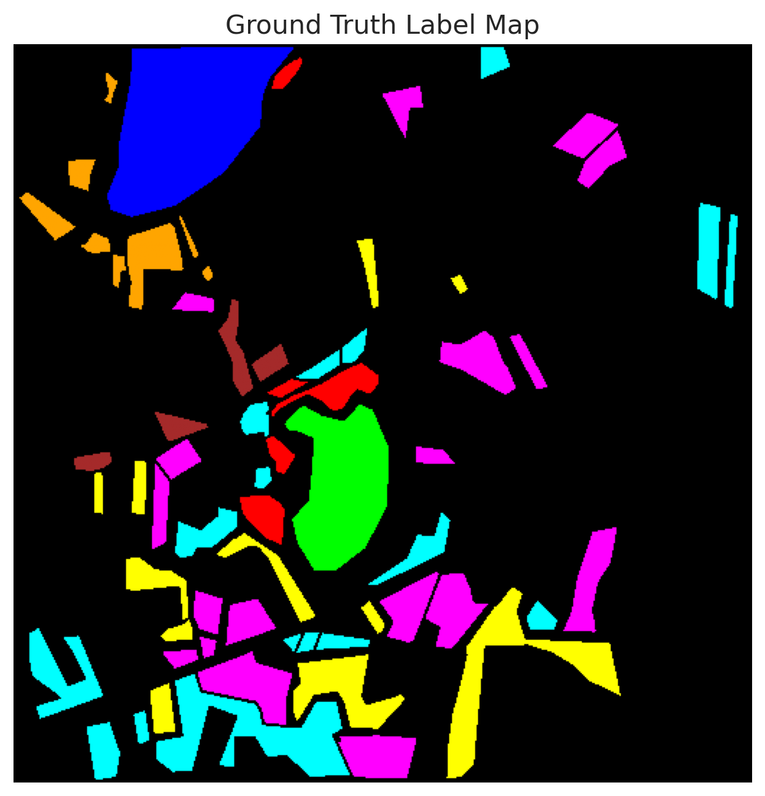
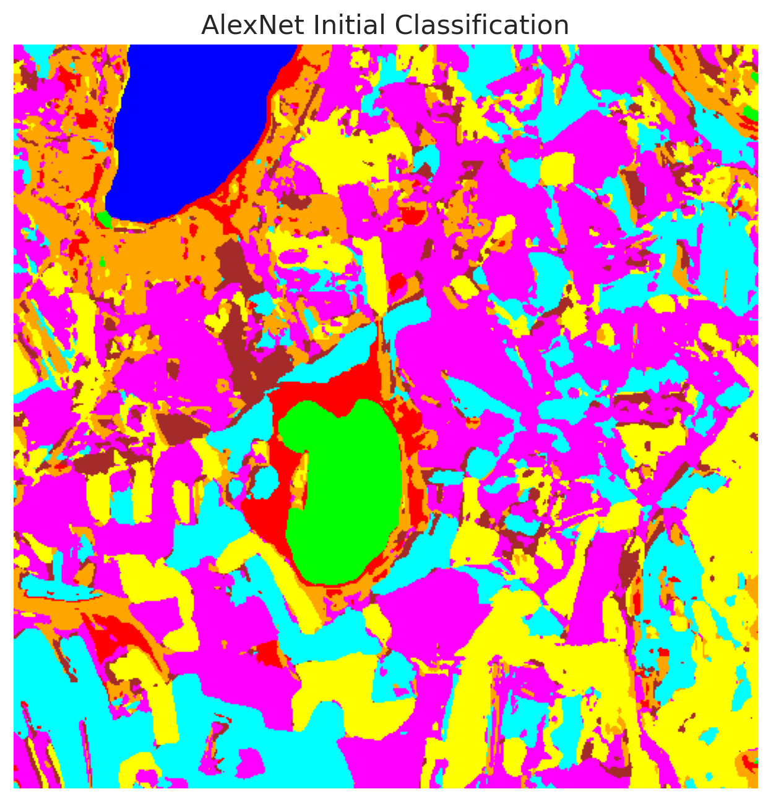
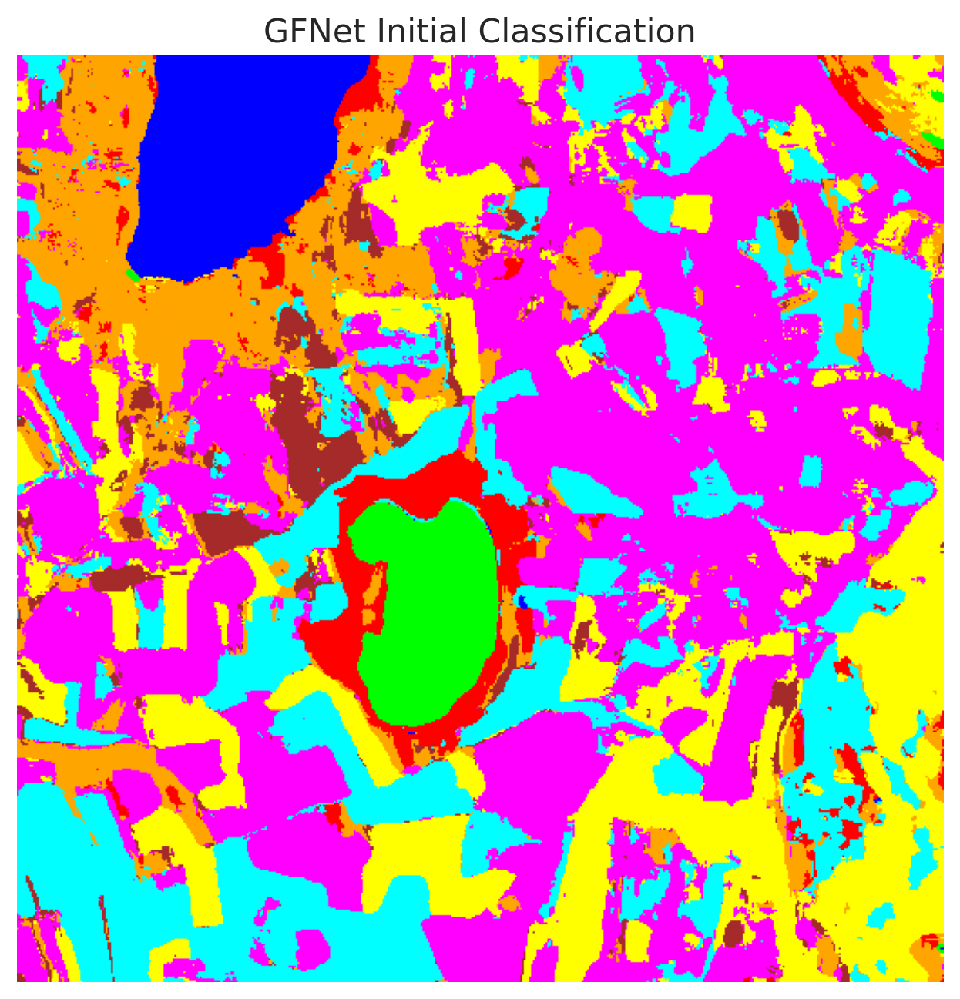
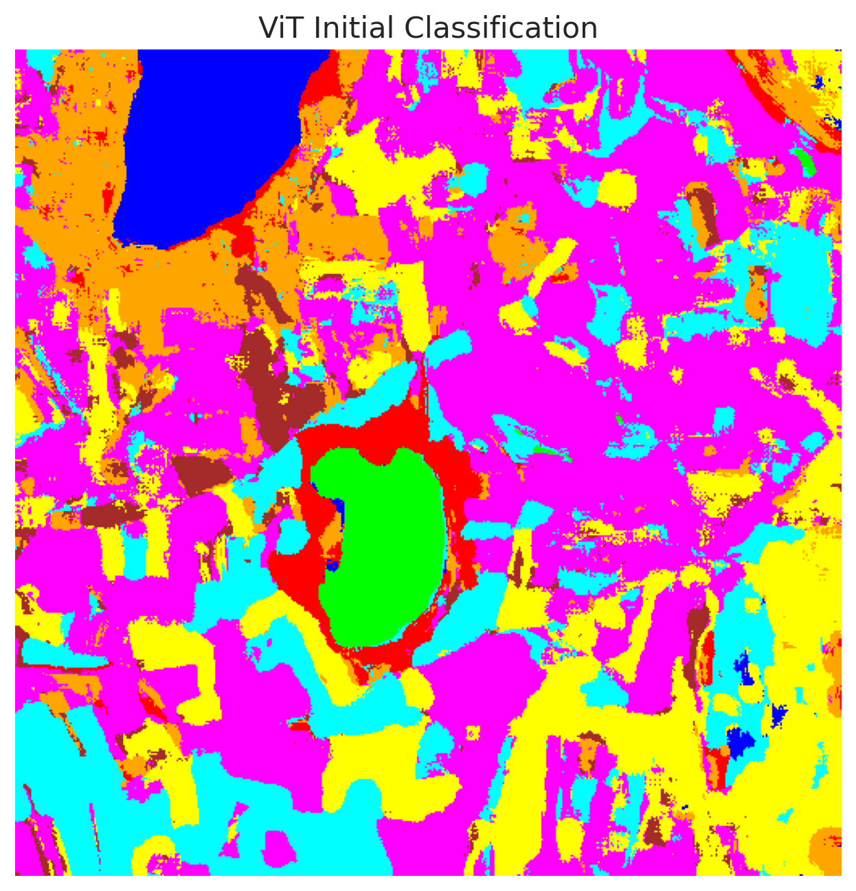

# Models and classification results

*Full report, chapter 2 of 6 (§5–§6).* [Overview](../README.md) · [Report contents](README.md)

---

## 5. Model architectures

Architecture is not the focus of this project, but every uncertainty method sits on top of one. Three
**baseline backbones** are used by every UQ method; eight **extended backbones** test whether the
conclusions survive a change of architecture.

### 5.1 Baseline backbones

| Model | Idea in one line | Key configuration |
|---|---|---|
| **AlexNet-CNN** | Stacked small convolutions learn local spatial-spectral texture | conv filters 96/256/384/384/256; dense 4096/1024/256/32 |
| **GFNet** | Replaces attention with a learnable filter in the Fourier domain, mixing all tokens cheaply | hidden 512, 5 blocks, MLP ratio 4, 3×3 inner patch |
| **ViT-UNet** | Vision Transformer whose layers are linked like a U-Net (layer *i* ↔ layer *L−i*) | dim 256, 12 layers, 4 heads |

### 5.2 Extended backbones (same five conformal methods)

| Folder | Models | Idea in one line |
|---|---|---|
| [`dofa/`](../dofa/README.md) | DOFA-Spectral, Hiera-ViT, DOFA+Hiera Fusion | A hypernetwork turns each band's wavelength into filter weights (DOFA); a hierarchical ViT (Hiera) adds multi-scale spatial context |
| [`georsclip/`](../georsclip/README.md) | GeoRSCLIP-TextHead | CLIP-style: image features are matched by cosine similarity to text embeddings of one prompt per class |
| [`mambahsi/`](../mambahsi/README.md) | MambaHSI Small / Base / Large | A selective state-space model scans the patch as a token sequence |
| [`spatialgcn/`](../spatialgcn/README.md) | SpatialGCN | Each patch is a graph of 81 pixel-nodes with 4-neighbour edges; graph convolutions pass messages |

The ensemble, multi-head and DAPM methods add their own structure on top of the baselines; their folders
describe it.

---

## 6. Classification results

| Model | Test accuracy | Cohen's κ | Macro-F1 | NLL | Brier | ECE (15 bins) |
|---|--:|--:|--:|--:|--:|--:|
| AlexNet-CNN | 99.93% | 0.9991 | 0.9983 | 0.0026 | 0.0013 | 0.0005 |
| GFNet | **99.99%** | 0.9999 | 0.9998 | 0.0081 | 0.0002 | 0.0080 |
| ViT-UNet | 99.93% | 0.9992 | 0.9990 | 0.0417 | 0.0027 | 0.0389 |
| Hiera-ViT | 100.00% | 1.0000 | 1.0000 | 0.0398 | — | 0.0390 |
| DOFA+Hiera Fusion | 99.98% | 0.9997 | 0.9996 | 0.0305 | — | 0.0294 |
| **DOFA-Spectral** | **83.91%** | 0.8038 | 0.6780 | 0.4657 | — | 0.0475 |
| GeoRSCLIP-TextHead | 100.00% | 1.0000 | 1.0000 | 0.0396 | — | 0.0388 |
| MambaHSI-Small | 99.98% | 0.9997 | 0.9998 | 0.0106 | — | 0.0102 |
| MambaHSI-Base | 99.99% | 0.9999 | 0.9999 | 0.0194 | — | 0.0192 |
| MambaHSI-Large | 99.99% | 0.9999 | 1.0000 | 0.0209 | — | 0.0206 |
| **SpatialGCN** | **97.05%** | 0.9644 | 0.9442 | 0.1132 | — | 0.0422 |

*__Table 1.__ Test-set classification metrics. Sources: `*/results/classification_summary.csv`. "—" =
not reported by that notebook.*

**What Table 1 shows.**
- **Nine of eleven models are effectively perfect** (≥ 99.93%). This level of accuracy is partly the
  random split (§4.3), not only model quality.
- **Two models make real mistakes**, and they are the most instructive for uncertainty. DOFA-Spectral
  (83.9%) throws away the spatial layout of the patch (§3.4), and SpatialGCN reaches 97.1%.
- **Calibration differs even among near-perfect models.** AlexNet's ECE (0.0005) is 80× lower than
  ViT-UNet's (0.0389). ViT-UNet's probabilities are less peaked than its accuracy justifies; label
  smoothing caps how confident it can be. This shows up again in the credal results (§8.7).

| Ground truth | AlexNet-CNN | GFNet | ViT-UNet |
|:-:|:-:|:-:|:-:|
|  |  |  |  |

*__Figure 10.__ Full-scene classification maps of the three baselines (notebook class numbering 0–7).*

**Reading Figure 10.** Inside labelled parcels the three maps agree with the reference almost perfectly.
They differ on **unlabelled land**, which is most of the scene. There each model extrapolates differently,
and no accuracy number can tell us which one is right. This is exactly where uncertainty maps add
information.

---

[← Data and experimental set-up](01_data_and_setup.md) · [Report contents](README.md) · [Uncertainty methods in plain words →](03_uncertainty_methods.md)
