# Uncertainty results and discussion

*Full report, chapter 4 of 6 (§8–§9).* [Overview](../README.md) · [Report contents](README.md)

---

## 8. Uncertainty results

The results are organised as seven research questions (RQ1–RQ7). Each subsection states the question,
shows the evidence, explains how to read it, and ends with the takeaway.

### 8.1 RQ1 · Does the 95% guarantee hold?

<p align="center">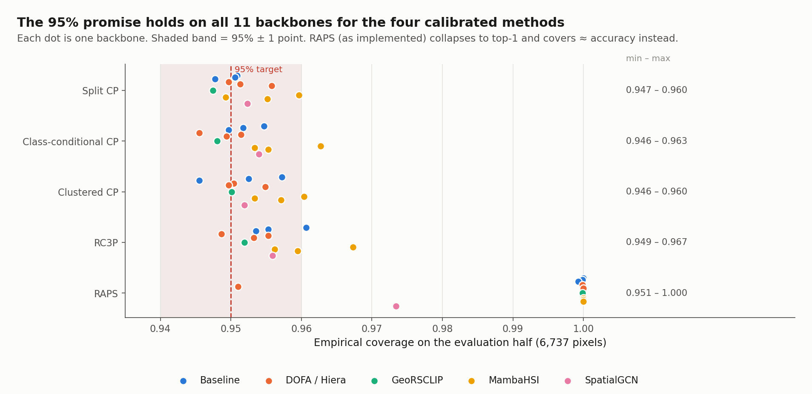</p>

*__Figure 11.__ Empirical coverage of the five baseline conformal methods on all 11 backbones.*

**How to read it.** Each dot is one backbone. The dashed line is the 95% target and the shaded band is
95% ± 1 point. A valid method should put its dots in or near the band. A little above the band is
acceptable (the guarantee is "at least 95%"), but far above means the sets are larger than necessary.

**What it shows.**
- **Split, class-conditional, clustered and RC3P** stay between **0.946 and 0.967** on every backbone,
  including DOFA-Spectral at 84% accuracy. The guarantee does what it says, independently of architecture.
- Small deviations below 0.95 (minimum 0.946) are expected sampling noise. With 6,737 evaluation pixels
  the standard error of a coverage estimate is about 0.27 points.
- **RAPS sits at ≈ 100%** for every near-perfect model and at 97.3% for SpatialGCN, i.e. at the model's
  accuracy. The implementation used here leaves out RAPS's randomisation, so its threshold collapses to
  zero and the set is always the top-1 class ([baseline/ §3.5](../baseline/README.md#raps)). Only for
  DOFA-Spectral, where the true class is often not ranked first, does RAPS reach its target (0.951).

> **Takeaway RQ1.** The four calibrated conformal methods are valid on this data. RAPS as implemented is
> not calibrated to 95%; it reproduces accuracy.

### 8.2 RQ2 · What do the prediction sets look like?

<p align="center">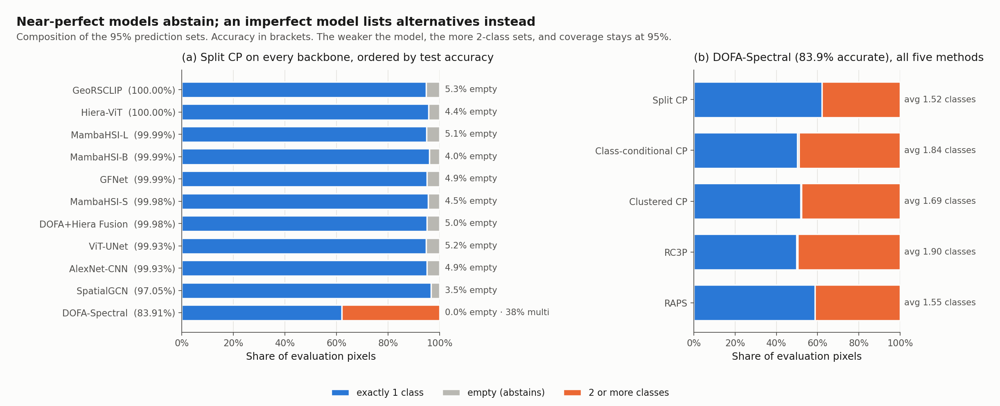</p>

*__Figure 12.__ Composition of the 95% prediction sets: (a) Split CP on every backbone, ordered by
accuracy; (b) all five methods on DOFA-Spectral.*

**How to read it.** Each bar is 100% of the evaluation pixels, divided into pixels whose set holds exactly
one class (blue), no class (grey) and two or more classes (orange).

**What it shows.**
- **Near-perfect models (≥ 99.9%) produce sets of exactly one class, or none.** About 95% are singletons
  and 4–5% are empty; there are virtually no 2-class sets.
- **SpatialGCN (97%)** has fewer empty sets (3.5%). Its class-aware variants begin to list two classes
  (up to 3.5% under RC3P; [spatialgcn/](../spatialgcn/README.md)).
- **DOFA-Spectral (84%)** has **no empty sets** and lists two or more classes for **38%** of pixels
  under Split CP, rising to about 50% under class-conditional CP and RC3P (average 1.84–1.90 classes).

**Why near-perfect models give empty sets.**

<p align="center">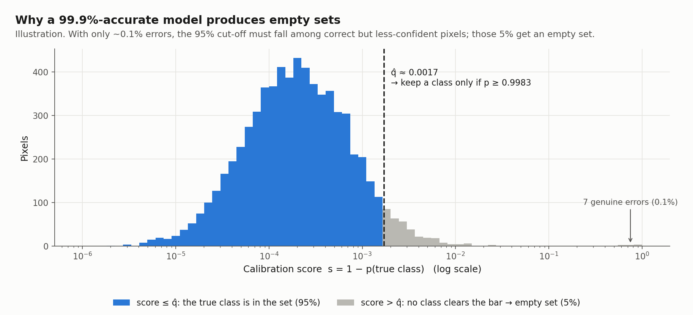</p>

*__Figure 13.__ Illustration with a simulated score distribution (not repository data).*

Conformal prediction promises *at least* 95% coverage and spends the remaining 5% to keep sets small.
A 99.9%-accurate model is wrong on only ~0.1% of pixels, so to "use up" its 5% budget the cut-off must
fall among **correct** predictions. The 5% of pixels with the least-confident correct prediction then
fail the bar for every class and receive an **empty set**: the method declines to commit. Hence, for
every near-perfect backbone:

```math
\text{coverage} \approx \text{singleton rate} \approx 0.95, \qquad \text{empty-set rate} \approx 0.05, \qquad \text{average set size} \approx 0.95 < 1
```

> **Takeaway RQ2.** On these models an empty set means *"one of the 5% least-confident pixels"*, not
> *"probably wrong"*. Sets become informative (they list real alternatives) only when the model makes real
> errors, as for DOFA-Spectral. To make sets flag errors on a near-perfect model, choose α below its error
> rate (e.g. α = 0.001), or evaluate on a harder, spatially blocked split.

### 8.3 RQ3 · Is coverage fair across classes?

<p align="center">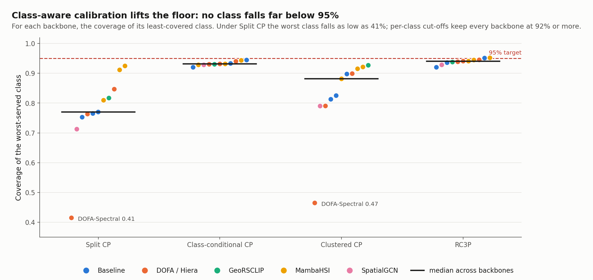</p>

*__Figure 14.__ For every backbone, the coverage of its least-covered class, per method.*

**How to read it.** Overall coverage can be 95% while one class is badly served. This figure keeps only
the **worst class** of each backbone, so a dot far below the dashed line means some class is
under-protected.

**What it shows.**
- Under **Split CP** the median worst class sits at **0.77**, and DOFA-Spectral's worst class is at
  **0.415**.
- **Clustered CP** (one cut-off per group of similar classes) helps most backbones but still lets
  DOFA-Spectral fall to 0.465. Its cluster mixes the hard class with easy ones.
- **Class-conditional CP and RC3P** compute one cut-off per class and keep the worst class of **every
  backbone at ≥ 0.92**.

<p align="center">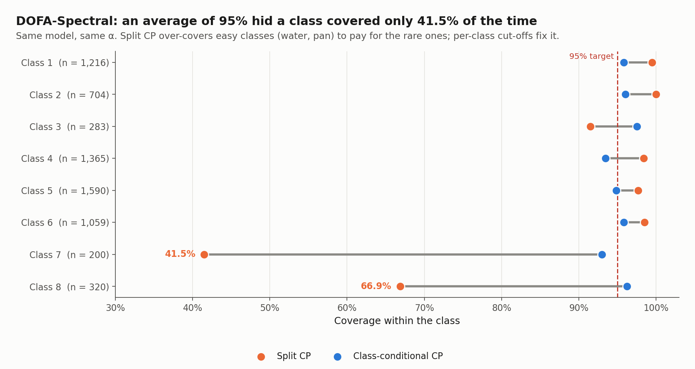</p>

*__Figure 15.__ DOFA-Spectral per-class coverage under Split CP (orange) and class-conditional CP (blue).*

**Reading Figure 15.** Split CP reaches its 95% average by **over-covering** the easy, large classes
(water and the pan at 99.5–100%) and **under-covering** the rare field classes: class 7 at 41.5% and
class 8 at 66.9%. Class-conditional CP pulls every class into 93–98%. It does not improve the model; it
redistributes the error budget fairly and pays with larger sets (Figure 12b).

<p align="center">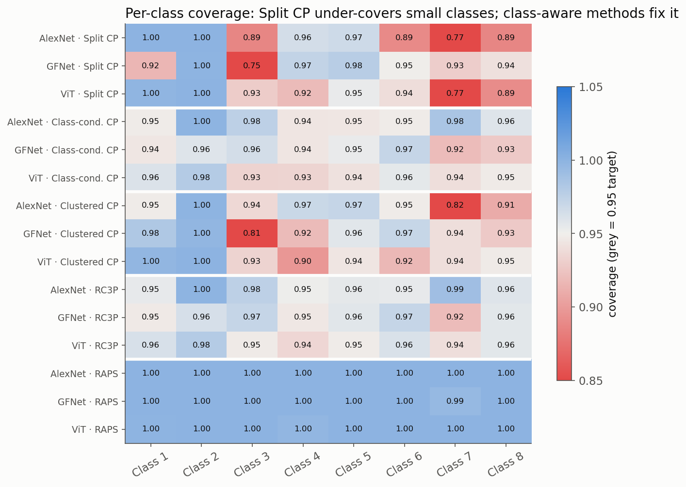</p>

*__Figure 16.__ Every class × method × baseline model. White ≈ 95%; red = under-covered.*

**Reading Figure 16.** The red cells under Split CP are the rare classes: label 7 for AlexNet and ViT
(0.77), label 3 for GFNet (0.75). The class-conditional and RC3P rows are uniformly close to white.

> **Takeaway RQ3.** For land-cover mapping, where small classes are often the point of the map, use a
> **class-aware** conformal method (class-conditional CP or RC3P). Split CP's guarantee is real but holds
> only on average.

### 8.4 RQ4 · Where on the map is the uncertainty?

| Baseline GFNet, Split CP (99.99% acc.) | DOFA-Spectral, Split CP (83.9% acc.) |
|:-:|:-:|
| 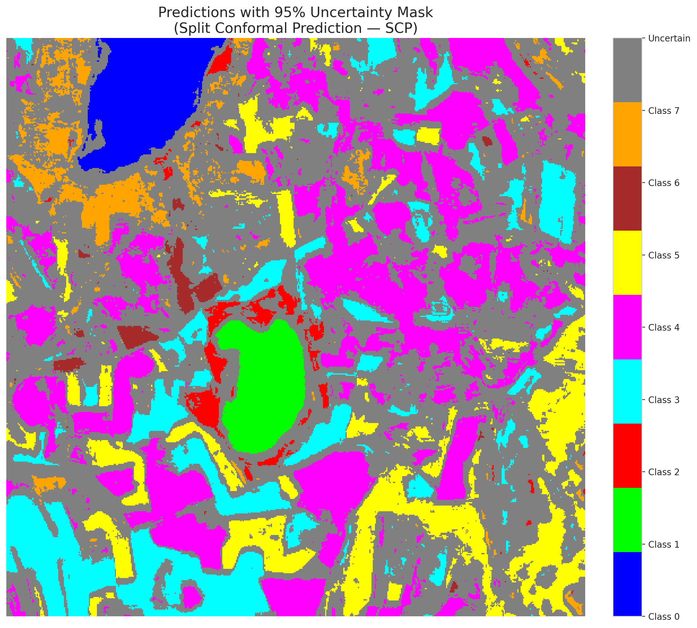 | 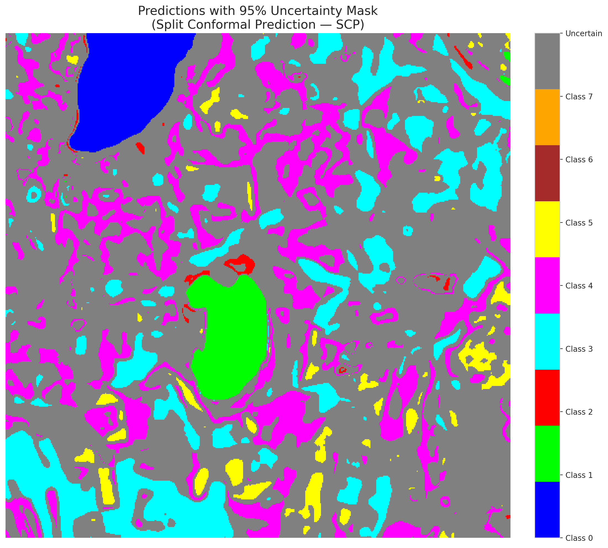 |

*__Figure 17.__ Full-scene class maps with "uncertain" pixels (set not a single class) shown in grey.
Notebook class numbering 0–7.*

**Reading Figure 17.**
- **GFNet (left):** grey concentrates on **parcel boundaries and unlabelled land**. These are places
  where the 9 × 9 patch mixes two surfaces, or where the surface was never labelled. Inside labelled
  parcels the model is confident.
- **DOFA-Spectral (right):** grey covers most of the **farmland**, the classes it confuses (Figure 5).
  The lake and the pan stay confident because their spectra are unique.

> **Takeaway RQ4.** Uncertainty concentrates in physically sensible places: mixed pixels at field edges,
> unlabelled surfaces, and spectrally similar crops. The map, not only the summary number, is the useful
> product.

### 8.5 RQ5 · How much of the map does each method call uncertain?

<p align="center">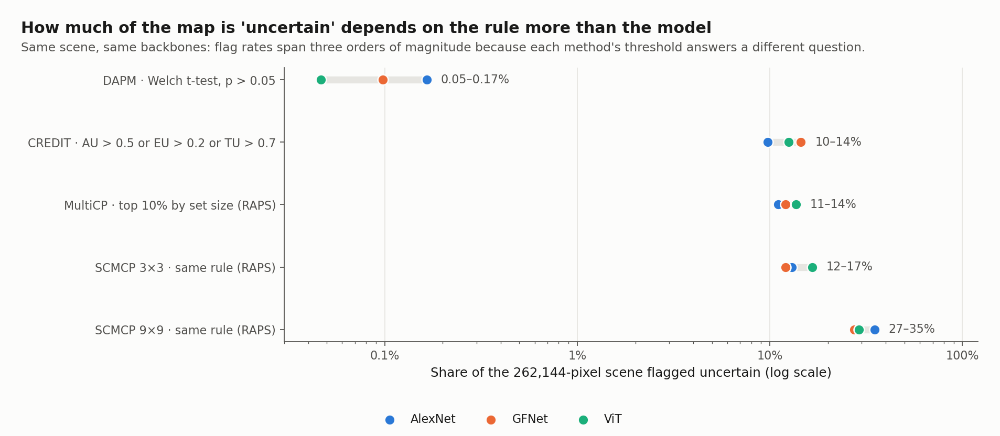</p>

*__Figure 18.__ Share of the full 262,144-pixel scene flagged uncertain, per method (log scale). Each dot
is one baseline backbone.*

**What it shows.** On the same scene and the same backbones, the flagged share ranges from **0.05%**
(DAPM) to **35%** (SCMCP with a 9 × 9 window), a factor of about 700. The models barely matter; the
rules do:

| Method | Its rule for "uncertain" | What the rule really asks |
|---|---|---|
| DAPM | Welch t-test p > 0.05 between top-2 classes over 30 samples | "Are the top two classes statistically tied?" Almost never, with 30 samples |
| CREDIT | AU > 0.5 or EU > 0.2 or TU > 0.7 (fixed thresholds) | "Is the cautious distribution spread out?" True mostly off the labels |
| MultiCP / SCMCP | the **top 10%** of pixels by set size | A quota rather than a test: about 10% (plus ties) is flagged by construction |

> **Takeaway RQ5.** "Percentage of the map that is uncertain" is not comparable across methods unless the
> threshold is calibrated to the same meaning. Only the conformal sets carry a calibrated meaning (a 95%
> coverage guarantee).

### 8.6 RQ6 · Multi-head and spatial variants

<p align="center">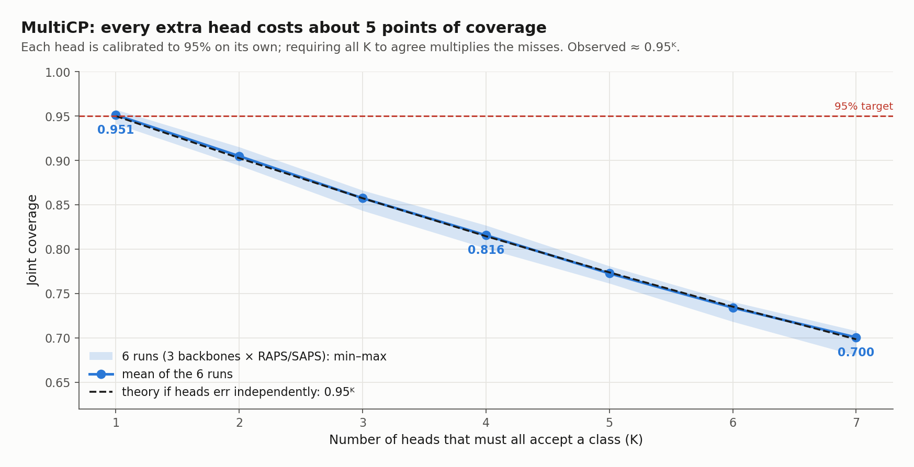</p>

*__Figure 19.__ MultiCP joint coverage as more heads must agree (6 runs, band = min–max).*

**Reading Figure 19.** Each head is calibrated to 95% on its own, and a class must pass **all K
heads**. Every additional head costs about 5 points of coverage, matching the independence prediction
0.95ᴷ almost exactly: **0.951 → 0.816 → 0.700** at K = 1, 4, 7. A Bonferroni budget of α/K per head, or
the joint calibration of the reference Multi-CP algorithm, would restore 95% ([multicp/](../multicp/README.md)).

<p align="center">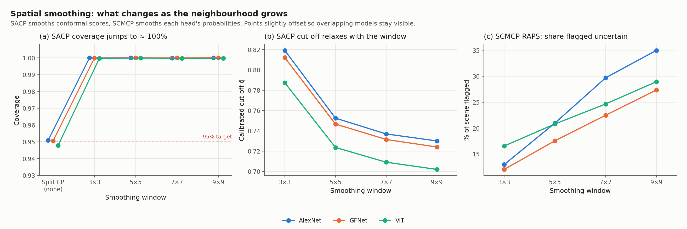</p>

*__Figure 20.__ Spatial methods as the smoothing window grows.*

**Reading Figure 20.**
- **(a)** SACP coverage jumps from Split CP's 95% to **≈ 100%** at every window. SACP forces empty sets to
  hold the best class, so the ~5% abstentions become (correct) singletons.
- **(b)** The calibrated cut-off falls as the window grows (0.82 → 0.73 for AlexNet). Averaging more
  neighbours' scores pulls them towards their mean.
- **(c)** In SCMCP, larger windows blur parcel edges into their neighbours, and the flagged share grows
  from 12–17% to 27–35%.

| Split CP (no smoothing) | SACP 3×3 |
|:-:|:-:|
|  | 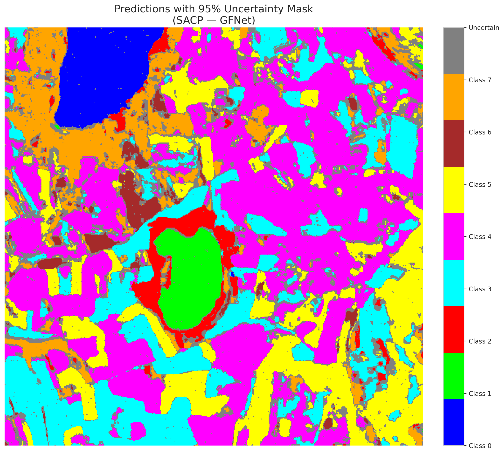 |

*__Figure 20b.__ GFNet: Split CP greys out whole unlabelled areas; SACP gives them coherent classes and
confines uncertainty to thin outlines along parcel boundaries.*

> **Takeaway RQ6.** Intersecting independently calibrated heads breaks the guarantee in a predictable way
> (0.95ᴷ). Spatial smoothing produces more coherent maps, at the cost of bending the exchangeability
> assumption behind the guarantee ([sacp/](../sacp/README.md#4-caveats)).

### 8.7 RQ7 · What do ensembles say about the two kinds of uncertainty?

<p align="center">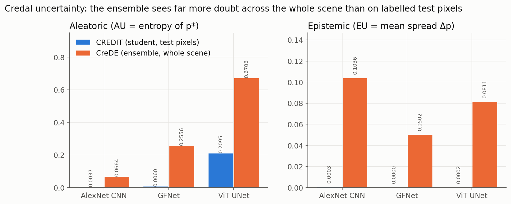</p>

*__Figure 21.__ Mean aleatoric (AU) and epistemic (EU) uncertainty: CREDIT student on labelled test
pixels vs CreDE ensemble over the whole scene (log scale).*

**Reading Figure 21.**
- On **labelled test pixels**, the five ensemble members agree almost perfectly. The CREDIT student
  learns a disagreement of **≈ 10⁻⁴** (2 × 10⁻⁶ for GFNet).
- Over the **whole scene**, 79% of it unlabelled, the same ensembles disagree **300–25,000× more** (EU
  0.05–0.10).
- Consistently, **99.6–99.96%** of the 25,499–38,001 pixels CREDIT flags are unlabelled.
- ViT-UNet has the highest aleatoric uncertainty on both pixel sets. This mirrors its high ECE in Table 1:
  its probabilities are flatter than its accuracy warrants.

> **Takeaway RQ7.** On this data the epistemic signal is a detector of **"surfaces the model was never
> taught"**, the most valuable thing a land-cover uncertainty map can show. Test-set metrics cannot
> reveal it, because the test set contains only labelled surfaces.

### 8.8 Method scorecard

| Method | Valid 95%? | Fair per class? | Informative on near-perfect models? | Spatially coherent? | Extra cost |
|---|:-:|:-:|:-:|:-:|---|
| Split CP | ✅ | ❌ (worst class 0.41–0.92) | ❌ abstains | ❌ | none |
| Class-conditional CP | ✅ | ✅ (≥ 0.92) | ❌ abstains | ❌ | none |
| Clustered CP | ✅ | ⚠️ partly | ❌ abstains | ❌ | k-means on embeddings |
| RC3P | ✅ | ✅ (≥ 0.92) | ❌ abstains | ❌ | rank search |
| RAPS (as implemented) | ❌ = accuracy | — | ❌ always top-1 | ❌ | none |
| SACP | ⚠️ ≈ 100%, assumption bent | ✅ | ❌ | ✅ | neighbourhood smoothing |
| MultiCP / SCMCP | ❌ ≈ 70% | ❌ (0.64–0.77) | ⚠️ quota-based | ⚠️ SCMCP | 7-head model |
| CreDE / CREDIT | no guarantee | ✅ measured ≥ 98% | ✅ flags unlabelled land | ✅ | 5 models (CREDIT: 1 at test time) |
| DAPM | no guarantee | — | ❌ flags ~0.1%, scattered at random | ❌ | VAE + diffusion, 30 samples/pixel |

---

## 9. Discussion and recommendations

**1. Validity is easy; usefulness is not.** Every standard conformal method kept its promise (RQ1). On
near-perfect models, however, a valid 95% set carries almost no information: it is the top class, or
nothing. The informative regime starts once the error rate approaches α. That happened only for
DOFA-Spectral and, partly, SpatialGCN.

**2. Report per-class coverage, always.** The most consequential failure in this study (41.5% coverage
on a rare class) is invisible in the headline coverage number (RQ3). Class-conditional CP and RC3P cost
nothing extra at test time and should be the default for land-cover maps.

**3. Do not compare "% uncertain" across methods.** The share of a map flagged uncertain reflects each
method's thresholding rule, not a shared quantity (RQ5). If an uncertainty map is to drive decisions,
its threshold must be calibrated to a stated meaning.

**4. The interesting uncertainty is off the labels.** Credal ensembles reveal that the models disagree
mainly on unlabelled surfaces (RQ7). No metric computed on the test set can see this. A practical
workflow is to label next whichever surfaces the epistemic map highlights (active learning).

**5. Spatial structure is the next frontier.** Both the leakage (F8) and SACP's coherent maps point the
same way. Pixels are not independent, and evaluation should respect that, with spatially blocked
splits and spatially aware calibration.

---

[← Uncertainty methods in plain words](03_uncertainty_methods.md) · [Report contents](README.md) · [Limitations and threats to validity →](05_limitations.md)
