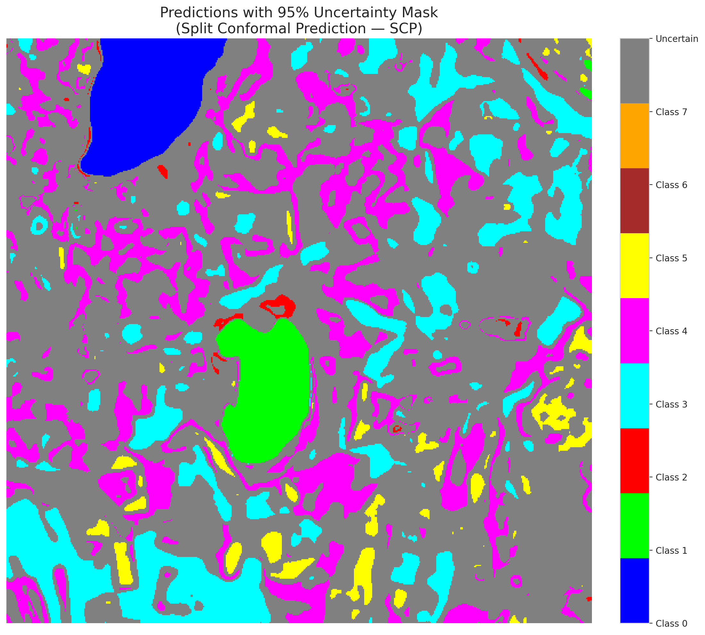
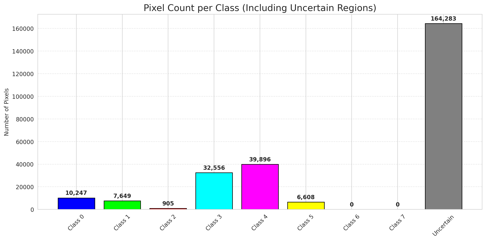
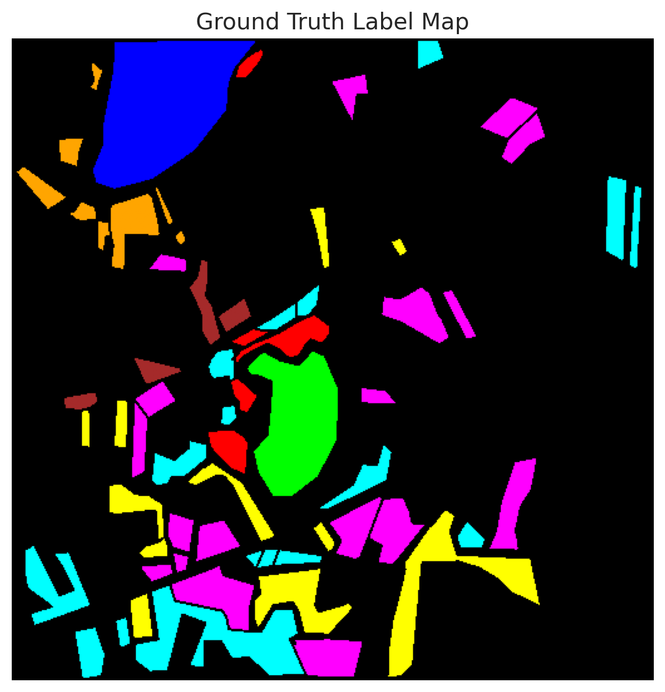
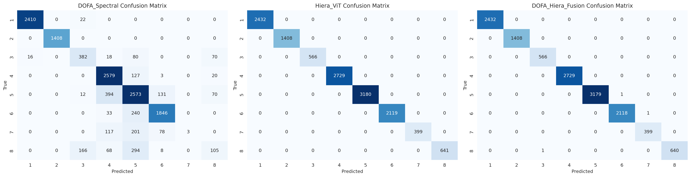

# DOFA & Hiera: wavelength-aware backbones, and the one model that makes real mistakes

[← back to main README](../README.md) · conformal methods explained in [baseline/](../baseline/README.md#3-the-five-methods-step-by-step)

> **In one sentence:** three new backbones go through the same five conformal methods. Two are
> near-perfect. **DOFA-Spectral (83.9% accuracy) is the only model in the project whose prediction sets
> really have to grow**, which makes it the best demonstration of what conformal prediction is for.

| Notebook | What it does |
|---|---|
| [`Model_training.ipynb`](Model_training.ipynb) | Trains DOFA-Spectral, Hiera-ViT and DOFA+Hiera Fusion (same split and recipe as the baseline) |
| [`Model_uncertainty_comparison.ipynb`](Model_uncertainty_comparison.ipynb) | Split, Class-conditional, Clustered, RC3P and RAPS on all three |

> `Report_dofa.md` in this folder is an **earlier draft with outdated numbers** (99.65% / 68.84%). The
> tables below are read from the current `results/*.csv` files and supersede it.

---

## 1. The models in plain words

| Model | Idea | Accuracy |
|---|---|--:|
| **DOFA-Spectral** | *Dynamic One-For-All.* A small "hypernetwork" receives each band's **wavelength** and generates that band's filter weights, so one network can in principle read any sensor. Here each pixel of the patch is embedded (dim 96) and the embeddings are **averaged over the patch**, so the model sees a mean spectrum and no spatial layout | **83.91%** |
| **Hiera-ViT** | A hierarchical Vision Transformer: attention over the 9×9 patch at two scales (128 → 256 channels) | 100.00% |
| **DOFA + Hiera Fusion** | Concatenates both feature sets (fusion dim 256) | 99.98% |

**Why DOFA-Spectral is weaker:** the [t-SNE in the main README](../README.md#24-how-much-independent-information-is-in-65-bands)
shows that the field classes 4–8 overlap when you look at the spectrum alone. Spatial *layout* separates
them; DOFA-Spectral averages it away, and Hiera keeps it. DOFA-Spectral also relies on wavelengths that the notebook **assumes** to be
65 evenly spaced values from 0.40 to 2.50 µm. The real band centres are unknown.

## 2. Conformal results

| Model | Method | Coverage | Avg. set size | Singletons | Empty | Mean per-class cov. |
|---|---|--:|--:|--:|--:|--:|
| **DOFA-Spectral** | Split CP | 0.951 | **1.52** | 62.1% | 0.0% | 0.867 |
| | Class-cond. CP | 0.952 | **1.84** | 50.2% | 0.7% | 0.954 |
| | Clustered CP | 0.950 | 1.69 | 51.8% | 0.3% | 0.905 |
| | RC3P | 0.955 | **1.90** | 49.8% | 0.6% | 0.959 |
| | RAPS | 0.951 | 1.55 | 58.8% | 0.0% | 0.868 |
| Hiera-ViT | Split CP | 0.956 | 0.956 | 95.6% | 4.4% | 0.962 |
| | RC3P | 0.953 | 0.953 | 95.3% | 4.7% | 0.960 |
| DOFA+Hiera Fusion | Split CP | 0.950 | 0.950 | 95.0% | 5.0% | 0.963 |
| | RC3P | 0.949 | 0.949 | 94.9% | 5.1% | 0.954 |

*Source: [`results/uncertainty_results/summary_metrics.csv`](results/uncertainty_results/summary_metrics.csv)
(all 15 rows). Classification: [`results/classification_summary.csv`](results/classification_summary.csv).*

**This is conformal prediction working as intended.** DOFA-Spectral is wrong on 16% of pixels, yet
every method still covers ≈ 95%. It does this by **widening the sets**: 38% of Split CP sets contain two or
more classes. There are no empty sets, because the threshold no longer has to cut into correct predictions
([contrast with near-perfect models](../README.md#71-why-near-perfect-models-produce-empty-sets)). Even
RAPS reaches 95% here, because the true class is often not ranked first.

### 2.1 The fairness lesson, in numbers

| Label (notebook class) | Pixels in eval | Split CP | Class-cond. CP | RC3P |
|:-:|--:|--:|--:|--:|
| 1 (0) | 1,216 | 99.5% | 95.8% | 96.1% |
| 2 (1) | 704 | 100.0% | 96.0% | 96.4% |
| 3 (2) | 283 | 91.5% | 97.5% | 98.2% |
| 4 (3) | 1,365 | 98.4% | 93.5% | 93.8% |
| 5 (4) | 1,590 | 97.7% | 94.8% | 95.3% |
| 6 (5) | 1,059 | 98.5% | 95.8% | 95.9% |
| **7 (6)** | **200** | **41.5%** | **93.0%** | **94.5%** |
| 8 (7) | 320 | 66.9% | 96.2% | 96.9% |

*Source: [`results/uncertainty_results/per_class_coverage.csv`](results/uncertainty_results/per_class_coverage.csv).*

Split CP reaches 95% **on average** by over-covering the easy, large classes (water, the pan) and
leaving the rarest crop class **covered only 41.5% of the time**. A user relying on Split CP would be
told "95% guaranteed" and be wrong on more than half of the label-7 parcels. Class-conditional CP and RC3P
pay with bigger sets (1.84–1.90 classes) and bring **every** class to 93–98%. **For land-cover mapping,
where small classes are often the point, a class-aware method is the right default.**

### 2.2 Maps (DOFA-Spectral, Split CP)

| Class map + uncertain mask | Certain vs uncertain | Pixel counts |
|:-:|:-:|:-:|
|  |  |  |

Water and the bright pan stay confident. Almost all the farmland is uncertain, because those are the
classes DOFA-Spectral confuses. *Extracted from
[`results/uncertainty_results/conformal_reports_all_models.xlsx`](results/uncertainty_results/conformal_reports_all_models.xlsx).*

### 2.3 Classification

| Ground truth | DOFA-Spectral | Hiera-ViT | Fusion |
|:-:|:-:|:-:|:-:|
|  |  |  |  |

## 3. Caveats

- The wavelengths are assumed (0.40–2.50 µm, evenly spaced), so DOFA's wavelength conditioning is only approximate.
- The DOFA weights are trained from scratch here; this is not the pretrained DOFA foundation model.
- The random-split optimism ([main README §8](../README.md#8-limitations-read-this-before-citing-a-number)) applies to Hiera and Fusion.

## References

Xiong et al. (2024), *Neural Plasticity-Inspired Foundation Model for Observing the Earth Crossing
Modalities* (DOFA); Ryali et al. (2023), *Hiera: A Hierarchical Vision Transformer without the
Bells-and-Whistles*; Ding et al. (2023), *Class-Conditional Conformal Prediction with Many Classes*.
