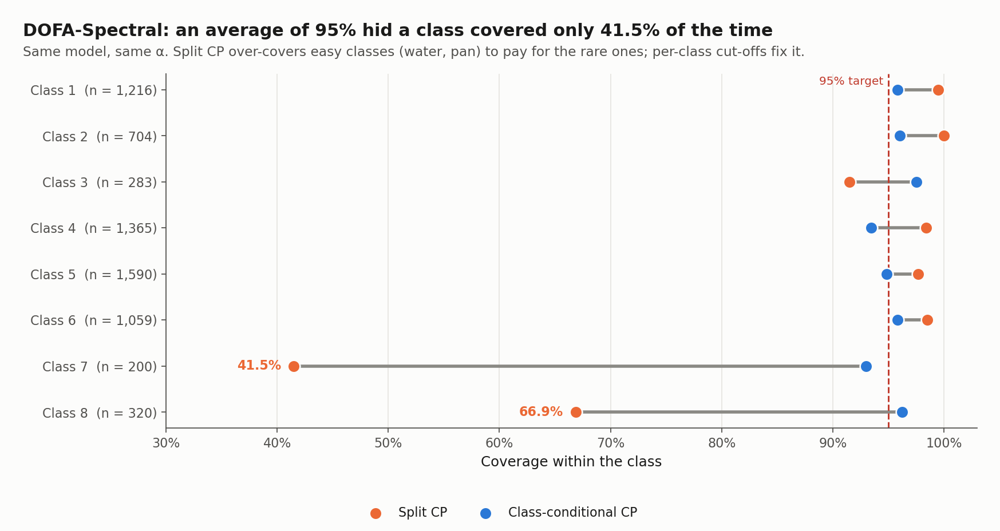
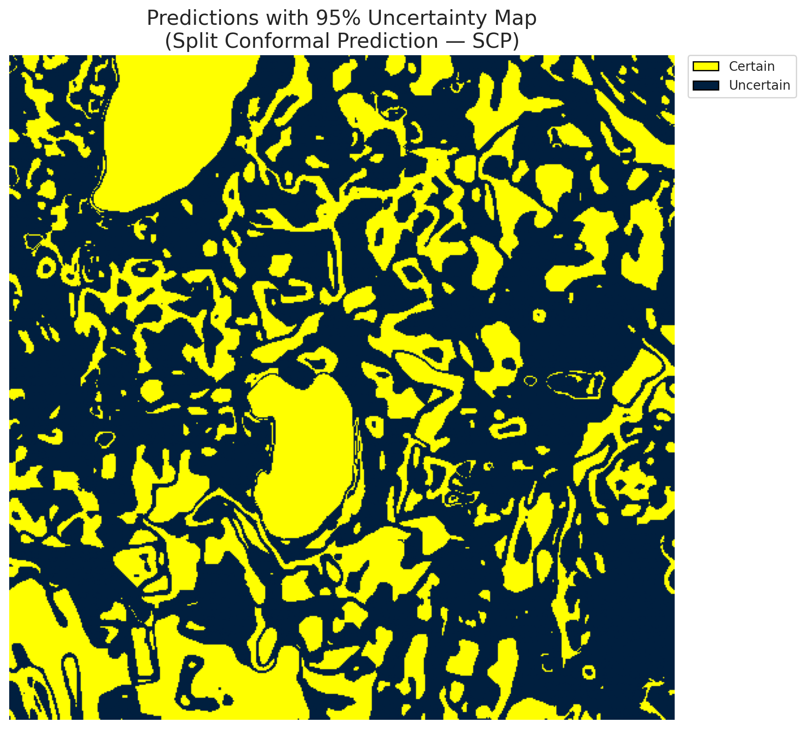
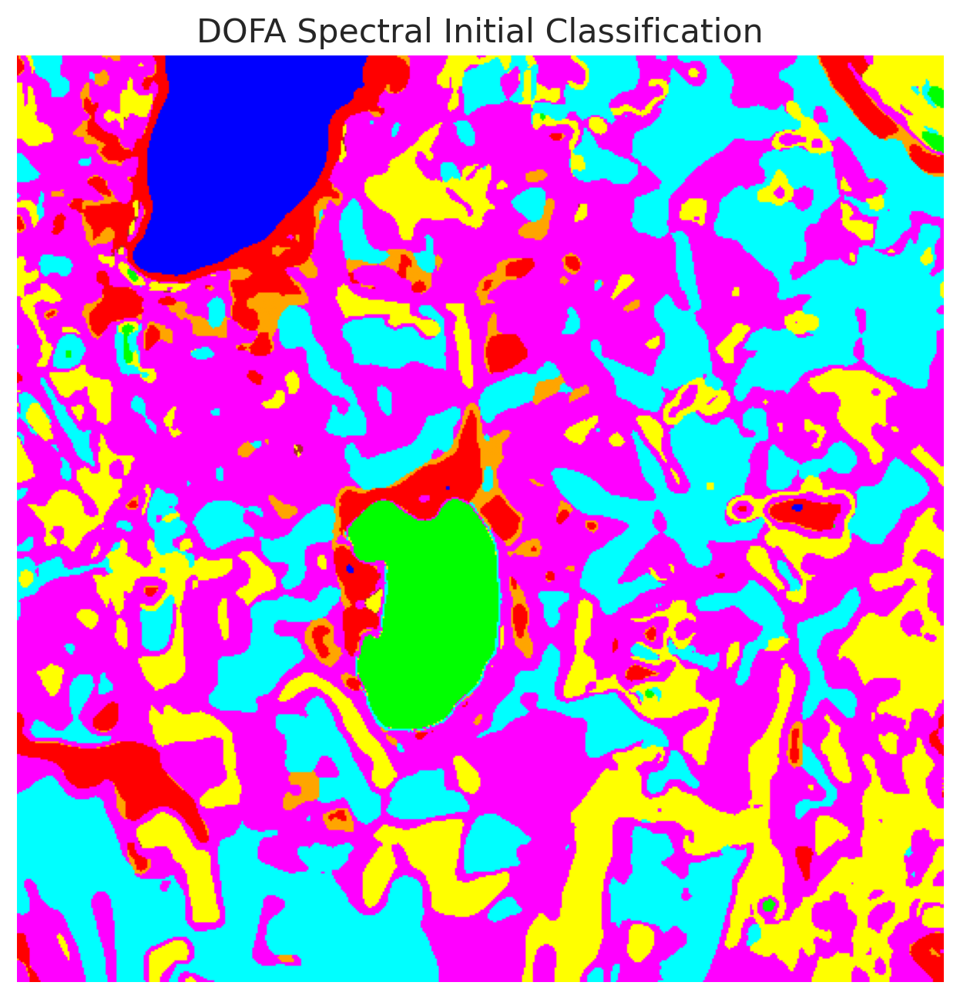
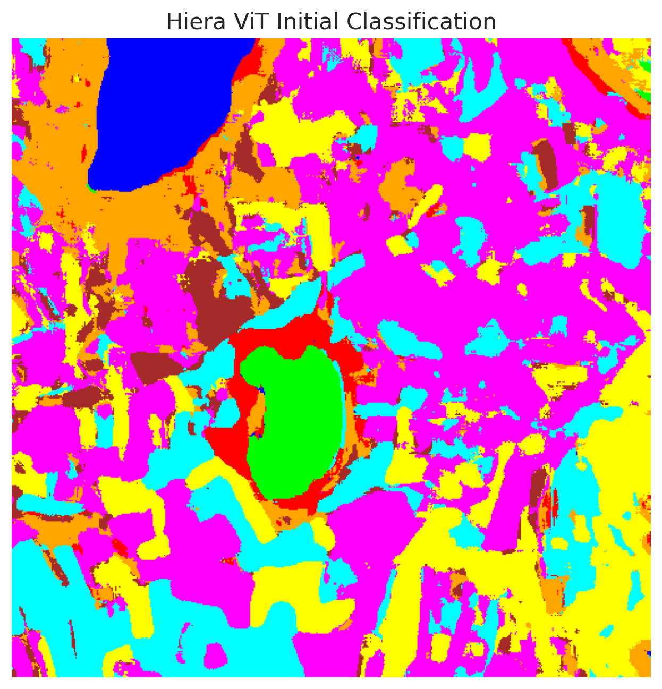
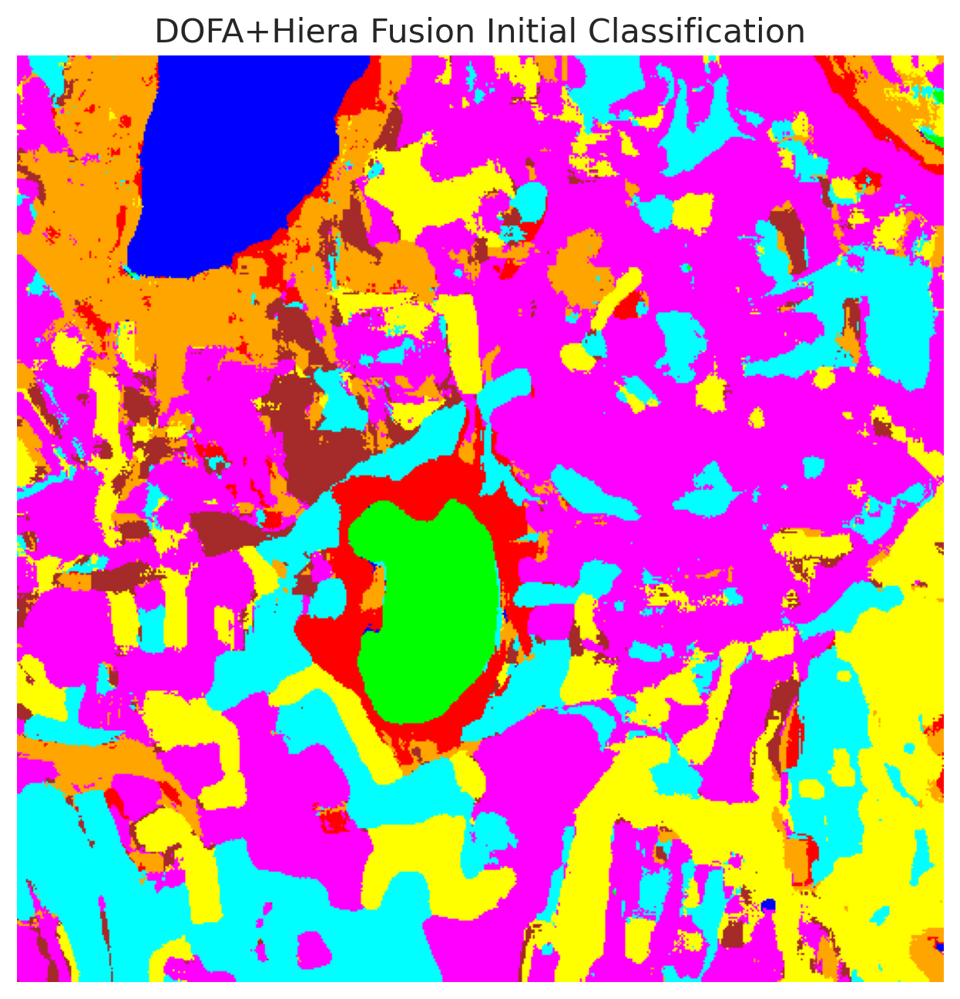

# DOFA & Hiera: wavelength-aware backbones, and the one model that makes real mistakes

[← back to main README](../README.md) · conformal methods explained in [baseline/](../baseline/README.md#3-the-five-methods-step-by-step)

| | |
|---|---|
| **What** | Three new backbones (DOFA-Spectral, Hiera-ViT, DOFA+Hiera Fusion) evaluated with the same five conformal methods as the baseline |
| **Key result** | DOFA-Spectral (83.9% accurate) is the only model whose sets must grow: **38%** of Split CP sets hold 2+ classes, and coverage stays at **95.1%** |
| **The lesson** | Split CP's 95% average hides a class covered only **41.5%** of the time; class-conditional CP restores **93%** |
| **Notebooks** | [`Model_training.ipynb`](Model_training.ipynb) · [`Model_uncertainty_comparison.ipynb`](Model_uncertainty_comparison.ipynb) |

> `Report_dofa.md` in this folder is an **earlier draft with outdated numbers** (99.65% / 68.84%). The
> tables below are read from the current `results/*.csv` files and supersede it.

---

## 1. The models in plain words

| Model | Idea | Accuracy |
|---|---|--:|
| **DOFA-Spectral** | *Dynamic One-For-All.* A small "hypernetwork" receives each band's **wavelength** and generates that band's embedding weights, so one network could in principle read any sensor. Here each pixel of the patch is embedded (dimension 96), and the embeddings are **averaged over the patch**: the model sees a mean spectrum and no spatial layout | **83.91%** |
| **Hiera-ViT** | A hierarchical Vision Transformer: attention over the 9 × 9 patch at two scales (128 → 256 channels), with tokens pooled between stages | 100.00% |
| **DOFA + Hiera Fusion** | Concatenates both feature sets (fusion dimension 256) | 99.98% |

**Why DOFA-Spectral is weaker.** The [data analysis](../docs/01_data_and_setup.md#34-how-much-independent-information-do-65-bands-carry)
shows that classes 3–8 overlap when you look at spectra alone: classes 5–8 are within 1.8–2.9° of each
other in spectral angle. Spatial *layout* is what separates them. DOFA-Spectral averages it away, and Hiera
keeps it. There are two further handicaps:
- the notebook **assumes** 65 evenly spaced wavelengths from 0.40 to 2.50 µm (the real band centres are
  unknown), and
- the input values wrap round for bright pixels ([main README §3.5](../docs/01_data_and_setup.md#35-a-data-quality-finding-stored-values-wrap-round)),
  which distorts the spectral shape that wavelength conditioning relies on.

### How the wavelength hypernetwork works

```math
W_b = h_\theta(\lambda_b), \qquad e(x) = \frac{1}{81}\sum_{\text{pixels } p}\Big(\sum_{b=1}^{65} x_{p,b}\, W_b + \beta\Big)
```

*In words: a small three-layer network $`h_\theta`$ (hidden width 64) turns the wavelength
$`\lambda_b`$ of band $`b`$ into a 96-number weight vector. Each pixel's embedding is the sum of its band
values times those weights, plus a learned bias $`\beta`$. The patch embedding is the average over its
81 pixels (code: `DOFAWavelengthEmbed`, then `GlobalAveragePooling2D`).* Because the weights come from wavelengths rather than band indices, a
sensor with different bands could reuse the same network.

---

## 2. Implementation details

| Setting | Value |
|---|---|
| Split, recipe | Same as the baseline (seed 42, 100 epochs, batch 128, lr 3 × 10⁻⁴) |
| DOFA embedding | dim 96, wavelengths `np.linspace(0.40, 2.50, 65)` µm (assumed) |
| Hiera stages | [128, 256] channels, patch merging between stages |
| Fusion | concatenation → 256-d |
| Conformal | Split, class-conditional, clustered (k = 4), RC3P, RAPS; α = 0.05; 6,737 / 6,737 calibration / evaluation |

---

## 3. Results

### 3.1 Coverage and set size

| Model | Method | Coverage | Avg. set size | Singletons | Empty | 2+ classes | Mean per-class cov. |
|---|---|--:|--:|--:|--:|--:|--:|
| **DOFA-Spectral** | Split CP | 0.951 | **1.52** | 62.1% | 0.0% | 37.9% | 0.867 |
| | Class-cond. CP | 0.952 | **1.84** | 50.2% | 0.7% | 49.1% | 0.954 |
| | Clustered CP | 0.950 | 1.69 | 51.8% | 0.3% | 47.9% | 0.905 |
| | RC3P | 0.955 | **1.90** | 49.8% | 0.6% | 49.6% | 0.959 |
| | RAPS | 0.951 | 1.55 | 58.8% | 0.0% | 41.2% | 0.868 |
| Hiera-ViT | Split CP | 0.956 | 0.956 | 95.6% | 4.4% | 0.0% | 0.962 |
| | RC3P | 0.953 | 0.953 | 95.3% | 4.7% | 0.0% | 0.960 |
| DOFA+Hiera Fusion | Split CP | 0.950 | 0.950 | 95.0% | 5.0% | 0.0% | 0.963 |
| | RC3P | 0.949 | 0.949 | 94.9% | 5.1% | 0.0% | 0.954 |

*__Table 1.__ Source: [`results/uncertainty_results/summary_metrics.csv`](results/uncertainty_results/summary_metrics.csv)
(all 15 rows). "2+ classes" = 1 − singletons − empty.*

<p align="center"></p>

*__Figure 1.__ (a) Split CP on every backbone, ordered by accuracy; DOFA-Spectral is the bottom bar.
(b) DOFA-Spectral under all five methods.*

**Reading Table 1 and Figure 1.** This is conformal prediction doing exactly what it is for. DOFA-Spectral
is wrong on 16% of pixels, yet every method still covers ≈ 95%. It manages this by **widening the sets**:
38% of Split CP sets contain two or more classes.
- **No empty sets.** The threshold no longer has to cut into correct predictions to use up its 5% budget;
  the model's own errors already supply it ([contrast with near-perfect models](../docs/04_uncertainty_results.md#82-rq2--what-do-the-prediction-sets-look-like)).
- **RAPS works here** (0.951). Unlike on the near-perfect models, the true class is often *not* ranked
  first, so the RAPS score is no longer always zero.
- **Hiera and Fusion** behave like every other near-perfect model: ~95% singletons, ~5% empty.

### 3.2 The fairness lesson, in numbers

<p align="center"></p>

*__Figure 2.__ Coverage inside each class, Split CP (orange) vs class-conditional CP (blue).*

| Label (notebook class) | Pixels in eval | Split CP | Class-cond. CP | RC3P | Clustered CP |
|:-:|--:|--:|--:|--:|--:|
| 1 (0) | 1,216 | 99.5% | 95.8% | 96.1% | 95.8% |
| 2 (1) | 704 | 100.0% | 96.0% | 96.4% | 100.0% |
| 3 (2) | 283 | 91.5% | 97.5% | 98.2% | 96.8% |
| 4 (3) | 1,365 | 98.4% | 93.5% | 93.8% | 91.4% |
| 5 (4) | 1,590 | 97.7% | 94.8% | 95.3% | 98.1% |
| 6 (5) | 1,059 | 98.5% | 95.8% | 95.9% | 98.6% |
| **7 (6)** | **200** | **41.5%** | **93.0%** | **94.5%** | **46.5%** |
| 8 (7) | 320 | 66.9% | 96.2% | 96.9% | 96.9% |

*__Table 2.__ Source: [`results/uncertainty_results/per_class_coverage.csv`](results/uncertainty_results/per_class_coverage.csv).*

**Reading Figure 2 and Table 2.**
- Split CP reaches 95% **on average** by over-covering the large, easy classes (water at 99.5%, the pan
  at 100%) and **under-covering** the rarest crop class, which is covered only **41.5%** of the time. A user
  told "95% guaranteed" would be wrong on more than half of the label-7 pixels.
- Clustered CP fixes label 8 (96.9%) but not label 7 (46.5%). Label 7 was clustered with classes whose
  scores are much lower, so it inherited a cut-off that is too strict for it.
- **Class-conditional CP and RC3P bring every class to 93–98%.** They pay with bigger sets (1.84–1.90
  classes). The extra classes go to exactly the pixels that need them.

> **Takeaway.** For land-cover mapping, where small classes are often the point, a class-aware method
> should be the default. The headline coverage number alone would have hidden this failure completely.

### 3.3 Where the uncertainty is on the map

| Class map + uncertain mask | Certain vs uncertain | Pixel counts |
|:-:|:-:|:-:|
|  |  |  |

*__Figure 3.__ DOFA-Spectral, Split CP. Extracted from
[`results/uncertainty_results/conformal_reports_all_models.xlsx`](results/uncertainty_results/conformal_reports_all_models.xlsx).*

**Reading Figure 3.** The lake and the bright pan stay confident; their spectra are unique. Almost all the
farmland is uncertain, which is exactly the set of classes that DOFA-Spectral confuses. This is the most
honest uncertainty map in the project. It looks alarming because the model really is unsure there.

### 3.4 Classification

| Ground truth | DOFA-Spectral | Hiera-ViT | Fusion |
|:-:|:-:|:-:|:-:|
|  |  |  |  |

*__Figure 4.__ Full-scene predictions.*

| Model | Accuracy | κ | Macro-F1 | NLL | ECE |
|---|--:|--:|--:|--:|--:|
| DOFA-Spectral | 83.91% | 0.8038 | 0.6780 | 0.4657 | 0.0475 |
| Hiera-ViT | 100.00% | 1.0000 | 1.0000 | 0.0398 | 0.0390 |
| DOFA+Hiera Fusion | 99.98% | 0.9997 | 0.9996 | 0.0305 | 0.0294 |

*__Table 3.__ Source: [`results/classification_summary.csv`](results/classification_summary.csv).
DOFA-Spectral's macro-F1 (0.678) is far below its accuracy (0.839), because its errors concentrate in the
small classes.*

<p align="center"></p>

*__Figure 5.__ Confusion matrices. DOFA-Spectral's errors sit in the field-class block (labels 3–8).*

---

## 4. Discussion

- **An imperfect model is the best test of an uncertainty method.** On the nine near-perfect backbones
  every method looks fine. Only DOFA-Spectral exposes Split CP's class-level failure and Clustered CP's
  dependence on a good clustering.
- **Spatial context matters more than wavelength conditioning on this scene.** Adding Hiera's spatial
  attention lifts accuracy from 83.9% to 99.98%.
- **Prediction sets can be read as "candidate classes" for verification.** With class-conditional CP, a
  field visit or manual check could target the ~49% of pixels with 2+ classes and still trust the rest.

## 5. Caveats

- The wavelengths are assumed (0.40–2.50 µm, evenly spaced), so DOFA's conditioning is approximate.
- The DOFA weights are trained from scratch here; this is not the pretrained DOFA foundation model.
- The random-split optimism ([main README §10](../docs/05_limitations.md#10-limitations-and-threats-to-validity)) applies, most strongly to Hiera and Fusion.

## References

Xiong et al. (2024), *Neural Plasticity-Inspired Foundation Model for Observing the Earth Crossing
Modalities* (DOFA); Ryali et al. (2023), *Hiera: A Hierarchical Vision Transformer without the
Bells-and-Whistles*; Ding et al. (2023), *Class-Conditional Conformal Prediction with Many Classes*.
