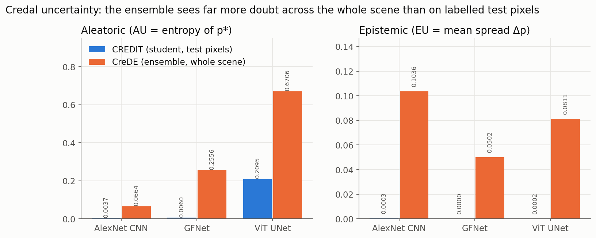

# Deep Ensembles & CreDE: five opinions instead of one

[← back to main README](../README.md) · related: [CREDIT](../credit/README.md)

| | |
|---|---|
| **What** | Train each backbone five times (seeds 43–47) and read uncertainty from **how much the five copies disagree** (epistemic) and **how unsure their cautious consensus is** (aleatoric) |
| **Key result** | Credal sets are single correct classes on labelled test pixels (coverage 1.000); over the **whole scene** the members disagree far more (mean EU 0.05–0.10) |
| **The lesson** | The ensemble's disagreement is a detector of *surfaces the model was never taught*, which a test-set metric cannot reveal |

| Notebook | What it does |
|---|---|
| [`Model_training_ensembles.ipynb`](Model_training_ensembles.ipynb) | Trains **M = 5** members per backbone (AlexNet-CNN, GFNet, ViT-UNet), seeds 43–47, same data split |
| [`Model_uncertainty_CreDE.ipynb`](Model_uncertainty_CreDE.ipynb) | Runs all 5 members on every pixel of the scene and turns their outputs into credal intervals, AU/EU/TU and maps |

---

## 1. The idea

Ask five experts who studied the same material but in a different order. If they all say *"water,
0.99"*, you can relax. If one says *"crop A, 0.9"* and another *"crop B, 0.8"*, the **disagreement**
is the warning sign, even if each expert sounds confident. That disagreement is **epistemic uncertainty**:
the training data didn't pin the answer down. If all five calmly say *"50/50 between A and B"*, the pixel
itself is ambiguous. That is **aleatoric uncertainty**, and more training would not fix it.

## 2. The maths, step by step

Let $`p^{(m)}_k(x)`$ be member $`m`$'s probability for class $`k`$ ($`m = 1..5`$).

**Step 1. Credal interval per class.** Keep the lowest and highest opinion:

```math
\underline{p}_k(x) = \min_m p^{(m)}_k(x), \qquad \overline{p}_k(x) = \max_m p^{(m)}_k(x), \qquad \Delta p_k(x) = \overline{p}_k - \underline{p}_k
```

*In words: the band of probabilities the five members span for each class. A "credal set" is the set of
all distributions inside these bands.*

**Step 2. A cautious single distribution.** Renormalise the lower bounds:

```math
p^{*}_k(x) = \frac{\underline{p}_k(x)}{\sum_j \underline{p}_j(x)}
```

**Step 3. Split uncertainty into two parts.**

```math
\text{AU}(x) = -\sum_k p^{*}_k \ln p^{*}_k \quad(\text{entropy}), \qquad \text{EU}(x) = \frac{1}{C}\sum_k \Delta p_k(x), \qquad \text{TU} = \text{AU} + \text{EU}
```

*AU is large when the cautious distribution is spread out (max ln 8 ≈ 2.08 for 8 classes). EU is large
when the members disagree (max 1).*

**Step 4. A prediction set by interval dominance.** Keep class $`k`$ unless another class is *certainly*
better, meaning its worst case beats $`k`$'s best case:

```math
k \in C(x) \iff \overline{p}_k(x) \ge \max_j \underline{p}_j(x)
```

> **Worked example (3 classes).** Five members give Crop A ∈ [0.55, 0.80], Crop B ∈ [0.15, 0.40],
> Water ∈ [0.01, 0.05]. The best lower bound is 0.55 (Crop A). Crop B's upper bound 0.40 < 0.55, so it is
> **excluded**; Water too. Set = {Crop A}. If instead Crop B ∈ [0.15, 0.60], then 0.60 ≥ 0.55, so the set
> is {Crop A, Crop B}.
> $`\Delta p`$ = (0.25, 0.25, 0.04) → EU = 0.18.

*Code:* `evaluate_homogeneous_ensemble` (Section 5.2), `credal_set_metrics` (Section 7.0a). Pixel masks use
fixed thresholds AU > 0.5, EU > 0.2, TU > 0.7.

---

## 3. Results

### 3.1 Members: are the five copies really different?

All 15 members are near-perfect; GFNet members reach 100.00% test accuracy.

| Backbone | Member accuracies (5 seeds) |
|---|---|
| AlexNet-CNN | 99.95%, 99.93%, 99.90%, 99.68%, 99.61% |
| GFNet | 100.00% × 5 |
| ViT-UNet | 99.97%, 99.97%, 99.96%, 99.96%, 99.94% |

*__Table 1.__ Source: [`results/classification_summary.csv`](results/classification_summary.csv).*

**Reading Table 1.** The AlexNet members spread over 0.34 points (99.61–99.95%). The GFNet members are
identical in accuracy. An ensemble is only informative where its members *can* differ, so on labelled
pixels there is little room for disagreement. The interesting differences appear elsewhere (§3.2).

### 3.2 Credal uncertainty: labelled pixels vs the whole scene

| Ensemble | Mean AU | Mean EU | Mean TU | Credal coverage | Avg. set size |
|---|--:|--:|--:|--:|--:|
| AlexNet-CNN | 0.0664 | 0.1036 | 0.1700 | 1.0000 | 1.0092 |
| GFNet | 0.2556 | 0.0502 | 0.3058 | 1.0000 | 1.0000 |
| ViT-UNet | 0.6706 | 0.0811 | 0.7517 | 1.0000 | 1.0023 |

*Sources: [`results/CreDE_Master_Summary.csv`](results/CreDE_Master_Summary.csv) (AU/EU/TU, averaged over
**all 262,144 scene pixels**) and [`results/CreDE_Credal_Coverage_Overall.csv`](results/CreDE_Credal_Coverage_Overall.csv)
(coverage, on the **13,474 labelled test pixels**).*

> ⚠️ Table 2 deliberately mixes two pixel sets: AU/EU/TU over the whole scene, coverage over labelled
> test pixels. Figure 1 puts the scene-wide AU/EU next to the same quantity on labelled pixels, as learned
> by the [CREDIT](../credit/README.md) student.

<p align="center"></p>

*__Figure 1.__ Mean aleatoric (AU) and epistemic (EU) uncertainty on labelled test pixels (CREDIT
student) vs the whole scene (CreDE ensemble). Log scale: each grid line is a factor of 10.*

**Reading Table 2 and Figure 1.**
- On labelled test pixels the credal sets are essentially always a single correct class (coverage 100%,
  size ≈ 1.00).
- Over the **whole scene**, including the 79% of pixels that were never labelled, the members disagree much
  more. AlexNet's mean EU is 0.10 and ViT's AU 0.67, so the ensemble "knows" it has not seen those
  surfaces. This is the most honest signal in the project about how the models behave **off** the training
  distribution.
- The gap is not small. Scene-wide EU is **300–25,000× larger** than on labelled pixels. The labelled
  pixels are where the members were trained to agree.
- ViT-UNet has the highest AU because its softmax outputs are less peaked (its NLL is also the highest of
  the three).

> **Takeaway.** Ensembles are cheap to explain and expensive to run (5× inference). On this scene their
> value lies entirely off the labels: the EU map points at surfaces that need labelling next.

### 3.3 Maps

| AlexNet-CNN | GFNet | ViT-UNet |
|:-:|:-:|:-:|
|  |  |  |

*__Figure 2.__ CreDE maps per backbone: the base prediction, binary AU/EU/TU masks (AU > 0.5, EU > 0.2,
TU > 0.7), grey overlays and per-class pixel counts.*

**Reading Figure 2.** The EU masks highlight unlabelled surfaces and parcel edges. Labelled parcel
interiors stay clear, consistent with Figure 1.

---

## 4. Caveats

- **Coverage is measured, not guaranteed.** Unlike conformal prediction, nothing calibrates credal sets
  to a 95% target.
- Members differ only by seed. They share data, architecture and split, so their disagreement understates
  true epistemic uncertainty.
- The AlexNet members were trained on the seed-10 split; the credal metrics for AlexNet are computed on that
  split's test pixels.
- Thresholds 0.5 / 0.2 / 0.7 are fixed by hand; the uncertain-pixel CSVs in `../credit/results/` include a
  threshold-sensitivity table.

## References

Lakshminarayanan et al. (2017), *Deep Ensembles*; Walley (1991), *Statistical Reasoning with Imprecise
Probabilities*; Hüllermeier & Waegeman (2021), *Aleatoric and Epistemic Uncertainty in Machine Learning*.
