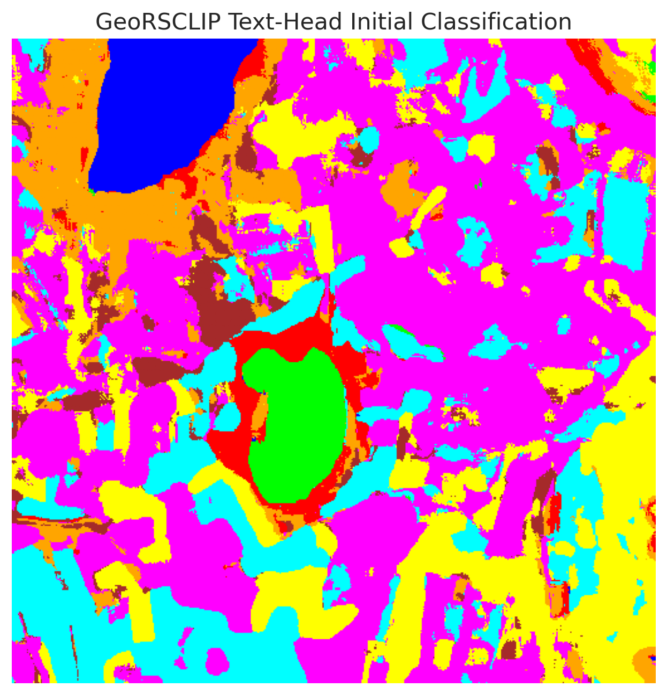

# GeoRSCLIP-TextHead: classifying by matching images to words

[← back to main README](../README.md) · conformal methods explained in [baseline/](../baseline/README.md#3-the-five-methods-step-by-step)

> **In one sentence:** instead of a normal output layer, the image features are compared with a text
> embedding of one prompt per class. The model reaches 100.00% test accuracy, and its conformal results match
> the baseline.

| Notebook | What it does |
|---|---|
| [`Model_training.ipynb`](Model_training.ipynb) | Trains the image tower (Hiera-style) and a text tower over class prompts, jointly |
| [`Model_uncertainty_comparison.ipynb`](Model_uncertainty_comparison.ipynb) | The five conformal methods |

## 1. The model in plain words

CLIP-style models learn a shared space where an image and a sentence describing it land close together.
Each class gets a prompt (here "land cover class one", "… two", …). The class probability is a softmax
over **cosine similarities**:

$$\hat p_k(x) = \frac{\exp\big(\cos(f(x), g(t_k))/\tau\big)}{\sum_j \exp\big(\cos(f(x), g(t_j))/\tau\big)}$$

*In words: "which class description does this patch look most like?" $f$ is the image tower, $g$ the
text tower, $t_k$ the prompt for class $k$, and $\tau$ a temperature.*

**What this is and isn't.** The text tower is trained **from scratch**, and the prompts carry no meaning
("class one"), so this is not the pretrained GeoRSCLIP. It behaves like a normal classifier with a
cosine-similarity head. With real class names (see the open question in the
[main README](../README.md#22-what-is-in-the-picture)) and pretrained weights, the text side could add
real knowledge. *Note: the notebook's hard-coded prompt list has 7 entries (left over from the 6-band
dataset) and is rebuilt for 8 classes before training.*

## 2. Results

| Method | Coverage | Avg. set size | Empty sets | Mean per-class cov. |
|---|--:|--:|--:|--:|
| Split CP | 0.948 | 0.948 | 5.3% | 0.960 |
| Class-cond. CP | 0.948 | 0.948 | 5.2% | 0.945 |
| Clustered CP | 0.950 | 0.950 | 5.0% | 0.960 |
| RC3P | 0.952 | 0.952 | 4.8% | 0.950 |
| RAPS | 1.000 | 1.000 | 0.0% | 1.000 |

*Source: [`results/uncertainty_results/summary_metrics.csv`](results/uncertainty_results/summary_metrics.csv).*

The near-perfect pattern again: ≈ 95% coverage, ≈ 5% empty sets, RAPS always top-1
([why](../README.md#71-why-near-perfect-models-produce-empty-sets)).

| Ground truth | Prediction |
|:-:|:-:|
|  |  |

## References

Radford et al. (2021), *Learning Transferable Visual Models From Natural Language Supervision* (CLIP);
Zhang et al. (2024), *RS5M and GeoRSCLIP*.
