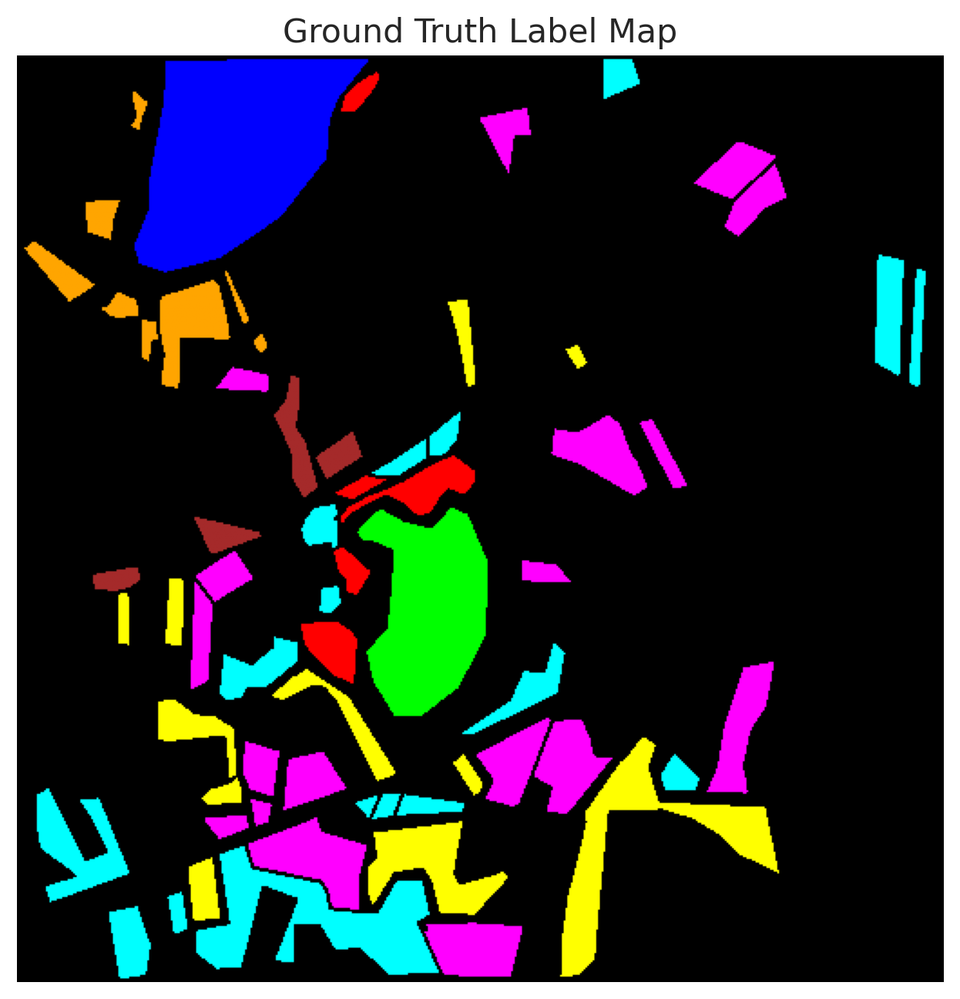
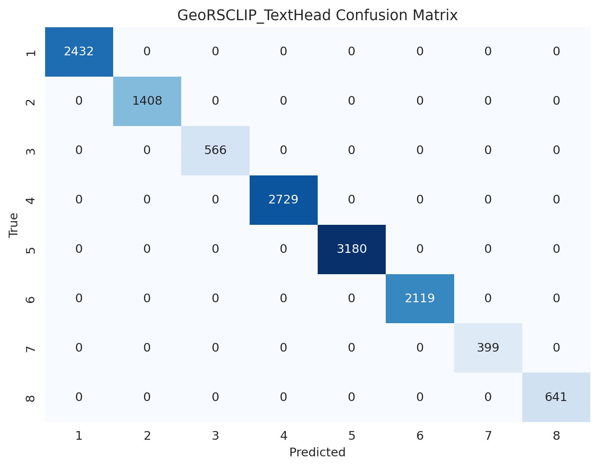

# GeoRSCLIP-TextHead: classifying by matching images to words

[← back to main README](../README.md) · conformal methods explained in [baseline/](../baseline/README.md#3-the-five-methods-step-by-step)

| | |
|---|---|
| **What** | Instead of a normal output layer, image features are compared with the text embedding of one prompt per class |
| **Key result** | 100.00% test accuracy; conformal results match the baseline (coverage 0.948–0.952, ~5% empty sets) |
| **The lesson** | A CLIP-style head on its own changes nothing for uncertainty. Its potential lies in real class names and pretrained text knowledge, which this scene lacks |
| **Notebooks** | [`Model_training.ipynb`](Model_training.ipynb) · [`Model_uncertainty_comparison.ipynb`](Model_uncertainty_comparison.ipynb) |

---

## 1. The model in plain words

CLIP-style models learn a shared space in which an image and a sentence that describes it land close
together. Each class gets a prompt (here "land cover class one", "… two", …). The class probability is a
softmax over **cosine similarities**:

```math
\hat p_k(x) = \frac{\exp\big(\cos(f(x), g(t_k))/\tau\big)}{\sum_j \exp\big(\cos(f(x), g(t_j))/\tau\big)}
```

| Symbol | Meaning |
|---|---|
| $`f(x)`$ | image tower (Hiera-style transformer) applied to the patch, L2-normalised |
| $`g(t_k)`$ | text tower applied to the prompt for class $`k`$, L2-normalised |
| $`\cos`$ | cosine similarity: 1 = same direction, 0 = unrelated |
| $`\tau`$ | temperature; the notebook learns $`1/\tau`$ as `logit_scale`, initialised at ln(100) like CLIP |

*In words: "which class description does this patch look most like?"*

**What this is, and what it isn't.** The text tower is trained **from scratch**, and the prompts carry no
meaning ("class one"). This is therefore not the pretrained GeoRSCLIP, and it behaves like a normal
classifier with a cosine-similarity head. With real class names (see the open question in the
[main README](../docs/01_data_and_setup.md#32-the-scene-and-its-classes)) and pretrained weights, the text side could
contribute real knowledge, e.g. that "salt pan" and "dry lake bed" are related.

*Implementation note:* the notebook's hard-coded prompt list has 7 entries, left over from the 6-band
dataset. It is rebuilt for 8 classes before training, so results are unaffected.

---

## 2. Results

| Method | Coverage | Avg. set size | Empty sets | Mean per-class cov. |
|---|--:|--:|--:|--:|
| Split CP | 0.948 | 0.948 | 5.3% | 0.960 |
| Class-cond. CP | 0.948 | 0.948 | 5.2% | 0.945 |
| Clustered CP | 0.950 | 0.950 | 5.0% | 0.960 |
| RC3P | 0.952 | 0.952 | 4.8% | 0.950 |
| RAPS | 1.000 | 1.000 | 0.0% | 1.000 |

*__Table 1.__ Source: [`results/uncertainty_results/summary_metrics.csv`](results/uncertainty_results/summary_metrics.csv).
Classification: accuracy 100.00%, macro-F1 1.000, NLL 0.0396, ECE 0.0388
([`results/classification_summary.csv`](results/classification_summary.csv)).*

**Reading Table 1.** This is the near-perfect pattern again: ≈ 95% coverage, ≈ 5% empty sets, RAPS
always top-1 ([why](../docs/04_uncertainty_results.md#82-rq2--what-do-the-prediction-sets-look-like)). One detail stands out.
Split CP's mean per-class coverage (0.960) is *higher* than class-conditional CP's (0.945). With 100%
accuracy every class is equally easy, so one shared cut-off is already fair. Class-conditional CP then
only adds estimation noise from the smaller per-class calibration sets.

| Ground truth | Prediction |
|:-:|:-:|
|  |  |

*__Figure 1.__ Reference labels and the full-scene GeoRSCLIP-TextHead prediction.*

<p align="center"></p>

*__Figure 2.__ Confusion matrix (diagonal).*

## 3. Caveats

- The prompts carry no semantics and the text tower is untrained at the start, so "vision–language" here
  is architectural only.
- The random-split optimism applies ([main README §10](../docs/05_limitations.md#10-limitations-and-threats-to-validity)).

## References

Radford et al. (2021), *Learning Transferable Visual Models From Natural Language Supervision* (CLIP);
Zhang et al. (2024), *RS5M and GeoRSCLIP: A Large Scale Vision-Language Dataset and A Large Vision-Language
Model for Remote Sensing*.
