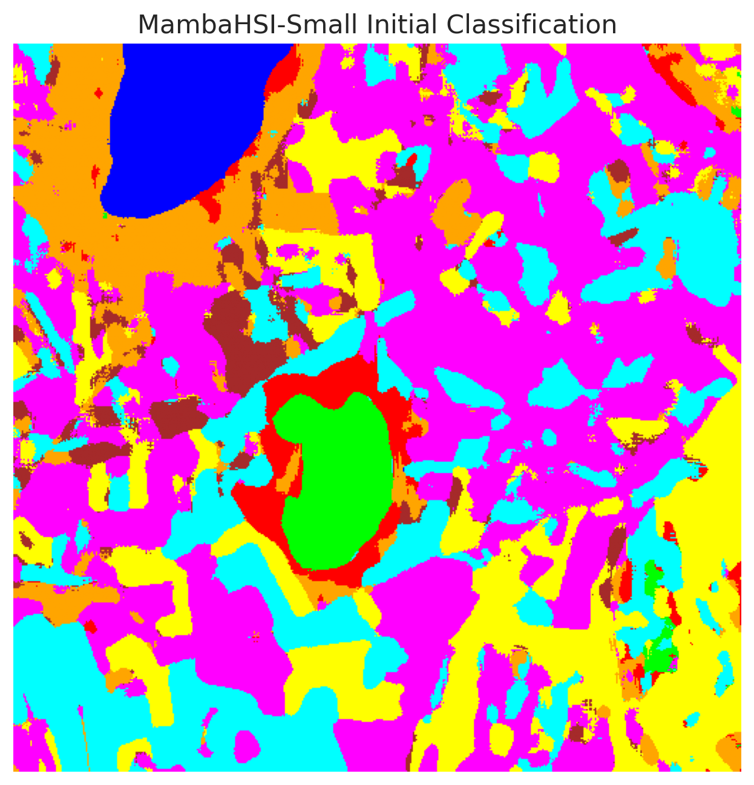
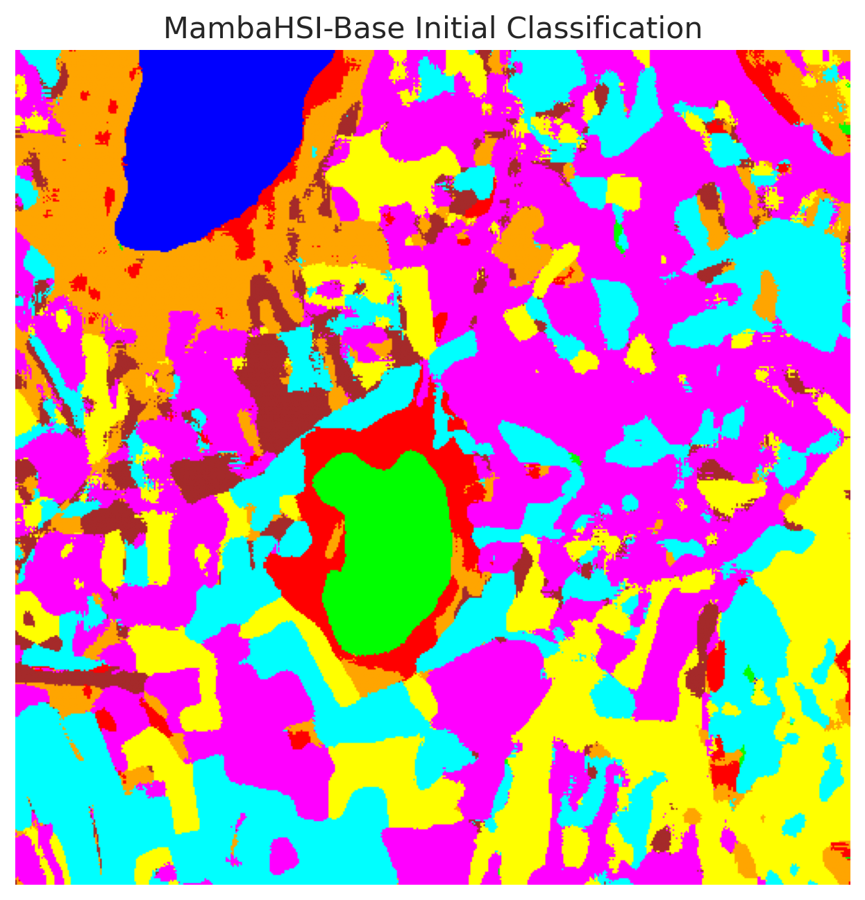
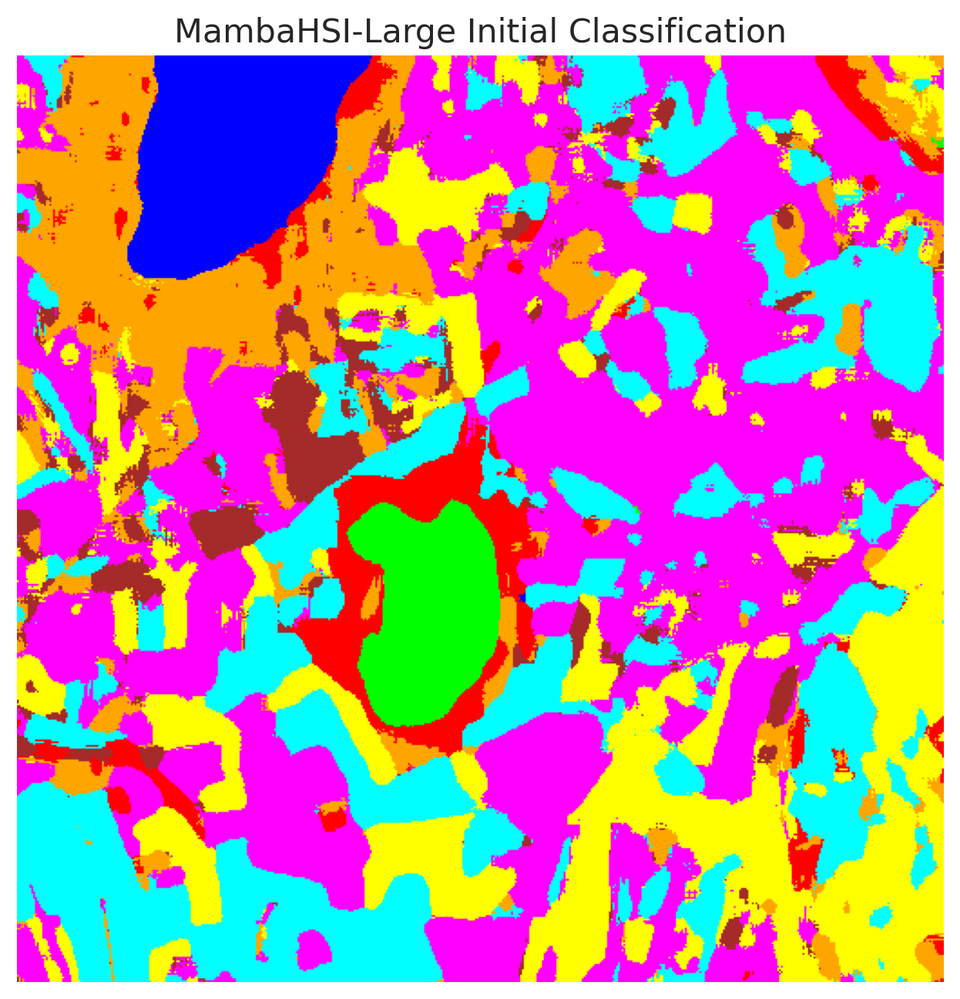

# MambaHSI: state-space models for hyperspectral patches

[← back to main README](../README.md) · conformal methods explained in [baseline/](../baseline/README.md#3-the-five-methods-step-by-step)

> **In one sentence:** three sizes of a Mamba-style *selective state-space* network read the patch as a
> sequence. All three are near-perfect (≥ 99.98%), and their conformal results reproduce the baseline
> pattern, which is evidence that the conclusions don't depend on architecture.

| Notebook | What it does |
|---|---|
| [`Model_training_mambahsi.ipynb`](Model_training_mambahsi.ipynb) | Trains MambaHSI Small / Base / Large |
| [`Model_uncertainty_comparison_mambahsi.ipynb`](Model_uncertainty_comparison_mambahsi.ipynb) | The five conformal methods |

## 1. The model in plain words

A state-space model reads tokens one at a time and keeps a running **memory** $`h_t`$:

```math
h_t = \bar A_t\, h_{t-1} + \bar B_t\, x_t, \qquad y_t = C_t\, h_t
```

*In words: "new memory = some of the old memory + some of the new input; the output reads from memory".*
**Selective** (Mamba) means $`\bar A_t, \bar B_t, C_t`$ depend on the current token, so the model can decide
what to remember and what to forget. It runs in linear time, where attention is quadratic. This notebook
implements the scan with `tf.scan`, which approximates Mamba's fused CUDA kernel.

| Size | Hidden | State | Blocks | Accuracy |
|---|--:|--:|--:|--:|
| Small | 128 | 64 | 2 | 99.98% |
| Base | 256 | 128 | 4 | 99.99% |
| Large | 384 | 192 | 6 | 99.99% |

## 2. Results

| Model | Split CP | Class-cond. CP | Clustered CP | RC3P | RAPS | Empty (Split) | Mean per-class cov. (Split) |
|---|--:|--:|--:|--:|--:|--:|--:|
| Small | 0.955 | 0.955 | 0.957 | 0.960 | 1.000 | 4.5% | 0.950 |
| Base | 0.960 | 0.963 | 0.960 | 0.967 | 1.000 | 4.0% | 0.964 |
| Large | 0.949 | 0.953 | 0.953 | 0.956 | 1.000 | 5.1% | 0.936 |

*Coverage at a 95% target. Source:
[`results/uncertainty_results/summary_metrics.csv`](results/uncertainty_results/summary_metrics.csv). Every
non-RAPS set is a singleton or empty: set size = coverage.*

**Reading it.** This is the same story as the [baseline](../baseline/README.md#41-coverage-and-set-size):
coverage within ±1.7% of 95%, ~4–5% abstentions, RAPS pinned at 100%. Model size changes nothing
here, because all three are already near-perfect on this split.

| Small | Base | Large |
|:-:|:-:|:-:|
|  |  |  |

<p align="center"></p>

## References

Gu & Dao (2023), *Mamba: Linear-Time Sequence Modeling with Selective State Spaces*; Li et al. (2024),
*MambaHSI: Spatial-Spectral Mamba for Hyperspectral Image Classification*.
