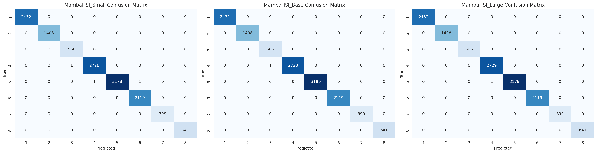

# MambaHSI: state-space models for hyperspectral patches

[← back to main README](../README.md) · conformal methods explained in [baseline/](../baseline/README.md#3-the-five-methods-step-by-step)

| | |
|---|---|
| **What** | Three sizes of a Mamba-style *selective state-space* network read the patch as a sequence of tokens |
| **Key result** | All three are near-perfect (≥ 99.98%); the five conformal methods reproduce the baseline pattern exactly |
| **The lesson** | The conformal conclusions don't depend on architecture, and model size changes nothing once accuracy has saturated |
| **Notebooks** | [`Model_training_mambahsi.ipynb`](Model_training_mambahsi.ipynb) · [`Model_uncertainty_comparison_mambahsi.ipynb`](Model_uncertainty_comparison_mambahsi.ipynb) |

---

## 1. The model in plain words

A state-space model reads tokens one at a time and keeps a running **memory** $`h_t`$:

```math
h_t = \bar A_t\, h_{t-1} + \bar B_t\, x_t, \qquad y_t = C_t\, h_t
```

| Symbol | Meaning |
|---|---|
| $`x_t`$, $`y_t`$ | input token and output at step $`t`$ |
| $`h_t`$ | the memory (state vector) |
| $`\bar A_t`$ | how much old memory to keep |
| $`\bar B_t`$, $`C_t`$ | how the new input is written to, and the output read from, memory |

*In words: "new memory = some of the old memory + some of the new input; the output reads from memory".*

**Selective** (Mamba) means $`\bar A_t, \bar B_t, C_t`$ depend on the current token, so the model can
decide what to remember and what to forget. The scan runs in time linear in sequence length; attention
is quadratic. This notebook implements the scan with `tf.scan`, a faithful but slower stand-in for
Mamba's fused CUDA kernel.

| Size | Hidden | State | Blocks | Accuracy | Macro-F1 | ECE |
|---|--:|--:|--:|--:|--:|--:|
| Small | 128 | 64 | 2 | 99.98% | 0.9998 | 0.0102 |
| Base | 256 | 128 | 4 | 99.99% | 0.9999 | 0.0192 |
| Large | 384 | 192 | 6 | 99.99% | 1.0000 | 0.0206 |

*__Table 1.__ Configuration and classification. Source: [`results/classification_summary.csv`](results/classification_summary.csv).*

---

## 2. Results

| Model | Split CP | Class-cond. CP | Clustered CP | RC3P | RAPS | Empty (Split) | Mean per-class cov. (Split) |
|---|--:|--:|--:|--:|--:|--:|--:|
| Small | 0.955 | 0.955 | 0.957 | 0.960 | 1.000 | 4.5% | 0.950 |
| Base | 0.960 | 0.963 | 0.960 | 0.967 | 1.000 | 4.0% | 0.964 |
| Large | 0.949 | 0.953 | 0.953 | 0.956 | 1.000 | 5.1% | 0.936 |

*__Table 2.__ Coverage at a 95% target. Source:
[`results/uncertainty_results/summary_metrics.csv`](results/uncertainty_results/summary_metrics.csv).
Every non-RAPS set is a singleton or empty, so set size = coverage.*

**Reading Table 2.**
- **Same story as the [baseline](../baseline/README.md#51-does-each-method-keep-its-95-promise):**
  coverage within 0.949–0.967, ~4–5% abstentions, RAPS pinned at 100%.
- **Model size changes nothing.** All three sizes are already at the accuracy ceiling of this split, so
  more capacity cannot change the calibration picture.
- **ECE rises slightly with size** (0.010 → 0.021) while accuracy stays flat. The larger models are a
  little *less* confident than they should be, which is a typical effect of label smoothing on bigger
  networks.
- MambaHSI-Base has the highest coverage of any near-perfect backbone (RC3P 0.967). It errs on the side of
  slightly larger (safer) sets.

| Small | Base | Large |
|:-:|:-:|:-:|
|  |  |  |

*__Figure 1.__ Full-scene predictions of the three sizes.*

<p align="center"></p>

*__Figure 2.__ Confusion matrices.*

## 3. Caveats

The random-split optimism applies ([main README §10](../README.md#10-limitations-and-threats-to-validity)).
The `tf.scan` implementation approximates Mamba's hardware-aware kernel; numerical results should match,
but speed does not.

## References

Gu & Dao (2023), *Mamba: Linear-Time Sequence Modeling with Selective State Spaces*; Li et al. (2024),
*MambaHSI: Spatial-Spectral Mamba for Hyperspectral Image Classification*.
