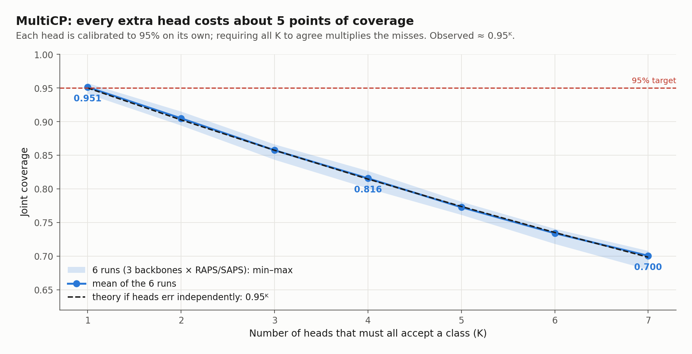
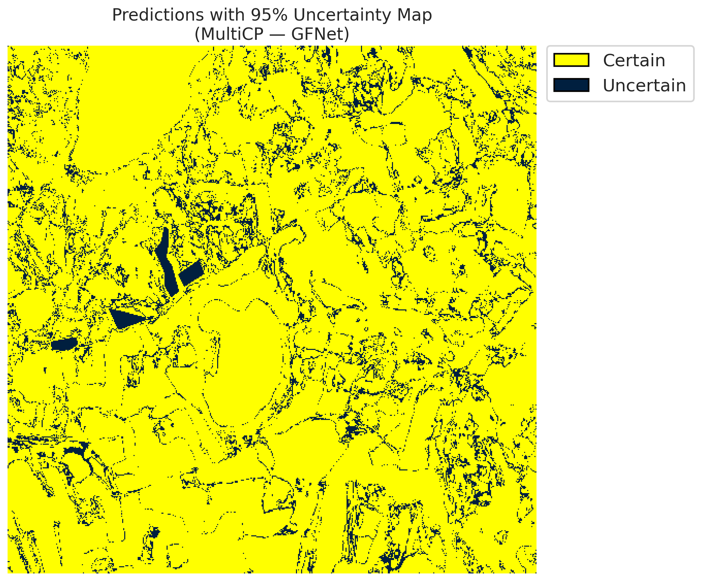
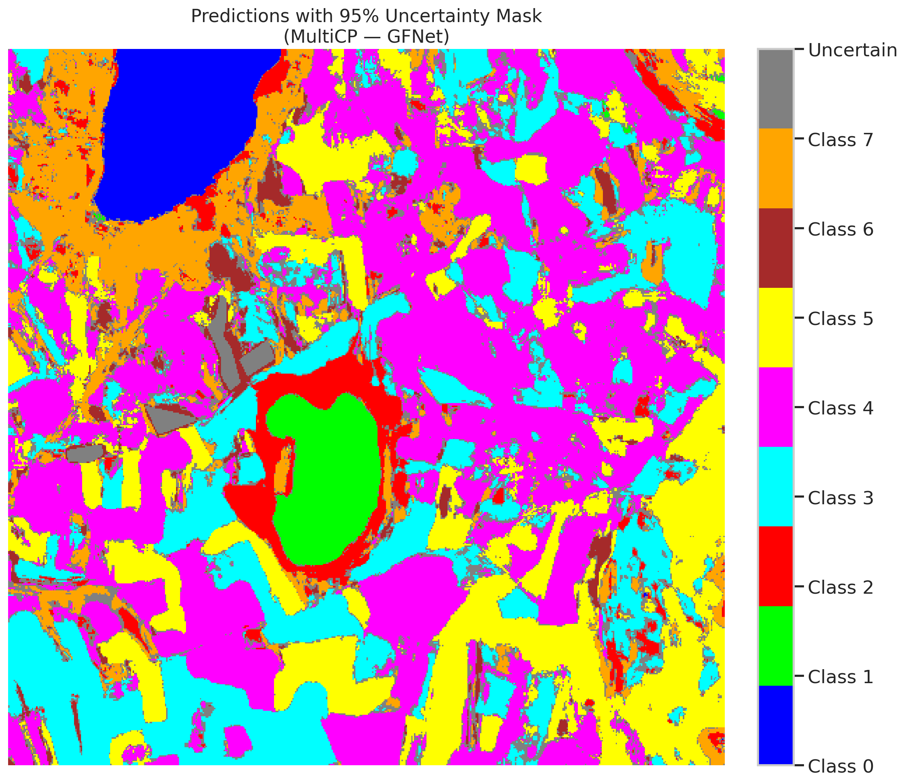
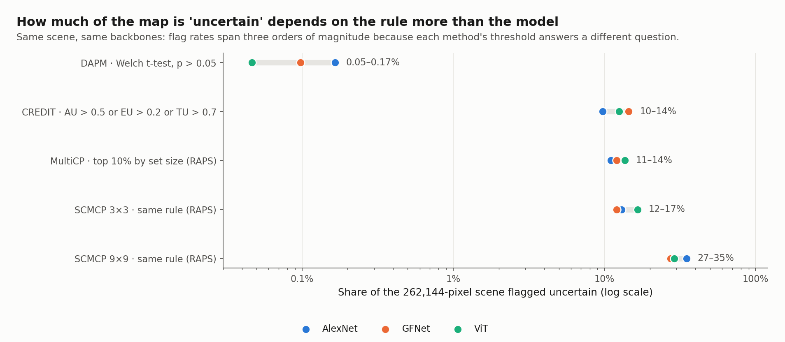

# MultiCP: conformal prediction with seven heads

[← back to main README](../README.md) · spatial version: [multicp_sacp/](../multicp_sacp/README.md)

| | |
|---|---|
| **What** | One network with **seven output heads**; each head gets its own conformal threshold, and a class is kept only if **all seven accept it** |
| **Key result** | Joint coverage **0.68–0.71** instead of 0.95, falling by about 5 points per extra head, exactly as **0.95ᴷ** predicts |
| **The lesson** | Independently calibrated guarantees multiply. Intersecting K sets needs a per-head budget of α/K, or joint calibration |
| **Map caveat** | The maps flag a fixed top 10% of pixels, and a leftover rule greys out real class-7 parcels |

| Notebook | What it does |
|---|---|
| [`Model_training_multihead.ipynb`](Model_training_multihead.ipynb) | Trains AlexNet, GFNet and ViT with **K = 7** softmax heads, using staged "shift" dropout so the heads learn different views |
| [`Model_uncertainty_multicp.ipynb`](Model_uncertainty_multicp.ipynb) | Scores each head with RAPS and SAPS, calibrates per head, intersects the sets, runs a 1→7 head sweep, and draws maps |

Split for this folder: train 75% / calibration 12.5% / test 12.5% (stratified, seed 42).

---

## 1. The idea

Seven witnesses describe a suspect. If you only accept descriptions that **every** witness agrees with,
the description gets very specific: a small set. But each witness can be wrong 5% of the time, and if
any one of them is wrong, the agreed description misses the truth. **Requiring agreement makes the set
smaller and makes errors more likely.** The [Multi-CP method](https://github.com/yamtawa/Multi-CP)
(reference implementation) solves this by calibrating the heads **jointly**. This notebook calibrates them
**separately**, and the gap between the two is the story of this folder.

## 2. The maths, step by step

**Step 1. A score per head.** For head $`h`$ with probabilities $`\hat p^{(h)}(x)`$, two scores come from the
Multi-CP library:

- **RAPS** (randomised, $`k_{reg} = 5`$, $`\lambda = 0.05`$): probability mass of all classes ranked above
  $`y`$, plus a random fraction $`u \sim U(0,1)`$ of $`y`$'s own mass, plus a penalty $`\lambda`$ for each rank
  beyond 5:
  $`s^{(h)}(x,y) = \sum_{j:\,r_j \lt r_y}\hat p_j + u\,\hat p_y + \lambda\max(r_y - 5, 0)`$
- **SAPS** ($`\gamma = 0.3`$): only the **top** probability is used, and every lower rank adds a fixed step.
  With ranks counted from 0 (top class $`r_y = 0`$): $`s(x, y) = u\,\hat p_{\max}`$ if $`r_y = 0`$, else
  $`\hat p_{\max} + \gamma\,(r_y - 1 + u)`$.
  *SAPS ignores how the remaining probability is spread, which makes it robust to over-confident tails.*

**Step 2. One threshold per head.** $`\hat q^{(h)}`$ = the 95th percentile of the true-class scores of head
$`h`$ on calibration pixels.

**Step 3. Intersect.**

```math
C(x) = \bigcap_{h=1}^{7} \big\{\,k : s^{(h)}(x, k) \le \hat q^{(h)}\,\big\}
```

**Why coverage collapses.** Each head's set misses the true class with probability ≈ 5%. The true class
survives the intersection only if **no** head misses it. If the misses were independent:

```math
\Pr(y \in C) \approx (1 - \alpha)^K = 0.95^{7} = 0.698
```

The head sweep below matches this almost exactly, so the misses of the seven heads are close to
independent. The fix is to give each head a stricter budget, for example $`\alpha/K`$ (Bonferroni: each head at $`1 - 0.05/7 \approx 99.29\%`$, which guarantees ≥ 95% jointly), or to use the reference Multi-CP algorithm, which selects "cells" in the
joint 7-dimensional score space to reach 95% **jointly**.

> **Worked example.** Three heads, each keeping its true class with probability 0.95: joint
> 0.95 × 0.95 × 0.95 = 0.857. With a Bonferroni budget of 0.05/3 per head, each keeps it with probability
> 0.983, and joint ≥ 0.95. ✔

*Code:* `generate_Dcal_Dcells_sets` (holds out 5% of calibration as "D-cells", **not used** afterwards),
`main_algo` (per-head `np.quantile(…, 1-α)` + intersection), `compute_head_sweep`.

---

## 3. Results

### 3.1 Head sweep: the key figure

**Question.** If each head is a valid 95% predictor, what happens to coverage as more heads must agree?

<p align="center"></p>

*__Figure 1.__ Joint coverage vs number of heads K. The band spans the six backbone × score runs, the line
is their mean, and the dashed curve is the independence prediction 0.95ᴷ.*

| Heads (K) | 0.95ᴷ | AlexNet RAPS | AlexNet SAPS | GFNet RAPS | GFNet SAPS | ViT RAPS | ViT SAPS |
|:-:|--:|--:|--:|--:|--:|--:|--:|
| 1 | 0.950 | 0.948 | 0.955 | 0.941 | 0.952 | 0.957 | 0.954 |
| 2 | 0.903 | 0.904 | 0.907 | 0.894 | 0.899 | 0.915 | 0.909 |
| 3 | 0.857 | 0.857 | 0.861 | 0.843 | 0.854 | 0.866 | 0.863 |
| 4 | 0.815 | 0.818 | 0.815 | 0.801 | 0.811 | 0.827 | 0.821 |
| 5 | 0.774 | 0.776 | 0.772 | 0.761 | 0.768 | 0.781 | 0.777 |
| 6 | 0.735 | 0.739 | 0.735 | 0.718 | 0.734 | 0.737 | 0.741 |
| 7 | 0.698 | 0.707 | 0.702 | 0.680 | 0.708 | 0.701 | 0.704 |

*__Table 1.__ Source: [`results/multicp_head_sweep.csv`](results/multicp_head_sweep.csv).*

**Reading Figure 1 and Table 1.**
- At **K = 1** every run is within sampling noise of 95% (0.941–0.957): a single head is valid.
- **Each extra head costs ≈ 4–5 points**, and the measured mean tracks 0.95ᴷ within about one point
  at every K. The heads' mistakes therefore behave as if independent. That is
  plausibly the intended effect of the staged dropout (diverse heads), and exactly what makes intersection
  so costly.
- RAPS and SAPS end up in the same place: the choice of score function does not matter when the
  combination rule is the problem.

> **Takeaway.** The collapse is arithmetic, not a model failure. With a per-head budget of
> α/K = 0.0071, the same seven heads would guarantee ≥ 95% jointly.

### 3.2 Summary at K = 7

| Backbone | Score | Joint coverage | Avg. set size* | Uncertain pixels (scene) |
|---|---|--:|--:|--:|
| AlexNet | RAPS | 0.707 | 0.953 | 11.0% |
| AlexNet | SAPS | 0.702 | 0.952 | 10.9% |
| GFNet | RAPS | 0.680 | 0.947 | 12.1% |
| GFNet | SAPS | 0.708 | 0.952 | 11.4% |
| ViT | RAPS | 0.701 | 0.974 | 13.7% |
| ViT | SAPS | 0.704 | 0.968 | 10.8% |

*__Table 2.__ Source: [`results/multicp_summary.csv`](results/multicp_summary.csv).
\* This "set size" is averaged over the **individual heads' sets**, not the intersected set the user
receives (the [SCMCP notebook](../multicp_sacp/README.md) fixes this and reports ≈ 0.70).*

Per-class coverage is uniformly low, 0.64–0.77 for every class
([`results/multicp_per_class_coverage.csv`](results/multicp_per_class_coverage.csv)). The shortfall
is systematic, not tied to particular classes.

### 3.3 Maps

| Binary uncertainty (GFNet · SAPS) | Prediction map with uncertain mask |
|:-:|:-:|
|  |  |

*__Figure 2.__ GFNet with the SAPS score at K = 7.*

**How the map is made:** the **top 10%** of pixels by average set size are marked uncertain (a fixed
fraction, not a calibrated level). Thin flagged lines trace parcel boundaries. **The solid dark blocks on
the left are a bug:** the code also marks every pixel whose *reference label is 7* as uncertain
(`gt_uncertain = (y_flat == 7)`), a hard-coded rule whose docstring calls label 7 "unlabelled". On
DIAS, label 7 is a real class (1,595 pixels), and those parcels are greyed out regardless of the model.

**How MultiCP compares.** Because the map flags a fixed quota, its 11–14% "uncertain" share is set by
the rule, not measured. Figure 3 places it next to the other methods.

<p align="center"></p>

*__Figure 3.__ Share of the scene flagged uncertain by each method (log scale). Read with
[main README §8.5](../README.md#85-rq5--how-much-of-the-map-does-each-method-call-uncertain).*

---

## 4. Caveats

- **Joint coverage ≈ 70%, not 95%:** independent per-head calibration (§2).
- The `Dcells` subset from the reference algorithm is computed but never used.
- Quantiles use `np.quantile(…, 1−α)` without the finite-sample $`(n+1)`$ correction, and scores are rounded to
  4 decimals (both minor).
- Maps: fixed top-10% rule, plus the label-7 bug above.

## References

Multi-CP reference implementation: [github.com/yamtawa/Multi-CP](https://github.com/yamtawa/Multi-CP);
Angelopoulos et al. (2021), *RAPS*; Huang et al. (2024), *SAPS: Conformal Prediction for Deep Classifier
via Label Ranking*; Bonferroni correction for multiple testing.
