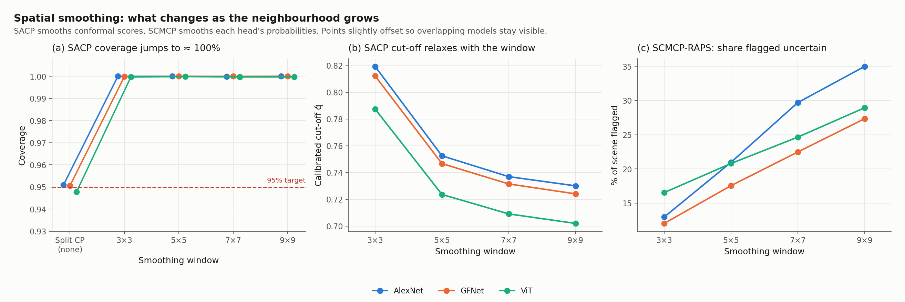
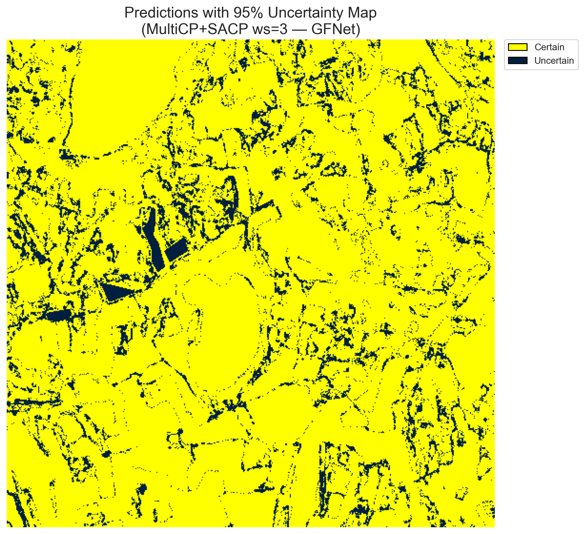
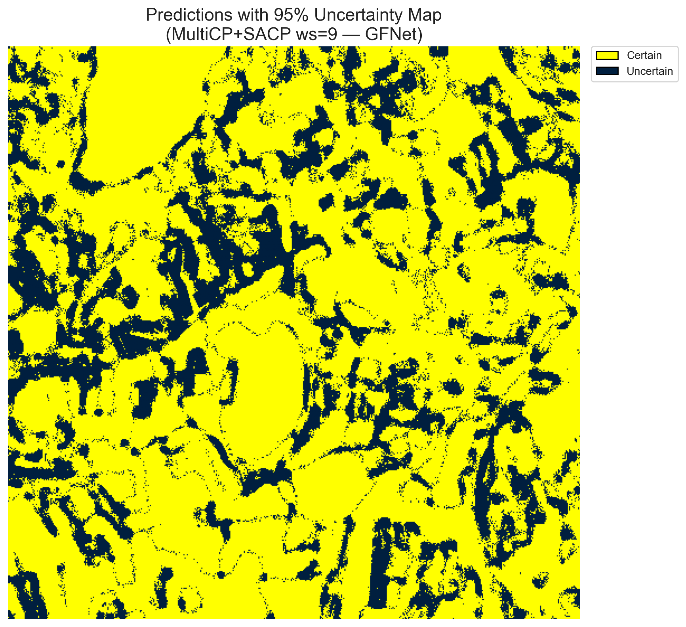

# SCMCP: Spatial Multi-head Conformal Prediction

[← back to main README](../README.md) · builds on: [multicp/](../multicp/README.md) + [sacp/](../sacp/README.md)

> **In one sentence:** take the seven heads of [MultiCP](../multicp/README.md), **smooth each head's
> probability map over a w × w neighbourhood** (then renormalise), and only then compute scores,
> calibrate and intersect.

| Notebook | What it does |
|---|---|
| [`Model_uncertainty_multicp_sacp.ipynb`](Model_uncertainty_multicp_sacp.ipynb) | Loads the 7-head models from `multicp/`, smooths probabilities per head, scores with RAPS/SAPS, calibrates per head, intersects, and sweeps windows 3/5/7/9 |

---

## 1. The idea

SACP smoothed **scores**; SCMCP smooths **probabilities**, so each head sees a "neighbourhood-aware"
opinion before any conformal step. Then MultiCP's rule applies: a class is kept only if all seven heads
accept it.

## 2. The maths, step by step

**Step 1. Smooth and renormalise each head's probabilities** (λ = 0.5, one pass):

$$\tilde p^{(h)}_k(i) = (1-\lambda)\,\hat p^{(h)}_k(i) + \lambda\cdot\frac{1}{|\mathcal N(i)|}\sum_{j\in\mathcal N(i)}\hat p^{(h)}_k(j), \qquad \tilde p^{(h)}(i) \leftarrow \frac{\tilde p^{(h)}(i)}{\sum_k \tilde p^{(h)}_k(i)}$$

*Renormalising keeps every pixel's probabilities summing to 1, so the score functions stay valid.*

**Step 2. Score, calibrate, intersect.** RAPS or SAPS scores from $\tilde p^{(h)}$; one threshold
$\hat q^{(h)}$ per head; final set $C(i) = \bigcap_h \{k : s^{(h)}_k(i) \le \hat q^{(h)}\}$. These are
exactly the formulas in [multicp/ §2](../multicp/README.md#2-the-maths-step-by-step).

> **Worked example.** One head says (crop A 0.60, crop B 0.40) at a pixel whose neighbours average
> (0.90, 0.10). Smoothed: 0.5·0.60 + 0.5·0.90 = 0.75 and 0.5·0.40 + 0.5·0.10 = 0.25 (already sums to 1).
> The neighbourhood pulls the head towards crop A before any threshold is applied.

This notebook reports the set size of the **intersected** set (the set a user actually receives), fixing the
per-head average reported by MultiCP.

---

## 3. Results

| Window | Model | Score | Joint coverage | Intersected set size | Uncertain pixels (scene) |
|:-:|---|---|--:|--:|--:|
| 3×3 | AlexNet | RAPS | 0.706 | 0.706 | 13.0% |
| 3×3 | AlexNet | SAPS | 0.701 | 0.702 | 82.3% |
| 3×3 | GFNet | RAPS | 0.681 | 0.681 | 12.0% |
| 3×3 | GFNet | SAPS | 0.708 | 0.708 | 81.6% |
| 3×3 | ViT | RAPS | 0.705 | 0.712 | 16.6% |
| 3×3 | ViT | SAPS | 0.697 | 0.703 | 11.9% |
| 5×5 | AlexNet | RAPS | 0.689 | 0.689 | 21.0% |
| 5×5 | GFNet | RAPS | 0.705 | 0.705 | 17.6% |
| 5×5 | ViT | RAPS | 0.703 | 0.712 | 20.8% |
| 7×7 | AlexNet | RAPS | 0.703 | 0.703 | 29.7% |
| 7×7 | GFNet | RAPS | 0.698 | 0.699 | 22.5% |
| 7×7 | ViT | RAPS | 0.706 | 0.712 | 24.7% |
| 9×9 | AlexNet | RAPS | 0.695 | 0.696 | 35.0% |
| 9×9 | GFNet | RAPS | 0.702 | 0.702 | 27.3% |
| 9×9 | ViT | RAPS | 0.703 | 0.710 | 28.9% |

*Source: [`results/combined_summary_all_windows.csv`](results/combined_summary_all_windows.csv) (all 24
rows, including SAPS at 5/7/9, are in the CSV). Head sweeps per window:
[`results/head_sweeps_all_windows.csv`](results/head_sweeps_all_windows.csv).*

**Reading it.**
- **Joint coverage ≈ 0.70 at every window.** Smoothing does not change the 0.95⁷ arithmetic of independent
  per-head thresholds ([multicp/ §2](../multicp/README.md#2-the-maths-step-by-step)).
- **Intersected set size ≈ coverage ≈ 0.70**, so about 30% of intersected sets are **empty**. Every
  non-empty set is a single correct class.
- **RAPS: larger windows flag more of the scene** (AlexNet 13% → 35%). Smoothing blends field edges into
  their neighbours, so more pixels land in the top-set-size tail.
- **SAPS at 3×3 flags ~82% of the scene** for AlexNet and GFNet, against 11–16% for the other
  combinations. The uncertain map uses a "top 10% by set size" quantile; when most pixels share the same set
  size, ties at the quantile mark most of them uncertain. Treat those two rows as an artefact of the
  thresholding rule.

### Maps (GFNet · RAPS)

| 3×3 binary | 9×9 binary |
|:-:|:-:|
|  |  |

The uncertain region thickens along parcel boundaries as the window grows. The maps inherit MultiCP's
label-7 rule, which marks real class-7 parcels as uncertain
([multicp/ §3.3](../multicp/README.md#33-maps)).

---

## 4. Caveats

- **Joint coverage ≈ 70%, not 95%.** A per-head budget of α/7 (Bonferroni) or joint calibration
  would be needed.
- The probability-smoothing step mixes calibration and test pixels, so exchangeability is only
  approximate, as in [SACP](../sacp/README.md#4-caveats).
- Fixed top-10% uncertainty rule, with tie effects (SAPS 3×3) and the label-7 bug.

## References

As for [MultiCP](../multicp/README.md#references) and [SACP](../sacp/README.md#references).
