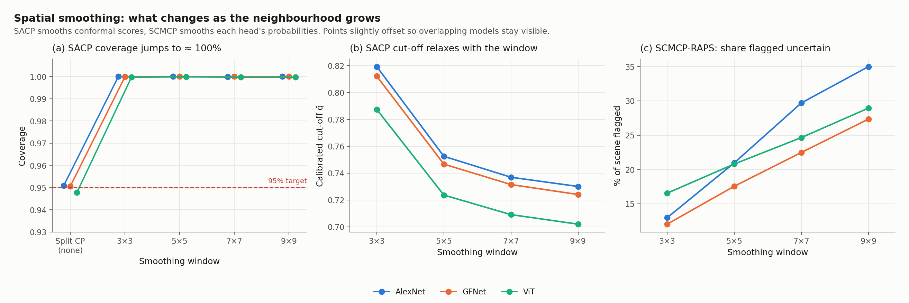
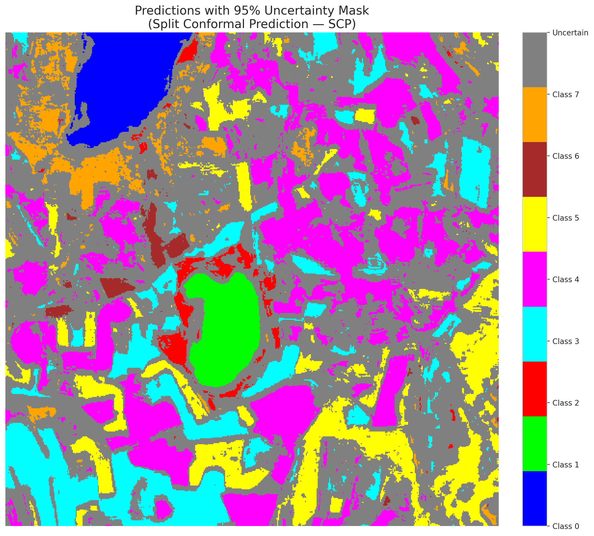
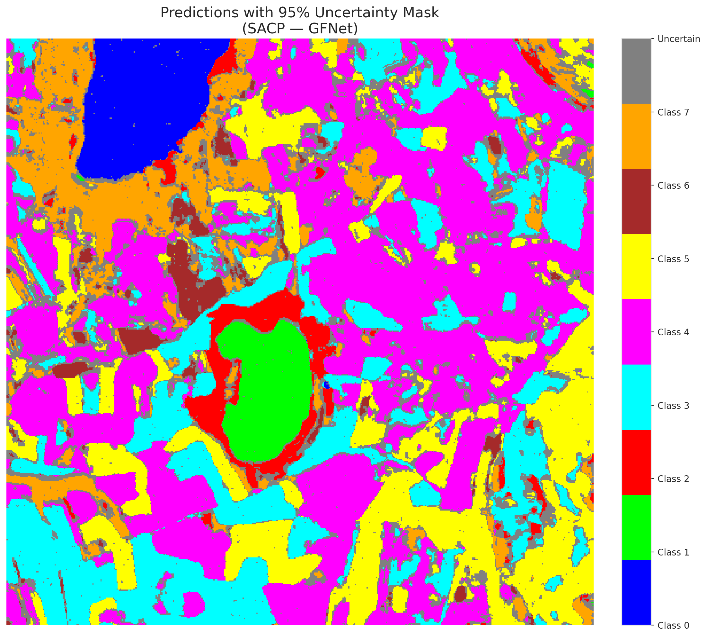
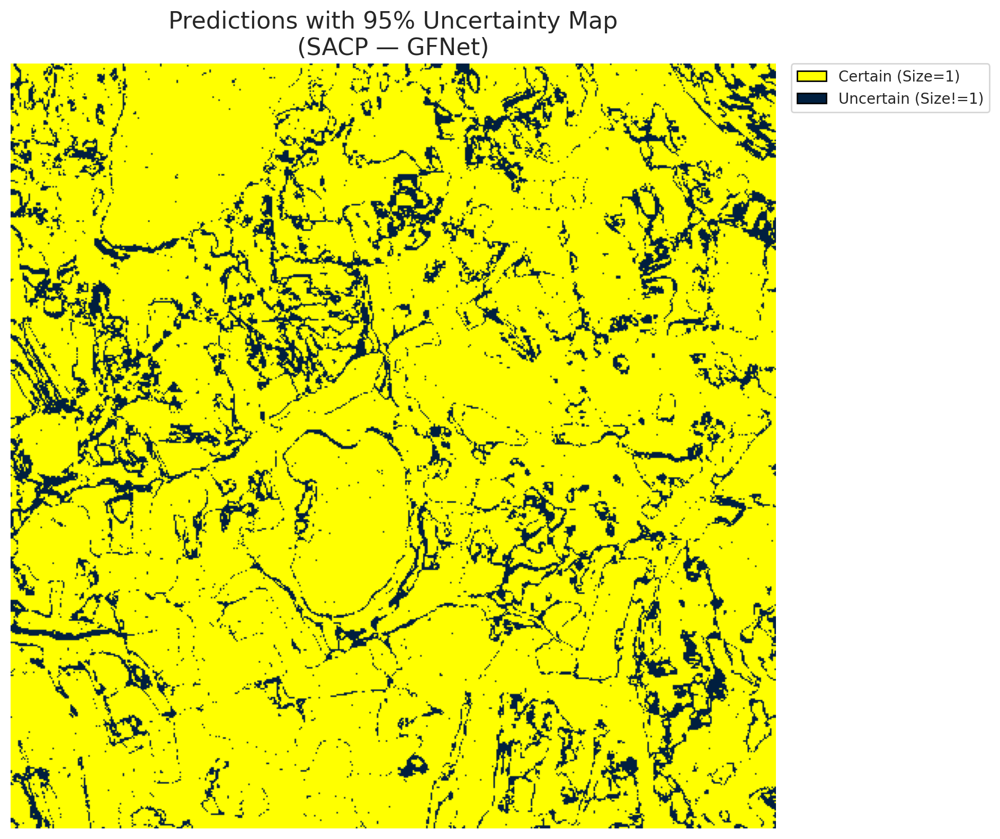

# SACP: Spatially-Aggregated Conformal Prediction

[← back to main README](../README.md) · multi-head version: [multicp_sacp/](../multicp_sacp/README.md)

> **In one sentence:** neighbouring pixels usually belong to the same field, so before calibrating, SACP
> **averages each pixel's conformal score with its neighbours' scores** over a 3×3, 5×5, 7×7 or 9×9 window.
> The result is spatially coherent uncertainty instead of salt-and-pepper noise.

| Notebook | What it does |
|---|---|
| [`Model_sacp_comparison.ipynb`](Model_sacp_comparison.ipynb) | Loads the three baseline backbones, computes APS scores, smooths them on the image grid, calibrates, and sweeps window sizes 3/5/7/9 |

Calibration/evaluation split as in [baseline/](../baseline/README.md#2-the-data-the-methods-see) (6,737 / 6,737).

---

## 1. The idea

If you are unsure whether one pixel is crop A or crop B, look at the pixels around it. If they are all
confidently crop A, you should be more confident too. SACP folds that common sense into the conformal
score: a pixel's "strangeness" is half its own and half its neighbourhood's.

## 2. The maths, step by step

**Step 1. Adaptive (APS) score for every class.** Sort the classes by probability. The score of class $k$
is the probability mass ranked above it, plus a random share of its own:

$$s_k(x) = \sum_{j \,:\, r_j < r_k} \hat p_j(x) \;+\; u \cdot \hat p_k(x), \qquad u \sim U(0, 1)$$

*In words: "how far down the list do I have to go to reach class k?" The top class scores between 0 and
its own probability; lower classes score higher.*

**Step 2. Spatial smoothing.** Place the score vectors of all calibration and evaluation pixels on the
512 × 512 grid. For pixel $i$ with labelled neighbours $\mathcal{N}(i)$ in a $w \times w$ window:

$$\tilde s_k(i) = \lambda\, s_k(i) + \lambda \cdot \frac{1}{|\mathcal{N}(i)|}\sum_{j \in \mathcal{N}(i)} s_k(j), \qquad \lambda = 0.5,\ \text{one pass } (k = 1)$$

*In words: 50% my own score, 50% the average of my neighbours'.*

**Step 3. Calibrate and predict** exactly as Split CP, but on smoothed scores:

$$\hat q = \text{Quantile}\big(\{\tilde s_{y_i}(i)\}_{i \in \text{cal}};\ \lceil (n+1)(0.95)\rceil / n\big), \qquad C(i) = \{\,k : \tilde s_k(i) \le \hat q\,\}$$

If a set comes out empty, the class with the smallest smoothed score is added, so **sets are never empty**
on the evaluation pixels.

> **Worked example.** A pixel's own scores are (crop A 0.30, crop B 0.85, water 0.99). Its neighbours
> average (0.10, 0.95, 0.99). Smoothed: 0.5·0.30 + 0.5·0.10 = **0.20** for crop A, 0.5·0.85 + 0.5·0.95 =
> **0.90** for crop B. With $\hat q = 0.80$ the set is {crop A}. Without smoothing (0.30 vs 0.85) the
> result is the same here, but a pixel whose own crop-B score were 0.75 would have entered the set alone and
> is pulled out by its neighbours.

*Code:* `SpatialConformalPredictor` (`compute_aps_scores`, `spatial_smoothing`, `fit_calibrate`),
`build_sacp_outputs_for_model`.

---

## 3. Results

| Window | Model | Coverage | Avg. set size | $\hat q$ |
|:-:|---|--:|--:|--:|
| 3×3 | AlexNet | 1.0000 | 1.0000 | 0.819 |
| 3×3 | GFNet | 0.9999 | 1.0000 | 0.812 |
| 3×3 | ViT | 0.9997 | 1.0009 | 0.787 |
| 5×5 | AlexNet | 1.0000 | 1.0000 | 0.753 |
| 5×5 | GFNet | 1.0000 | 1.0001 | 0.747 |
| 5×5 | ViT | 0.9999 | 1.0006 | 0.724 |
| 7×7 | AlexNet | 0.9999 | 1.0000 | 0.737 |
| 7×7 | GFNet | 1.0000 | 1.0001 | 0.731 |
| 7×7 | ViT | 0.9997 | 1.0004 | 0.709 |
| 9×9 | AlexNet | 1.0000 | 1.0000 | 0.730 |
| 9×9 | GFNet | 1.0000 | 1.0001 | 0.724 |
| 9×9 | ViT | 0.9997 | 1.0004 | 0.702 |

*Source: [`results/combined_summary_all_windows.csv`](results/combined_summary_all_windows.csv); per-window
workbooks and CSVs in `results/window_{3,5,7,9}/`.*

**Reading it.**
- **Coverage ≈ 100% and set size ≈ 1 at every window.** With a 99.9%-accurate model, the top class's APS
  score is $u \cdot \hat p_{\max} \approx u$ (uniform on 0–1), while every other class scores ≈ 1. The 95th
  percentile therefore lands below 1, which keeps the top class and drops the rest. Because empty sets are
  forced to hold the best class, the ~5% "abstentions" of Split CP become singletons, and coverage rises to
  match accuracy.
- **$\hat q$ falls as the window grows** (0.82 → 0.73 for AlexNet). Averaging more neighbours' random $u$
  values pulls the smoothed scores towards 0.5, so the 95th percentile moves down.

### Maps (GFNet)

| Split CP (no smoothing) | SACP 3×3 |
|:-:|:-:|
|  |  |

| SACP 3×3: certain vs uncertain | SACP 9×9: certain vs uncertain |
|:-:|:-:|
|  |  |

This is SACP's real contribution here. Split CP greys out large unlabelled areas; SACP gives them
**coherent classes and confines uncertainty to thin outlines along parcel boundaries**, where a 9×9 patch
really does straddle two surfaces. *Maps extracted from `results/window_*/conformal_reports_SACP_ws*_all_models.xlsx`;
notebook class numbering 0–7 = label 1–8.*

---

## 4. Caveats

- **Calibration vs map mismatch.** During calibration only calibration and evaluation pixels are
  neighbours. For the full-scene map, every pixel is. The map's sets therefore use a slightly different
  score distribution than the one $\hat q$ was calibrated on.
- **Exchangeability is bent.** Smoothing mixes calibration and evaluation pixels' scores, so the
  calibration scores are no longer independent of the test points. The textbook guarantee does not strictly
  apply.
- The forced non-empty rule makes coverage ≥ accuracy by construction on near-perfect models.
- Note the code's update is $\lambda\cdot\text{own} + \lambda\cdot\text{neighbours}$. This equals a
  proper weighted average only for λ = 0.5, the value used.
- AlexNet inherits the seed-10/seed-42 overlap ([main README §8](../README.md#8-limitations-read-this-before-citing-a-number)).

## References

Romano et al. (2020), *APS*; Angelopoulos & Bates (2023); spatial conformal prediction for remote sensing
(e.g. Mao et al., 2024, *Valid Model-Free Spatial Prediction*).
