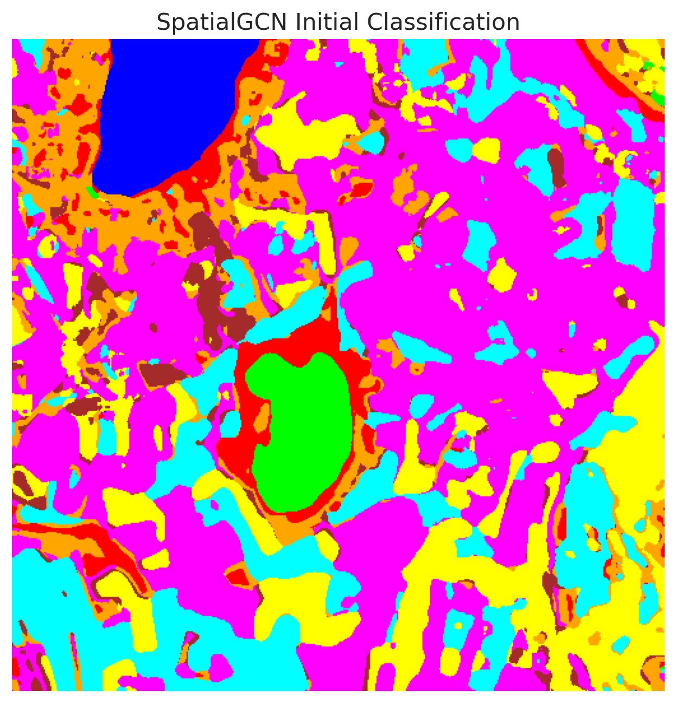

# SpatialGCN: a graph network, and what a 97% model does to conformal sets

[← back to main README](../README.md) · conformal methods explained in [baseline/](../baseline/README.md#3-the-five-methods-step-by-step)

> **In one sentence:** each 9×9 patch becomes a small graph of 81 pixel-nodes. SpatialGCN reaches
> **97.05%** accuracy, which sits between the near-perfect models and [DOFA-Spectral](../dofa/README.md),
> and its conformal sets show the transition from "abstain" to "list two classes".

| Notebook | What it does |
|---|---|
| [`Model_training.ipynb`](Model_training.ipynb) | Builds the patch graph and trains SpatialGCN (same split and recipe as the baseline) |
| [`Model_uncertainty_comparison.ipynb`](Model_uncertainty_comparison.ipynb) | The five conformal methods |

## 1. The model in plain words

Every pixel in the patch is a **node** holding its 65-band spectrum. Each node is linked to its four
neighbours (up, down, left, right). A *graph convolution* updates every node with the average of its
neighbours, transformed by learned weights:

```math
H^{(l+1)} = \sigma\!\left(\hat D^{-1/2}\hat A\,\hat D^{-1/2}\,H^{(l)}\,W^{(l)}\right), \qquad \hat A = A + I
```

*In words: "become a blend of yourself and your neighbours, then pass through a small neural layer".* Three
layers (64 → 128 → 128 units) spread information about 3 pixels in each direction. The node features are
then averaged over all 81 nodes and passed to a small dense head.

## 2. Results

| Method | Coverage | Avg. set size | Singletons | Empty | 2+ classes | Mean per-class cov. |
|---|--:|--:|--:|--:|--:|--:|
| Split CP | 0.952 | 0.965 | 96.5% | 3.5% | 0.0% | 0.911 |
| Class-cond. CP | 0.954 | 0.996 | 94.7% | 2.8% | 2.4% | 0.959 |
| Clustered CP | 0.952 | 0.980 | 95.8% | 3.1% | 1.1% | 0.936 |
| RC3P | 0.956 | 1.010 | 94.0% | 2.5% | 3.5% | 0.961 |
| RAPS | 0.973 | 1.000 | 100% | 0.0% | 0.0% | 0.954 |

*Source: [`results/uncertainty_results/summary_metrics.csv`](results/uncertainty_results/summary_metrics.csv);
"2+ classes" = 1 − singletons − empty. Accuracy 97.05%, macro-F1 0.944
([`results/classification_summary.csv`](results/classification_summary.csv)).*

**Reading it.** The model is wrong on about 3% of pixels, so to reach 95% Split CP only has to drop
about 2% of correct pixels, and the empty-set rate falls from ~5% to 3.5%. The class-aware methods go further:
for hard classes they **list two classes** (up to 3.5% of pixels under RC3P) instead of abstaining, and
raise mean per-class coverage from 0.91 to 0.96. RAPS covers 97.3%, which is exactly the accuracy:
always top-1, as explained in [baseline §3.5](../baseline/README.md#raps).

Put the three model groups side by side: near-perfect → empty sets; 97% → a few 2-class sets; 84%
([DOFA](../dofa/README.md)) → 38% multi-class sets. **The worse the model, the more informative its
conformal sets**, and coverage stays at 95% throughout.

| Ground truth | SpatialGCN prediction |
|:-:|:-:|
|  |  |

<p align="center"></p>

## Caveats

The random-split optimism applies ([main README §8](../README.md#8-limitations-read-this-before-citing-a-number)).

## References

Kipf & Welling (2017), *Semi-Supervised Classification with Graph Convolutional Networks*.
