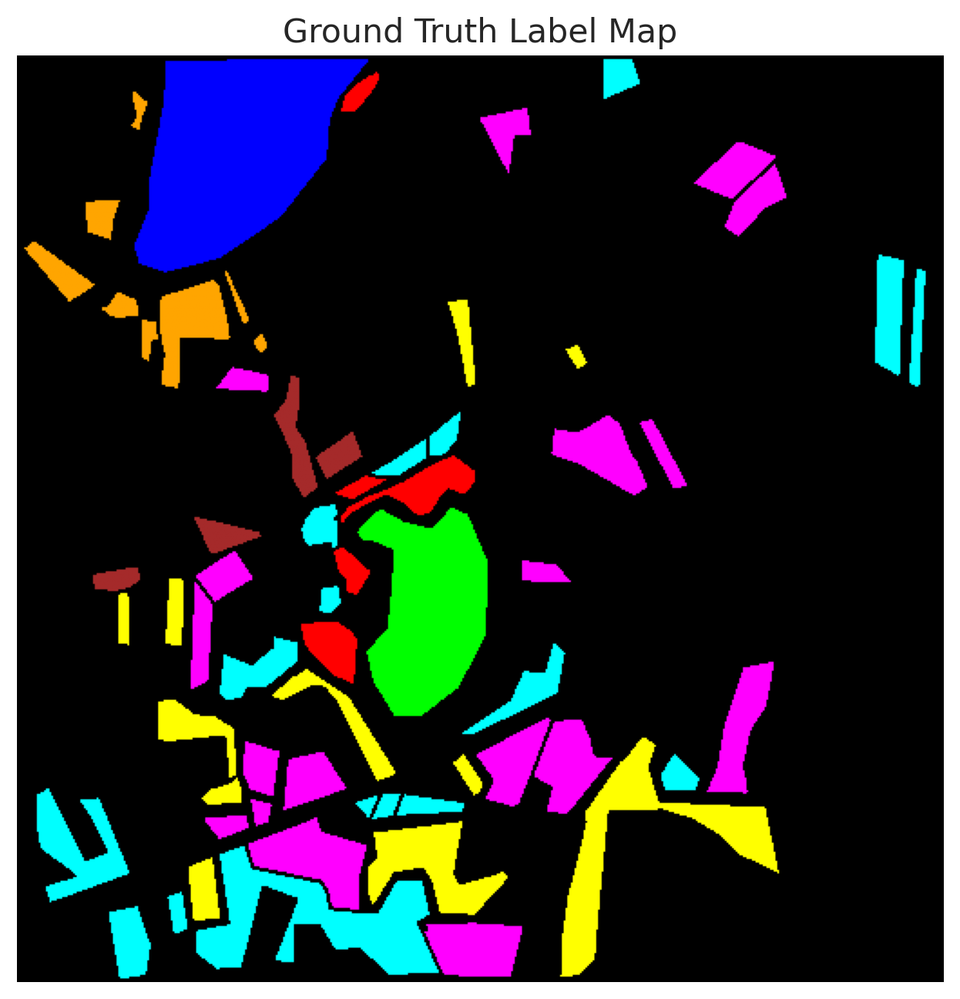
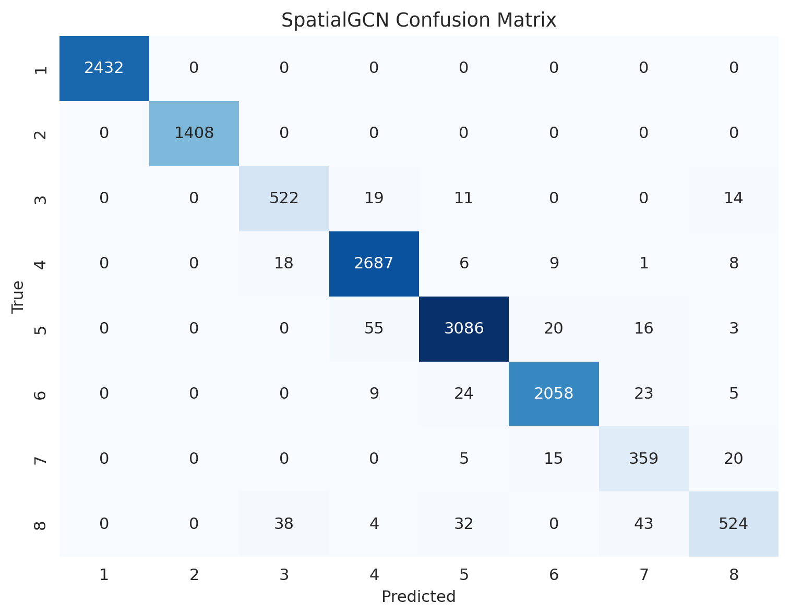
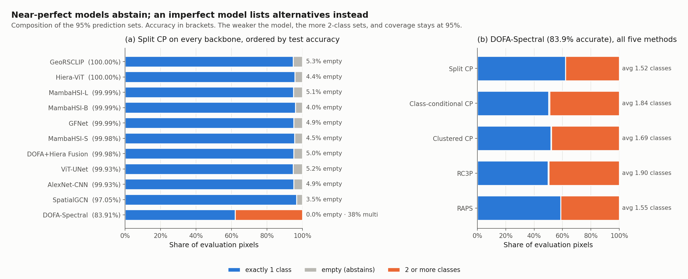

# SpatialGCN: a graph network, and the transition from abstaining to hedging

[← back to main README](../README.md) · conformal methods explained in [baseline/](../baseline/README.md#3-the-five-methods-step-by-step)

| | |
|---|---|
| **What** | Each 9 × 9 patch becomes a graph of 81 pixel-nodes; graph convolutions pass information between neighbours |
| **Key result** | **97.05%** accuracy: between the near-perfect models and [DOFA-Spectral](../dofa/README.md). Empty sets fall to 3.5%, and class-aware methods start listing two classes (up to 3.5%) |
| **The lesson** | The less accurate the model, the more its conformal sets *hedge* instead of *abstain*, while coverage stays at 95% |
| **Notebooks** | [`Model_training.ipynb`](Model_training.ipynb) · [`Model_uncertainty_comparison.ipynb`](Model_uncertainty_comparison.ipynb) |

---

## 1. The model in plain words

Every pixel in the patch is a **node** holding its 65-band spectrum. Each node is linked to its four
neighbours (up, down, left, right) and to itself. A *graph convolution* updates every node with a
normalised average of itself and its neighbours, transformed by learned weights:

```math
H^{(l+1)} = \sigma\!\left(\hat D^{-1/2}\hat A\,\hat D^{-1/2}\,H^{(l)}\,W^{(l)}\right), \qquad \hat A = A + I
```

| Symbol | Meaning |
|---|---|
| $`H^{(l)}`$ | the 81 node feature vectors at layer $`l`$ (layer 0 = the spectra) |
| $`A`$, $`I`$ | the 4-neighbour adjacency matrix; the identity (self-loops) |
| $`\hat D`$ | the degree of each node in $`\hat A`$: the normalisation keeps corner and edge nodes from being under-weighted |
| $`W^{(l)}`$, $`\sigma`$ | learned weights; non-linear activation |

*In words: "become a blend of yourself and your neighbours, then pass through a small neural layer".*
Three layers (64 → 128 → 128 units) spread information about 3 pixels in each direction. The node features
are then averaged over all 81 nodes and passed to a small dense head.

| Setting | Value |
|---|---|
| Graph | fixed 9 × 9 grid, 4-connectivity + self-loops, symmetric normalisation (Kipf & Welling) |
| GCN units | [64, 128, 128], then global average pooling and dense layers |
| Training | same split and recipe as the baseline (seed 42, 100 epochs) |

---

## 2. Results

### 2.1 Classification

| Accuracy | κ | Macro-F1 | NLL | ECE |
|--:|--:|--:|--:|--:|
| 97.05% | 0.9644 | 0.9442 | 0.1132 | 0.0422 |

*__Table 1.__ Source: [`results/classification_summary.csv`](results/classification_summary.csv).*

| Ground truth | SpatialGCN prediction |
|:-:|:-:|
|  |  |

*__Figure 1.__ Reference labels and the full-scene SpatialGCN prediction.*

<p align="center"></p>

*__Figure 2.__ Confusion matrix. Errors fall among the spectrally similar field classes.*

### 2.2 Conformal prediction

| Method | Coverage | Avg. set size | Singletons | Empty | 2+ classes | Mean per-class cov. |
|---|--:|--:|--:|--:|--:|--:|
| Split CP | 0.952 | 0.965 | 96.5% | 3.5% | 0.0% | 0.911 |
| Class-cond. CP | 0.954 | 0.996 | 94.7% | 2.8% | 2.4% | 0.959 |
| Clustered CP | 0.952 | 0.980 | 95.8% | 3.1% | 1.1% | 0.936 |
| RC3P | 0.956 | 1.010 | 94.0% | 2.5% | 3.5% | 0.961 |
| RAPS | 0.973 | 1.000 | 100% | 0.0% | 0.0% | 0.954 |

*__Table 2.__ Source: [`results/uncertainty_results/summary_metrics.csv`](results/uncertainty_results/summary_metrics.csv);
"2+ classes" = 1 − singletons − empty.*

**Reading Table 2.**
- The model is wrong on about 3% of pixels. To reach 95%, Split CP therefore has to "spend" only about
  2% of its budget on correct pixels, and the **empty-set rate falls from ~5% to 3.5%**.
- The class-aware methods go one step further. For hard classes they **list two classes** (up to 3.5% of
  pixels under RC3P) instead of abstaining, and they raise mean per-class coverage from 0.91 to 0.96.
- RAPS covers 97.3%, which is exactly the accuracy: always top-1, as explained in [baseline §3.5](../baseline/README.md#raps).

### 2.3 Where SpatialGCN sits in the bigger picture

<p align="center"></p>

*__Figure 3.__ Split CP set composition for all 11 backbones (panel a). SpatialGCN is second from the bottom.*

Put the three regimes side by side:

| Model group | Accuracy | What the 95% sets do |
|---|--:|---|
| Nine near-perfect backbones | ≥ 99.93% | ~95% one class, **~5% empty**, no 2-class sets |
| **SpatialGCN** | 97.05% | 3.5% empty; class-aware methods list 2 classes for up to 3.5% |
| DOFA-Spectral | 83.91% | no empty sets, **38–50% multi-class** sets |

> **Takeaway.** The worse the model, the more informative its conformal sets, and coverage stays at 95%
> throughout. Conformal prediction adapts the *form* of its answer to the model's real error rate.

---

## 3. Caveats

- The random-split optimism applies ([main README §10](../docs/05_limitations.md#10-limitations-and-threats-to-validity)).
- A graph over a regular grid is mathematically close to a convolution; the gain over a CNN here comes
  from the symmetric neighbour averaging, not from irregular structure.

## References

Kipf & Welling (2017), *Semi-Supervised Classification with Graph Convolutional Networks*; Hong et al.
(2021), *Graph Convolutional Networks for Hyperspectral Image Classification*, IEEE TGRS.
